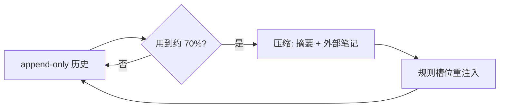

# Day 01 — 各家 Harness 设计大调查：append-only + 70% 压缩模板，谁收敛了、谁没有

> 📖 阅读版：https://papa-panda.github.io/post-training/harness-engineering/day-01-vendor-harness-survey/

## 元信息

- Date: 2026-11-15
- Type: 厂商调查（vendor survey，不是单篇论文）
- 模板来源：2026-11-15 的讨论 + 腾讯技术工程《别再只卷 Prompt 了，真正拉开 Agent 差距的是 Context Engineering》（知乎专栏，2026-09-15）——该文主张长任务在 context 用到约 70–80% 时压缩、50 轮不管 context 会膨胀到约 120,000 tokens、管好后约 20,000 tokens。本文把这套主张当作待检验的模板，不当作结论。
- 覆盖厂商（9 家，按核查顺序）：Claude Code、Codex、Gemini CLI、Jules、SkyRL（Mercor 397B 训练）、Cursor、OpenHands、SWE-agent、Aider
- 核实口径：全部事实来自官方文档、官方博客或官方公开仓库，逐条带源链接；凡未从一手来源核实的一律标注 NOT VERIFIED，不进入结论。Jun 的规则是篇目逐篇核实后才推，本篇对厂商文档执行同一标准。
- 与本专题的关系：01–08 章是理论（context compiler、workflow、control loop）；Daily 系列从 Day 01 起逐日核查各家落地设计。synthetic-data Day 08 的 Harness-S 是 GRPO 训练论文（兄弟 harness 救活有效组），与本篇的厂商 harness 调查不重叠。
- Tags: [harness, context-engineering, kv-cache, compaction, vendor-survey]

## 一句话总结

没有一家厂商把约 70% 当作默认压缩阈值——实测的默认值是 Claude Code 约 96.7%、Gemini CLI 50%、其余各家要么用 token 数或事件数触发、要么根本不压缩；但九家在另一点上高度收敛：子 agent 各跑各的 context、只把摘要还给主 agent，以及规则要有一块压缩后还能回来的位置。70% 这个数本身不是行业共识，它是缓存命中收益与压缩重算成本之间的一个平衡点，各家按自己的窗口大小、缓存 TTL 和任务长度把它推到了不同位置。

<!-- viz:stats: Claude 默认压缩点 96.7% | Gemini 默认压缩点 50% | SkyRL nudge 80% 触发 | Cursor 摘要约 1,000 tokens -->

## 模板定义：待检验的四要素加一个隐藏变量

本篇检验的模板来自 2026-11-15 的讨论：

1. **Append-only**：历史只追加、不改写前面的内容，这样前缀不变，KV cache 持续命中，直到窗口快满才一次性处理。
2. **Compress at ~70%**：context 用到约七成时触发一次压缩，摘要进外部笔记或替换旧历史，然后继续 append。
3. **Fixed rule slots**：规则（系统指令、工具说明）有固定槽位，压缩后仍在显眼位置，不被挤到中间看不见的地方。
4. **Error-trajectory isolation**：错误轨迹隔离，不让失败的尝试污染后面的 context。
5. **隐藏变量——KV-cache 命中**：append-only 的收益只有缓存命中时才兑现；改动前缀会让缓存失效，而压缩本身也是一次缓存失效。任何只谈压缩时机、不谈缓存的设计都是缺了一半的账。

## 3 个问题

1. 压缩阈值到底该是多少？——三臂实验：A 50% 压缩（Gemini CLI 默认）、B 70% 压缩（本模板）、C 96.7% 压缩（Claude Code 默认）。固定同一套长任务（SWE-bench 风格、多轮工具调用），同一模型、同一缓存配置。指标：任务成功率、总 token（含缓存命中折算）、缓存命中率、压缩次数。判据：若 B 的成功率 ≈ C 且总 token < C → 70% 比晚压缩更省；若 B 的成功率 < A 且总 token ≈ A → 早压缩的收益主要来自成功率、不是省 token；若三臂成功率无差异 → 阈值在该任务集上不敏感，真正起作用的是摘要质量。再预测一个 2×2 格子：{短任务，长任务} × {早压缩，晚压缩}，哪个格子总 token 最低并写理由。漏洞：缓存 TTL 是混杂变量——Claude 主对话订阅下缓存 1 小时、API 下 5 分钟，阈值实验若不固定 TTL，省下的 token 可能来自缓存续命而非阈值；而且“成功率”本身依赖摘要质量，阈值臂与摘要模型臂没有拆开。
2. 规则放哪里才不会丢？——三臂实验：A 每轮重发规则（Gemini CLI 的 GEMINI.md 式）、B 规则只放开头、压缩后从磁盘重注入（Claude Code 的 CLAUDE.md 式）、C 规则按需加载（Claude Code 的 path-scoped rules 式，只在触达对应文件时加载）。固定同一套“容易违反的规则”（如禁止修改某文件、必须先跑测试），跑 30 轮以上长任务。指标：规则违反率、规则占用的 token、压缩后首轮的违反率。判据：若 A 违反率最低但 token 最高 → 重发是拿 token 换合规；若 B 在压缩后首轮违反率跳升 → 重注入有窗口期问题；若 C 违反率 ≈ B 且 token 最低 → 按需加载是更优的槽位设计。再构造一个具体反例：一条“只在某子目录生效”的规则在 B 臂里被放进项目根 CLAUDE.md——压缩后它一直在场，反而在无关任务里误触发；这个反例成立时，B 的“固定槽位”就从优点变成了污染源。漏洞：违反率需要一个裁判（judge）来判定，裁判本身可能漏判或误判；而且三臂的 token 口径不同（A 计入每轮重发，B 计入重注入，C 计入触发时的加载），不统一口径就比不出成本。
3. 把 SkyRL 的 nudge 搬到 coding agent 上管用吗？——综合 SkyRL 与 Claude Code：SkyRL 在剩余 20%（即用到 80%）时注入一条“收尾”提示，不压缩、只让模型自己收束；Claude Code 在约 96.7% 时做摘要压缩。三臂：A 无 nudge、只压缩；B nudge + 压缩；C 只 nudge、不压缩。指标：blown-context 率（跑满窗口未完成）、任务成功率、总 token。判据：若 B 的 blown-context 率 ≪ A 且成功率 ≈ A → nudge 是便宜的保险；若 C 的 blown-context 率 ≈ B → 对该任务集，nudge  alone 就够，压缩可以推迟；若 B 的成功率 < A → nudge 打断了思路，保险的代价是质量。再预测一个 2×2 格子：{任务接近完成，任务刚开局} × {有 nudge，无 nudge}，哪个格子 nudge 的收益最大并写理由。漏洞：nudge 本身占 token、且会改变模型行为——它既是“提醒”也是“指令”，B 臂的成功率变化分不清是“少爆了窗口”还是“被 nudge 推着走”；而且 SkyRL 的 nudge 是在 RL 训练里、奖励会惩罚爆窗口，coding agent 没有这个奖励，nudge 的约束力可能弱得多。

## 核心机制

### 1. 逐家核查

#### Claude Code（Anthropic）

- **压缩触发**：默认在接近窗口上限时压缩；1M 窗口的模型默认约 967K tokens（约 96.7%），Sonnet 4.6 / Opus 4.6（无扩展 context）为 200K 边界；可用 `/autocompact` 在 100K–1M 之间调，手动 `/compact` 可带 focus 指令。来源：https://code.claude.com/docs/en/model-config#default-auto-compact-thresholds
- **压缩后保留什么**：摘要保留架构决策、未解决 bug、实现细节，丢弃冗余工具输出；随后重注入项目根 CLAUDE.md、auto memory、skill 描述、plan，并重读最多 5 个最近修改的文件。来源：https://code.claude.com/docs/en/context-window 与 https://www.anthropic.com/research/effective-context-engineering-for-ai-agents
- **规则位置**：CLAUDE.md 按 managed / 用户 / 项目 / 本地四级拼接，以 user message 形式跟在 system prompt 之后；目标每文件 under 200 行，超 4 MiB 跳过；path-scoped rules 只在触达对应文件时加载。来源：https://code.claude.com/docs/en/memory
- **子 agent**：各自独立 context 窗口，只返回摘要；可嵌套 3 层；fork 继承全部对话并复用父级 prompt cache。来源：https://code.claude.com/docs/en/sub-Agents
- **KV-cache**：服务端前缀缓存，精确前缀匹配；主对话订阅下 TTL 1 小时、其余 5 分钟；缓存读取价约为输入价的 0.1x / 0.05x / 0.025x（按模型）；文档明确把“压缩对话”列为缓存失效动作之一。来源：https://code.claude.com/docs/en/prompt-caching
- **错误处理**：MCP 工具输出超 10,000 tokens 告警、超 25,000 tokens 默认上限后转存文件；错误文本超约 11,000 字符时只保留首尾各 5,000 字符；另有防压缩抖动的 guard（单文件或单次工具输出过大导致压缩后立刻回满时，几次尝试后停止自动压缩并报错）。会话以 append-only JSONL 存盘。
- **结论**：append-only 在存储层成立、会话内压缩替代；规则有 durable 文件槽位但不是保留 token 预算；子 agent 隔离是九家中最完整的；阈值 96.7%，与 70% 分歧最大。

#### Codex（OpenAI）

- **压缩触发**：`model_auto_compact_token_limit`——token 数阈值触发自动压缩，未设置时用模型默认值；另有用户可设的 `model_post_turn_compact_threshold_percent`（回合结束时按窗口百分比压缩，0 为关闭）；手动 `/compact`。官方配置参考中没有任何 70%（或任何百分比）默认值。来源：https://developers.openai.com/codex/config-reference
- **规则位置**：`AGENTS.md` 在每次运行开始时读一次，从根目录向下拼接、后出现的覆盖先前的；合并后以独立 user-role 消息注入对话顶部、用户提示之前；合计上限 `project_doc_max_bytes`（默认 32 KiB）。来源：https://developers.openai.com/codex/guides/agents-md
- **子 agent**：默认开启，可并行；官方文档明确动机是把噪声移出主线程——“只返回摘要，不返回原始中间输出”，并点名这是为了对抗 context pollution / context rot；内置 default / worker / explorer 三种。来源：https://developers.openai.com/codex/agent-configuration/subagents
- **错误处理**：每条工具输出有 `tool_output_token_limit` 预算（默认值未在文档中写明）；错误轨迹没有单独的隔离机制，隔离靠子 agent  delegation 实现。
- **KV-cache**：Codex CLI 的 prompt caching 在本次核查的官方文档中 NOT VERIFIED，未找到相关说明，不作断言。
- **结论**：形状上最接近模板（压缩 + 规则链 + 子 agent 摘要），但触发是 token 数而非百分比，规则槽位是一个 32 KiB 上限而非保留预算。

#### Gemini CLI（Google）

- **压缩触发**：`model.compressionThreshold` 默认 0.5，即用到 50% 就触发压缩；手动 `/compress` 会把整个对话替换成摘要。来源：https://geminicli.com/docs/reference/configuration/ 与 https://geminicli.com/docs/reference/commands/
- **规则位置**：GEMINI.md 分层加载（全局 → 工作区/父目录 → JIT 按需），拼接后随每次提示发送；`/memory show` 可查看完整拼接内容。来源：https://geminicli.com/docs/cli/gemini-md/
- **子 agent**：各自独立 context 循环，历史独立、工具独立、不能再递归派生子 agent；完成后只返回结果。来源：https://geminicli.com/docs/core/subagents/
- **错误处理**：`model.summarizeToolOutput` 可按工具设 token 预算（目前仅 run_shell_command 支持）；`general.maxAttempts` 默认 10；循环检测默认开启。错误轨迹本身没有单独的截断/隔离文档。
- **KV-cache**：CLI 文档中未找到缓存机制说明（NOT VERIFIED）；API 层面 Gemini 2.5+ 有默认开启的 implicit caching（2.5 Flash 最低 2,048 tokens），但 CLI 是否命中未在文档中说明。来源：https://aistudio.google.com/docs/caching
- **结论**：九家中与模板收敛度最高的一家，唯一分歧是阈值数字——50%，不是 70%；且压缩是替换整段历史，不是 append。

#### Jules（Google）

- **压缩触发**：官方文档中没有压缩/摘要机制（NOT VERIFIED——不是“没有”，是文档中未找到）。
- **任务模型**：每个任务跑在全新 VM 里，克隆仓库、装依赖、做修改；单仓库根目录一个 AGENTS.md 自动读取；计划先审后执行。来源：https://jules-documentation.web.app/faq 与 https://jules-documentation.web.app/environment
- **错误处理**：失败步骤自动重试（网络抖动、安装错误等），多次失败后整个任务标记失败；没有工具输出截断或错误轨迹隔离的文档。
- **结论**：模板基本不适用——Jules 是短命任务制（fresh VM → PR），不是长会话压缩制；它的隔离在任务/VM 层，不在会话 context 层。

#### SkyRL / Mercor（RL 训练 harness，不是 coding agent）

- **Append-only**：默认多轮路径严格追加 token（token-in-token-out），文档要求 chat history 必须 strictly appending（不做摘要类 context 管理）；唯一例外是 step-wise 训练，支持非追加历史但代价为 O(T²)。来源：https://docs.skyrl.ai/docs/tutorials/skyrl_gym_generator 与 https://docs.skyrl.ai/docs/tutorials/agent-integration
- **压缩**：没有。Mercor 训练 160k、评测 256k，博客原文“both without compaction”。最接近的机制是 **nudge**：剩余 20%（即用到 80%）时注入一条收尾提示，让模型自己收束，不做摘要。来源：https://www.mercor.com/blog/training-frontier-knowledge-work-agents-a-397b-rl-training-guide-with-skyrl/
- **规则位置**：没有规则槽位概念；最接近的是固定预算——工具结果截断到固定 token/字符预算、所有环节设超时、`max_turns` 上限。
- **错误处理**：进程级隔离（每个 agent 循环独立 Ray task、独立 MCP 客户端）+ fail-the-trial vs retry 分类；训练前以 300–600 rollouts 的并发把非模型错误率压到接近零，博客明确警告不要依赖“RL 时 mask 掉错误”。
- **KV-cache**：并发度的系统上限就是 KV-cache 总量除以平均轨迹长度（35B 并发 550、397B 并发 300，算法上限 (3+1)×16×16=1024）；`clear_kv_cache_on_weight_sync` 默认 false（复用旧权重的 KV cache，代价是轻微过期）；`use_cache_salt` 默认开启，按权重版本隔离 prefix cache。来源：https://docs.skyrl.ai/docs/tutorials/fully_async
- **关键数字**：397B APEX-Agents Pass@1 从 16.11% 到 27.29%；harness 修好后 35B 零训练从 22.74% 到 28.69%；prompt_mean 比 token_mean 高 3.9 个点；overlong filtering 扣 1.5 个点；trainer 与推理引擎 logprob 差小于 0.03 为健康；单次 eval 在 480 个任务上噪声约 ±1–3 个点，故报 3-pass 均值。
- **结论**：模板的 append-only 一半完全命中，压缩、规则槽位、错误隔离三半不适用——这是训练 harness，context 策略住在 agent/harness 层（Harbor + ArchipelagoAgent），不在 SkyRL 核心。

#### Cursor

- **压缩触发**：窗口满时触发摘要，无百分比文档（NOT VERIFIED——80k/40k 数字只出现在 Composer 的测试环境描述中，不是线上默认值）。摘要后给 agent 一个历史文件引用，需要细节时可自行检索恢复；官方承认摘要是有损压缩。来源：https://cursor.com/blog/dynamic-context-discovery 与 https://cursor.com/blog/self-summarization
- **规则位置**：规则在 model context 开头；项目规则为 `.cursor/rules/*.mdc`（Always Apply / Apply Intelligently / 按文件 glob / 手动 @ 提及四种），Team → Project → User 顺序；建议 under 500 行。来源：https://prod.cursor.com/docs/rules
- **子 agent**：独立 context 窗口、可并行（一次发多个 Task 调用即并行）、只返回最终结果；内置 Explore 与 Browser 专门处理“会撑爆主 context”的重活。来源：https://prod.cursor.com/docs/subagents
- **KV-cache**：仅在 Composer 自摘要上有验证——自摘要比基线少用约 4/5 的 token 且复用 KV cache、压缩误差降低 50%，摘要平均仅约 1,000 tokens（基线压缩后 context 平均超 5,000 tokens）；通用 prompt caching 机制未在官方文档中找到（NOT VERIFIED）。
- **错误处理**：官方文档中未找到重试次数、错误过滤或错误隔离规则（NOT VERIFIED）。
- **结论**：设计哲学是 dynamic context discovery（按需拉取、文件作抽象），不是 append-only + 固定槽位；但子 agent 隔离与“摘要后可回查原文”两点与模板同向。

#### OpenHands

- **压缩触发**：`LLMSummarizingCondenser`，按事件数触发（`max_size`），文档示例 10/2，SDK PR 称线上默认 80/4；保留最前 `keep_first` 条事件与最近尾巴，中间替换为 LLM 摘要；官方称每轮 API 成本最多降 2 倍。来源：https://github.com/openhands/docs/blob/HEAD/sdk/guides/context-condenser.mdx
- **规则位置**：`AGENTS.md` 全文放进初始 system prompt；skills 三级渐进披露（目录 → 按名调用 → 按需读资源文件），不全量加载。来源：https://docs.openhands.dev/overview/skills
- **子 agent**：TaskToolSet，同步执行、可按 task ID 恢复、各自有自己的 condenser（此前子 agent 没有 condenser、深跑会直接溢出，是 PR #3696 修的问题）。
- **KV-cache**：harness 层面的缓存设计未验证（NOT VERIFIED）；文档只有按供应商计价的 cached-input 价格。
- **错误处理**：官方文档中未找到 stuck detector、重试或错误过滤设计（NOT VERIFIED）。
- **结论**：压缩一半收敛最像（保头保尾、摘要中间），但触发是事件数不是百分比；规则是渐进披露，不是固定槽位。

#### SWE-agent

- **压缩触发**：没有摘要压缩。经典 history processor 是 elide（只留最近 5 条观测，其余替换成一行 "Old environment output: (n lines omitted)"）；当前默认配置甚至不 elide，只有 `cache_control`（最近 2 条消息打缓存断点）。context 溢出是终止条件（`exit_context`，自动提交已有 patch 后停止），不是压缩事件。来源：https://swe-agent.com/latest/reference/history_processor_config/ 与 https://swe-agent.com/latest/config/config/
- **规则位置**：无规则文件机制；指令是 YAML 模板（system / instance / next-step 三段）。
- **子 agent**：未验证到子 agent 机制；并行只存在于 batch 层面（多实例并行）。
- **KV-cache**：prompt caching 是默认 history processor（`cache_control`，最近 2 条消息）；文档明确警告 elide 处理器会破坏 prompt caching（每次查询历史都变）。来源：https://swe-agent.com/latest/config/models/
- **错误处理**：格式/屏蔽/bash 语法错误走有界 requery 循环（`max_requeries` 默认值未在官方文档中找到，NOT VERIFIED）；观测截断 `max_observation_length` 默认 100,000 字符；致命错误一律 autosubmit 后停止。
- **维护状态**：SWE-agent 已进入 maintenance-only，被 mini-swe-agent 取代。来源：https://swe-agent.com/latest/config/config/
- **结论**：九家中的反模板——不压缩、不隔离子 agent、溢出即退出；唯一的收敛点是显式的 prompt caching 设计，以及它亲身证明的教训：改写历史会打碎缓存。

#### Aider

- **压缩触发**：`--max-chat-history-tokens` 软上限，超了开始摘要（默认值按模型定，当前官方选项页不给数字）；另有 repo map（tree-sitter + 图排序，`--map-tokens` 约 1k tokens，2023 年博客默认值）。来源：https://aider.chat/docs/config/options.html 与 https://aider.chat/2023/10/22/repomap.html
- **规则位置**：无自动加载的规则槽位；`CONVENTIONS.md` 需显式用 `/read` 或配置 `read:` 加载为只读文件（prompt caching 开启时可被缓存）。
- **子 agent**：未验证到子 agent / 并行机制；多模型分工只在单轮内（architect / editor-model）。
- **KV-cache**：`--cache-prompts` 可选，默认关闭；keepalive ping 默认 0。
- **错误处理**：lint/test 反馈循环（auto-lint 默认开，auto-test 默认关）；token 超限只上报、不强制，用户手动 `/drop` 或 `/clear`。重试上限未在官方文档中找到（NOT VERIFIED）。
- **结论**：结构上分歧最大的一家——真正的 context 策略是 token 预算化的 repo map，不是 append-only 历史；但“软上限触发摘要”这一点与模板同向。

### 2. 对照总表

| 厂商 | 压缩触发（已核实） | 规则槽位 | 子 agent 隔离 | KV-cache 机制 | 错误轨迹处理 |
|---|---|---|---|---|---|
| Claude Code | 约 96.7%（967K/1M），可调 100K–1M | CLAUDE.md 四级拼接，压缩后重注入 | 是，独立窗口 + 摘要返回，可嵌套 3 层 | 前缀缓存，TTL 5 分钟 / 订阅 1 小时；压缩使缓存失效 | 工具输出截断 + 转存文件，错误文本首尾截断 |
| Codex | token 数阈值（未设用模型默认）+ 用户可设回合百分比 | AGENTS.md 链，32 KiB 上限，对话顶部 | 是，并行，摘要返回 | NOT VERIFIED | 靠子 agent 隔离，无单独错误过滤文档 |
| Gemini CLI | 50%（`compressionThreshold` 默认 0.5） | GEMINI.md 分层，每轮重发 | 是，独立循环，不可递归 | CLI 层面 NOT VERIFIED；API 有 implicit caching | 工具输出可按工具设预算，无错误隔离文档 |
| Jules | 无压缩文档 | 单个根 AGENTS.md | 无（隔离在任务/VM 层） | NOT VERIFIED | 整任务自动重试后标记失败 |
| SkyRL | 无压缩；nudge 在 80% | 无（只有固定预算） | 不适用（训练 harness） | `use_cache_salt` 按版本隔离；默认复用旧权重 KV | 进程级隔离 + fail/retry 分类，训前压到接近零 |
| Cursor | 窗口满时摘要，无百分比文档 | `.cursor/rules/*.mdc`，context 开头 | 是，并行，摘要返回 | 仅 Composer 自摘要验证复用 KV cache | NOT VERIFIED |
| OpenHands | 事件数 `max_size`（线上默认 80/4） | AGENTS.md 全文进初始 prompt；skills 渐进披露 | 是，同步，可恢复，各自有 condenser | NOT VERIFIED | NOT VERIFIED |
| SWE-agent | 无压缩；溢出即退出 | 无（YAML 模板） | 无 | `cache_control` 默认（最近 2 条消息） | 有界 requery；致命错误 autosubmit 后停止 |
| Aider | 软上限 token 数（按模型） | 无自动加载（显式 `/read`） | 无 | `--cache-prompts` 可选，默认关 | lint/test 反馈循环，无重试上限文档 |

<!-- viz:bars: Claude Code 96.7% | Gemini CLI 50% | SkyRL nudge 80% -->

<!-- viz:vs: 百分比触发 | Claude 约 96.7%，Gemini 50% || 事件数触发 | OpenHands 80 events || 无压缩 | SWE-agent 溢出即退出，SkyRL 不压缩 -->

### 3. 为什么没有一家用 70%？

1. **阈值是成本-风险权衡，不是自然常数**。窗口越大，晚压缩越划算：Claude Code 的 1M 窗口把默认点推到约 96.7%，因为摘要本身要花一次模型调用、且会丢信息；窗口相对小或按 token 计费的 CLI（Gemini 50%）则早压缩。70% 只是这条权衡曲线上的一个点，不是曲线的拐点。
2. **触发量纲各不相同**。百分比（Claude、Gemini）、token 数（Codex、Aider）、事件数（OpenHands）、“满了再说”（Cursor）、“不压缩”（SkyRL、SWE-agent）——五种量纲并存，说明业界连“用什么度量触发”都没统一，更谈不上统一数值。
3. **压缩的代价不只是 token**。Claude 的文档把压缩列为缓存失效动作；SWE-agent 的文档警告 elide 会破坏 prompt caching。压缩省下的输入 token，要拿一次摘要调用 + 一次缓存重建去换；窗口越大、缓存 TTL 越长，这笔账越不划算，阈值就越往后推。70% 这个数只有在“缓存收益小、摘要便宜”的假设下才最优，而这个假设各家并不共享。

### 4. KV-cache：模板漏掉的隐藏变量

模板的四要素只谈“留什么、什么时候压缩”，没谈“留下的东西下次还算不算数”。九家的证据补上了这一半：

$$\text{concurrency} \le \min\left(\frac{\text{KV-cache capacity}}{\text{avg trajectory length}}, (S+1) \times B \times n\right)$$

上式是 SkyRL/Mercor 的并发度上限：系统上限是 KV-cache 总量除以平均轨迹长度，算法上限是 staleness 容忍度决定的轨迹数，取两者较小值（35B 取 550、397B 取 300，远低于算法上限 1024）。KV-cache 在这里不是“显存够不够”的装饰，是直接决定并发度的约束。

三条可迁移的缓存教训：

1. **前缀精确匹配**：Claude 的 prompt caching 是精确前缀匹配，改动前缀任意一处、其后全部重算；这正是 append-only 能省钱的机制，也是“改前面一个字、后面全作废”的出处。
2. **压缩与缓存互斥**：压缩重写对话即缓存失效（Claude 文档原话）；SWE-agent 的 elide 处理器同样打碎缓存。任何压缩设计必须把“重建缓存的成本”算进总账，否则省下的 token 是假的。
3. **版本隔离**：SkyRL 用 `use_cache_salt` 按权重版本隔离 prefix cache，`clear_kv_cache_on_weight_sync` 默认 false 则是主动复用旧权重 KV——同一个开关，两个方向：隔离防错用、复用省重算。coding agent 里对应的问题是：fork 的子 agent 复用父级缓存（Claude Code 的 fork 明确这样做），而 fresh 子 agent 则不能。

### 5. 关键数字

- Claude Code 默认压缩点：1M 窗口约 967K tokens（约 96.7%）；可调范围 100K–1M。
- Gemini CLI 默认压缩点：`compressionThreshold` 默认 0.5（50%）。
- Codex 规则链上限：`project_doc_max_bytes` 默认 32 KiB。
- Cursor Composer 自摘要：摘要平均约 1,000 tokens（基线压缩后 context 平均超 5,000 tokens），压缩误差降低 50%，用约 1/5 的 token 且复用 KV cache。
- OpenHands 压缩器：线上默认 `max_size` 80、保留前 4 条事件；官方称每轮 API 成本最多降 2 倍。
- SkyRL：nudge 在剩余 20% 触发；并发 550（35B）/ 300（397B）；staleness 上限 1024 条轨迹；logprob 差小于 0.03 为健康；397B Pass@1 从 16.11% 到 27.29%。
- SWE-agent：观测截断默认 100,000 字符；默认 history processor 只有 `cache_control`（最近 2 条消息）。
- Aider：repo map 默认约 1k tokens（2023 年博客）；`--cache-prompts` 默认关闭。

## 边界

- **Jules 与 SkyRL 让模板部分失效**：Jules 是短命任务制，模板的会话 context 机制不适用；SkyRL 是训练 harness，context 策略住在 agent 层而非 SkyRL 核心。模板的适用域是“长会话 coding agent”，不是所有 agent 系统。
- **文档版本漂移**：Jules 的 FAQ 在本次核查时写“默认 2 并发、每天 5 任务”，另有更新的说法称 15/天、3 并发——以本次直接读取的 FAQ 为准；OpenHands 的 80/4 线上默认值来自 SDK PR 摘录，文档指南只给 10/2 示例；Claude Code 的 idle-compaction 数字（≥200K tokens、约 54 分钟）来自 release note 的第三方转述，本次未直接核实，不写入结论。
- **未核实清单**（不写进结论，只记在这里）：Codex CLI 的 prompt caching；Cursor 的通用 prompt caching 与错误处理；OpenHands 的 stuck detector 与错误过滤；SWE-agent 的 `max_requeries` 默认值；Aider 的 `--max-chat-history-tokens` 当前默认值与重试上限；Gemini CLI 的并行子 agent 执行。
- **厂商文档只给机制、不给效果**：压缩阈值对任务成功率的影响，没有一家公开消融实验；本篇的“收敛/分歧”说的是设计选择，不是效果优劣。效果之争要靠第 3 个问题里的对照实验，不是靠读文档。
- **时效性**：厂商文档更新快，本篇所有结论以 2026-11-15 读取的版本为准；Claude Code 文档中出现的版本号为 v2.1.29x–2.1.32x 区间。

## 迁移

- **模板可直接用作自家 harness 的 checklist**：append-only 存储（Claude 的 JSONL 式）+ 压缩阈值可配（别写死 70%，按窗口与缓存 TTL 调）+ 规则重注入（压缩后从磁盘回来，而不是只活在历史里）+ 子 agent 隔离（摘要返回）+ 缓存命中监控（压缩次数与缓存失效次数一起看）。
- **SkyRL 的 nudge 可搬到 coding agent**：在 80% 处先注入收尾提示，比直接压缩便宜；第 3 个问题的三臂实验就是验证它值不值。
- **OpenHands 的 keep_first 可搬到任何摘要器**：保头（system prompt 与初始消息）保尾（最近几轮）、只摘要中间，是九家里对 lost-in-the-middle 最直接的回答；本专题 ch.03 的 context layout（goal → 约束 → 当前节点 → 最小快照 → 证据 → 工具 schema）与此同构。
- **SWE-agent 的教训是负迁移**：任何改写历史的操作（elide、摘要、重排）都要先问缓存——它的文档自己写明了 elide 会破坏 prompt caching；自家 harness 上线任何历史改写前，先量缓存命中率的变化。
- **与 ch.03、ch.04 的对照**：ch.03 把 context 选择写成带预算的约束优化，本篇是九家实现的参数化实例（触发量纲、阈值、保留集各不相同）；ch.04 的 workflow 与 subagent 图，本篇验证了其中“子 agent 隔离 + 摘要返回”在五家产品里是真实共识，不是理论偏好。

## 讨论题

- 九家里，哪一家最可能先把压缩阈值改成自适应的（按任务长度或缓存状态动态调）？为什么？
- 如果窗口继续变大（1M 变 10M），压缩阈值这个数字会不会消失——还是说摘要会从“省 token”变成“防 lost-in-the-middle”的手段？
- Claude 的缓存 TTL 主对话 1 小时、其余 5 分钟：如果 TTL 只有 5 分钟，append-only 的收益还剩多少？阈值该往前还是往后推？
- Jules 证明了“不压缩也能跑 agent”（短命任务 + 全新 VM）：长会话压缩制与短命任务制，分别适合哪类任务？

## 来源清单（全部一手来源，2026-11-15 读取）

- Anthropic Claude Code 文档：model-config / context-window / memory / sub-Agents / prompt-caching / costs / mcp / hooks — https://code.claude.com/docs/en/
- Anthropic 博客：Effective Context Engineering for AI Agents — https://www.anthropic.com/research/effective-context-engineering-for-ai-agents
- OpenAI Codex 文档：config-reference / agents-md / subagents / prompting guide — https://developers.openai.com/codex/
- Google Gemini CLI 文档：configuration / commands / gemini-md / subagents — https://geminicli.com/docs/
- Google Gemini API 缓存文档 — https://aistudio.google.com/docs/caching
- Google Jules 文档：faq / environment / errors / running-tasks — https://jules-documentation.web.app/
- Mercor 博客：Training frontier knowledge work agents: A 397B RL training guide with SkyRL（2026-09-01）— https://www.mercor.com/blog/training-frontier-knowledge-work-agents-a-397b-rl-training-guide-with-skyrl/
- SkyRL 文档：fully_async / skyrl_gym_generator / agent-integration / dapo / configuration — https://docs.skyrl.ai/docs/
- Cursor 博客：Dynamic Context Discovery / Self-Summarization；Cursor 文档：rules / subagents — https://cursor.com/blog/ 与 https://prod.cursor.com/docs/
- OpenHands 文档：context-condenser / skills / task-tool-set；SDK PR #3696 — https://docs.openhands.dev/ 与 https://github.com/OpenHands/software-agent-sdk
- SWE-agent 文档：history_processor_config / config / models / agent — https://swe-agent.com/latest/
- Aider 文档：options / repomap / conventions / lint-test / token-limits — https://aider.chat/
- 模板来源：腾讯技术工程《别再只卷 Prompt 了，真正拉开 Agent 差距的是 Context Engineering》（知乎专栏，2026-09-15）— https://zhuanlan.zhihu.com/p/2082840666342699445
