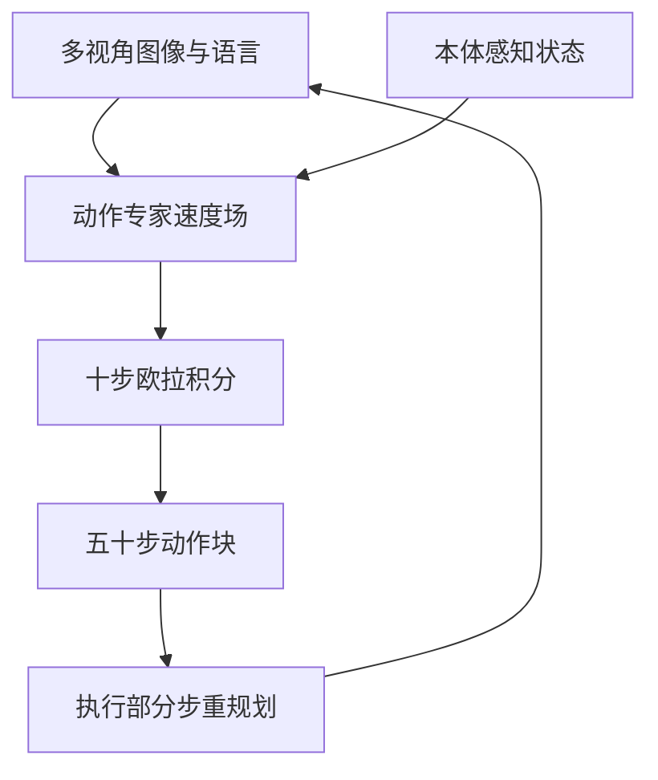

# Day 11 — π₀：用 flow matching 生成高频连续动作块的 VLA

> 📖 阅读版：https://papa-panda.github.io/post-training/physical-ai/day-11-2024-pi0-flow-vla/

## 元信息
- Title: π₀: A Vision-Language-Action Flow Model for General Robot Control
- Authors / Org: Kevin Black, Noah Brown, Danny Driess, Adnan Esmail, Michael Equi, Chelsea Finn, Niccolo Fusai, Lachy Groom, Karol Hausman, Brian Ichter, Szymon Jakubczak, Tim Jones, Liyiming Ke, Sergey Levine, Adrian Li-Bell, Mohith Mothukuri, Suraj Nair, Karl Pertsch, Lucy Xiaoyang Shi, James Tanner, Quan Vuong, Anna Walling, Haohuan Wang, Ury Zhilinsky / Physical Intelligence
- Link / arXiv / Blog: https://arxiv.org/abs/2410.24164 / https://www.physicalintelligence.company/blog/pi0
- Official code: https://github.com/Physical-Intelligence/openpi
- Date read: 2026-09-01
- Tags: [physical-ai, vla, pi0, flow-matching, action-chunking, cross-embodiment, dexterous-manipulation, robot-foundation-model]
- Thread: physical-ai
- Folder: day-11-2024-pi0-flow-vla
- GitHub: https://github.com/Papa-Panda/post-training/tree/master/physical-ai/day-11-2024-pi0-flow-vla

## 一句话总结
π₀ 把 PaliGemma 的视觉—语言语义与一个 300M action expert 接在同一 Transformer 中，用 conditional flow matching 一次生成 50-step 连续动作块；再以 10,000+ 小时、7 类机器人配置、68 个任务的跨 embodiment 数据预训练，并用少量高质量数据 post-train，使单一 3.3B VLA 能在最高 50 Hz 的双臂精细操作中兼顾语义、动作流畅度和错误恢复。

## 大纲
- 问题：离散动作 token 的量化误差与逐维自回归延迟，不适合高频双臂与接触丰富的操作
- 架构：PaliGemma 语义前缀与 300M action expert 分参数、共享 self-attention，连续量不挤进语言词表
- 生成：flow matching 学噪声到动作块的直线速度场，10 步 Euler 积分联合生成整段动作块
- 执行：预测时域 50 步，只执行 16 或 25 步就重规划，用动作块摊销 73 ms 的单次推理延迟
- 配方：10,000+ 小时跨 embodiment 预训练学覆盖与恢复，高质量小数据 post-train 学流畅与一致
- 证据：复杂任务以每任务 10 次真机试验的平均进度分报告，单项贡献未被总成绩单独钉死

## 流程图

## 和之前工作的关系

- **接了哪条线：** Day09 用 RT-2 / OpenVLA 建立“视觉 + 语言 → 动作”的 VLA 总览；Day11 专门深挖连续动作生成这一分支，回答 action token 在高频、双臂、接触丰富任务上的限制。
- **补了哪个短板：** Day09 的 OpenVLA 把每个动作维度离散成 token，单帧自回归输出 7D action；π₀ 直接建模条件分布 $p(A_t\mid o_t)$ ，一次联合生成整段 $H=50$ 的连续动作，因此能表达跨时间、跨关节耦合与多峰策略。
- **替代 / 分叉 / 改进：** π₀ 不替代 Day07/08 的 torque / locomotion 稳定环，也不显式学习 Day04–06 那种环境 transition model；它是低频语义条件与中频 manipulation command 之间的生成式 policy。真实电机安全、力控和碰撞约束仍由底层 controller 兜底。
- **对之前 Day X 的直接对比：** RT-2 / OpenVLA 的主轴是“动作即 token”，π₀ 的主轴是“动作块即条件生成轨迹”。前者复用 next-token CE infra；后者用 10 次 flow integration 换取连续精度和 action-chunk 联合建模。

## 为什么今天读它

路线保留 Day09/10 的总览后再进入 Day11–18 分专题扩展。π₀ 是 VLA 从离散动作 token 走向连续生成式控制的关键节点，也把 LLM 式 pre-training / post-training 配方直接迁移到机器人：广而杂的预训练数据提供覆盖和恢复行为，高质量 post-training 数据提供流畅、稳定、任务特定的执行风格。这和 Jun 当前关注的 data flywheel、post-training、rollout infra 有直接可迁移性。

## 今天的 3 问
1. 为什么对高频双臂 manipulation，联合生成 $H=50$ 的连续 action chunk 会比逐动作、逐维 token 解码更合适；收益来自连续精度、时间耦合，还是推理摊销？
2. 预训练混合中“低质量但多样”的纠错轨迹和 post-training 中“高质量且一致”的示范如何配比，才能同时避免笨拙与脆弱？
3. action chunk 有 0.5–0.8 秒 open-loop 执行窗口；接触、遮挡或人类干预使真实状态偏离后，何时应提前重规划，怎样把 uncertainty 接到底层 safety controller？

## 问答补充（2026-09-07）

> 以下问答归档自 physical AI side chat（2026-09-05）的用户主动提问；Day N 推送卡片与提醒类消息已跳过。每个条目保留问题原文（精简）、核心答案与符号定义。

### Flow Matching 是什么

**问**：flow matching 是啥？

**答**：Flow Matching 就是学一个"把噪声推向数据"的速度场。设真实动作块为 $ A $ ，高斯噪声为 $ \epsilon $ ，画一条直线把它们连起来：

$$A^\tau=(1-\tau)\epsilon+\tau A,\quad \tau\in[0,1].$$

$ \tau=0 $ 时是纯噪声， $ \tau=1 $ 时是真实数据；这条直线上的瞬时速度很简单，就是 $ A-\epsilon $ 。训练让网络 $ v_\theta(A^\tau,o,\tau) $ 去拟合这个速度：

$$\mathcal{L}=\mathbb{E}\|v_\theta(A^\tau,o,\tau)-(A-\epsilon)\|^2.$$

学好之后，推理时从噪声出发，跟着学到的速度场往前走，解一个常微分方程 $ dA/d\tau=v_\theta $ ，用 Euler 积分 10 步就从噪声走到了一个合法的动作块。跟 Diffusion 的区别：Diffusion 学的是"去噪"，走的是随机的 SDE 路径，有 100 个离散时间步；Flow Matching 学的是"方向"，走的是确定性的直线 ODE，路径更短、更快。π₀ 选它，就是因为要 50Hz 实时控制，10 步生成一个 50 步动作块刚刚好。

**符号**： $ A $ 真实动作块； $ \epsilon $ 高斯噪声； $ \tau $ flow 时间（去噪进行到哪了）； $ o $ 观测（含图像、本体感知、语言）； $ v_\theta $ 速度场网络， $ \theta $ 为参数； $ \mathcal{L} $ 训练 loss 标量。

### 这个 loss 是 tau 的函数吗

**问**：这个 loss 是 tau 的函数吗？

**答**：对一半。训练时每一个样本的误差项是 $ \tau $ 的函数，网络 $ v_\theta $ 也把 $ \tau $ 当输入（它要知道现在噪声有多大、该用多大的速度）。但最终的 loss 是对 $ \tau\sim\text{Uniform}[0,1] $ 取了期望的标量：

$$\mathcal{L}=\mathbb{E}_{\tau,A,\epsilon,o}\|v_\theta(A^\tau,o,\tau)-(A-\epsilon)\|^2.$$

所以它不是某一个 $ \tau $ 的函数，而是把所有 $ \tau $ 上的误差平均掉了。训练时每次随机采样一个 $ \tau $ 来算，时间长了就相当于把整条路径都学好了。

### 修正：π₀ 有语言输入（澄清前一条回答的表述）

**问**：day12 有道理，day11 不对啊——因为都没有语言输入，怎么做很多活？

**答**：纠正：π₀ 是**有**语言输入的；前一条"一个模型干很多活"的表述没把条件讲全，容易误会。它的观测 $ o $ 本来就是三件套：多视角图像 + 本体感知 $ q_t $ + **语言指令** $ \ell $ ，PaliGemma 那一半就是专门吃"图像+文字"的。所以"干很多活"靠的是语言切换任务：说"擦桌子"它擦桌子，说"叠衣服"它叠衣服，动作头都是同一个 flow 模型。Day12 的 Diffusion Policy 才是真的没有语言——所以它只能死守一个任务。逻辑是：π₀ "有语言→多任务"，DP "无语言→单任务"，各自自洽。

**符号**： $ q_t $ 本体感知（关节角/末端位姿）； $ \ell $ 语言指令。

**与之前工作的关系**：本节 3 问构成 Day11 的"flow 生成"主线——速度场直觉 → loss 对 $ \tau $ 取期望 → 语言条件带来多任务；与 Day12 的"去噪"参数化对照（对照见 README 问答记录），与 Day14 的 flow 低层执行相接。

## 数学视角：统一成一个部分可观测的条件生成控制问题

### 1) State / observation / action / objective

真实系统可视为 POMDP：隐藏物理状态

$$x_t=(q_t,\dot q_t,\text{object poses},\text{contact modes},\text{friction},\text{deformation},\ldots),$$

但 policy 只能看到

$$o_t=[I_t^1,\ldots,I_t^n,\ell_t,q_t].$$

- $I_t^i\in\mathbb{R}^{h\times w\times 3}$ ：第 $i$ 个 RGB 相机，论文每个平台用 $n=2$ 或 $3$ 个视角。
- $\ell_t=(w_1,\ldots,w_L)$ ：长度为 $L$ 的语言 token 序列，既可以是总任务，也可以是约 2 秒粒度的 segment annotation / 高层子指令。
- $q_t\in\mathbb{R}^{d_q}$ ：本体状态，主要是关节角；跨机器人训练时 padding 到最大维度 18，并 mask 不存在的 image slot。
- 单步动作 $a_t\in\mathbb{R}^{d_a}$ ，整段动作为 $A_t=[a_t,\ldots,a_{t+H-1}]\in\mathbb{R}^{H\times d_a}$ ； $H=50$ ， $d_a$ 随 embodiment 变化并 padding 到统一维度。

行为克隆目标不是预测一个均值动作，而是学习完整条件分布：

$$\pi_\theta(A_t\mid o_t)\approx p_{\mathcal D}(A_t\mid o_t).$$

这很重要：同一件衣服可能向左或向右展平，双臂绕过障碍也可能有多条可行轨迹；普通 MSE 容易平均出不可执行动作，flow matching 则允许多峰连续分布。

### 2) Conditional flow matching

从噪声 $\epsilon\sim\mathcal N(0,I_{H d_a})$ 到示范动作块 $A_t$ 建立线性概率路径：

$$A_t^{\tau}=(1-\tau)\epsilon+\tau A_t,\qquad \tau\in[0,1].$$

对应的目标速度场为 $u=A_t-\epsilon$ （若采用反向时间参数化，符号相反），训练 action expert $v_\theta$ ：

$$\mathcal L_{\mathrm{FM}}(\theta)=\mathbb E_{(o_t,A_t)\sim\mathcal D,\epsilon,\tau}\left[\left\|v_\theta(A_t^\tau,o_t,\tau)-(A_t-\epsilon)\right\|_2^2\right].$$

- $A_t^\tau\in\mathbb R^{H\times d_a}$ ：第 $\tau$ 个 flow time 的 noisy action chunk；这里的 $\tau$ 是生成积分时间，不是机器人控制时间 $t$ 。
- $v_\theta\in\mathbb R^{H\times d_a}$ ：模型预测的整段动作速度场；所有 $H$ 个 action slots 彼此双向 attention，因此关节与时间步联合建模。
- 论文对 $\tau$ 使用偏向低 $\tau$ / 高噪声区的 shifted Beta 分布，而不是均匀采样；直觉是给定机器人观测后，“从纯噪声找出合理平均动作”并不容易，应增加这一区域的训练权重。

推理从 $A_t^0\sim\mathcal N(0,I)$ 出发，用 10 步 Euler 积分（ $\delta=0.1$ ）：

$$A_t^{\tau+\delta}=A_t^\tau+\delta\,v_\theta(A_t^\tau,o_t,\tau).$$

最后得到 $A_t^1$ 并执行其中一部分动作。20 Hz 的 UR5e / Franka 每 0.8 秒重推理一次、执行 16 步；其他 50 Hz 平台每 0.5 秒重推理一次、执行 25 步。因此 $H=50$ 是模型预测 horizon，不等于每次都 open-loop 执行 50 步。

### 3) 和系统实现的对应

- **VLM prefix：** $[I_t^1,\ldots,I_t^n,\ell_t]$ 进入 PaliGemma 3B backbone，承接 Internet-scale 视觉语义。
- **Robot suffix：** $[q_t,A_t^\tau]$ 进入约 300M 的 action expert；两组参数只通过 self-attention 交互，避免让机器人连续量直接挤进语言词表。
- **三段 blockwise mask：** image/language、state、noisy actions 各自块内双向 attention，前块不看未来块；于是 image/language/state 的 KV cache 可在 10 个 flow steps 间复用。
- **延迟预算：** 3 个相机、RTX 4090 上 image encoder 14 ms、observation pass 32 ms、10 次 action pass 合计 27 ms，总 on-board 73 ms；off-board 加网络后 86 ms。action chunk 将高频控制和较慢模型推理解耦。

### 4) 假设与数学没有覆盖的真实误差

这个 loss 默认示范动作在时间上对齐、归一化和 embodiment mask 正确，也默认观测足以消除关键歧义；它没有显式建模相机延迟、控制通信抖动、joint backlash、力 / 触觉、摩擦变化、柔性物体内部状态、碰撞约束和执行器饱和。更关键的是，0.5–0.8 秒 open-loop 窗口内真实 transition $x_{t+1}=f(x_t,a_t,w_t)$ 仍会受未观测扰动 $w_t$ 影响；flow loss 只拟合示范分布，不保证闭环稳定性、安全性或约束可行性。

## 核心

1. **Motivation：离散 action token 不够高频、也不够连续**
   - 机器人 foundation model 既要继承 VLM 的语义泛化，又要执行双臂、柔性物体和接触丰富的连续动作；逐 token 自回归动作在控制频率、量化误差和长 action sequence 延迟上受限。
   - π₀ 用 flow matching 输出连续 action chunk，使整个时间窗内的动作相关性一次建模，也把多次控制命令摊到一次视觉编码和一次条件生成。
   - 目标不是只做一个漂亮模型，而是形成“广覆盖 pre-training → 高质量 post-training → 复杂任务部署”的机器人训练 recipe。

2. **System / Method：3B VLM backbone + 300M action expert**
   - PaliGemma 负责 image / language tokens，action expert 负责 proprioception / noisy actions；总参数约 3.3B，action expert 从零初始化。
   - 模型采用 3-block attention：视觉语言、机器人状态、动作块。动作 token 之间全双向 attention，适合联合生成 $H=50$ 的轨迹。
   - 每次采样做 10 次 flow integration；条件 prefix 的 KV cache 复用，使多步生成不必重复算视觉与语言。
   - 控制动作并非 torque-level safety policy；它输出 robot-specific joint / gripper / base command，底层执行器仍需速率、位置、碰撞和急停约束。

3. **Training / Data Details：覆盖与质量分阶段优化**
   - 自有数据超过 10,000 小时，涵盖 7 种机器人配置和 68 个宽定义任务；另混合 OXE、Bridge V2、DROID。自有数据约 903M timesteps，其中 106M 单臂、797M 双臂；开源数据占训练 mixture 的 9.1%。
   - 不平衡的 task-robot 组合按 $n^{0.43}$ 加权，而不是按样本数线性采样，从而压低 laundry 等大数据任务的垄断效应。
   - 预训练强调任务、场景、机器人和错误恢复的覆盖；post-training 用 5 小时到 100+ 小时不等的任务特定高质量数据，强化流畅、稳定和一致策略。
   - 语言标签同时使用 coarse task name 与约 2 秒的细粒度 segment annotation；复杂任务还可由高层 VLM 动态输出子指令。

4. **Key Tricks：最值得抄的细节**
   - **Trick 1 — action expert 解耦参数、共享 attention：** 保留 VLM 语义参数，同时给连续状态 / 动作独立容量；比把动作硬塞进语言 token 更适合高维、连续和高频控制。
   - **Trick 2 — action chunk + prefix KV cache：** 一次生成 50 步、实际执行 16 或 25 步再重规划；10 次 flow pass 只重算 action suffix，达到 73 ms on-board inference。
   - **Trick 3 — pretrain 学恢复，post-train 学风格：** 广而杂的数据包含失误、纠正和长尾状态，高质量小数据教 fluent execution；只用后者会脆，只用前者会笨。
   - **Trick 4 — $n^{0.43}$ mixture weighting：** 以次线性频率保留大数据集信号，又给小任务足够曝光，是 data curation 与 model training 联动的简单可复用接口。
   - **Trick 5 — 低噪声区少采、高噪声区多采：** flow timestep 分布针对 action prediction 调整，不照搬图像生成的 logit-normal recipe。

5. **Results：生成架构、VLM 初始化和预训练 recipe 都有贡献，但评测仍偏小样本**
   - Base model 在 shirt folding、两档 bussing、grocery bagging、toast 等 5 个任务上，以每方法每任务 10 trials 评估；完整 700k-step π₀ 最强，160k-step compute-parity 版本也超过同 mixture 的 OpenVLA / Octo。
   - 新任务 fine-tuning 中，π₀ 通常优于 OpenVLA、Octo、ACT 和 Diffusion Policy；相似于预训练分布的任务收益更大，部分设置中预训练相对 scratch 可到约 2×。
   - 复杂任务包括随机皱褶衣物折叠、移动取衣、桌面清理、纸箱组装、装蛋和外卖盒打包；完整 pretrain + post-train 在所有任务平均得分超过满分的 50%，并普遍优于 zero-shot / scratch ablation。
   - 但大多结果只有每任务 10 次真机 trial，baseline 训练步数并非全部严格匹配；论文也承认尚不清楚不同数据源的边际价值，以及跨得很远的 domain（驾驶、导航、legged locomotion）是否正迁移。

## 可迁移 / Transfer

- **方法在 held-out 上是否 transfer？模型 vs 框架哪个贡献更大？** 有新物体、新任务、跨机器人和少量数据 fine-tuning 的正迁移证据；但 π₀ 同时改变了模型规模、VLM 初始化、连续 action head、action chunk、数据规模和训练 recipe，单项贡献不能只凭总成绩归因。更严谨的视角是“完整系统栈”的胜利。
- **对你 Infra → Post-training → Physical AI 迁移的 1-2 个直接启发：**
  1. 机器人 post-training 与 LLM post-training 的结构高度相似：base model 的 coverage / recovery repertoire 与高质量 task data 的行为塑形必须分开管理；真正的机会在 mixture observability、dataset value、failure replay 和 eval flywheel。
  2. rollout infra 不只要吞吐，还要建模 control deadline：图像编码、prefix pass、10 次 flow pass、网络、机器人执行必须形成 latency budget；p95 jitter 会直接改变闭环 policy，而不是单纯服务质量指标。
- **Infra 视角：可扩展性 / 成本 / 评测自动化 / 可复现性：** 按 task × embodiment × camera config 记录数据权重、action norm stats、mask、loss 与 success；serving 同时记录 flow-step latency、achieved action Hz、stale-observation age、chunk interruption、controller saturation、collision / recovery。官方 openpi 已提供 base checkpoints、JAX / PyTorch 实现和 remote policy server，但截至其文档，PyTorch 路线仍缺 FSDP、LoRA、EMA 与 mixed precision 等能力。

## 疑问 / 下一步

- **没看懂 / 想深挖：** 怎样在保持 chunk-level 多峰性的同时显式引入 closed-loop feedback？固定每 0.5–0.8 秒重规划会把 inference schedule 当超参，但真正需要的是根据接触变化、uncertainty 或 safety residual 自适应中断。
- **如果要复现 / 小规模试，第一个实验做什么？** 用 openpi 的无机器人 inference / LIBERO example 做 smoke test：固定同一 observation batch，比 10 / 5 / 2 flow steps 的 p50/p95 latency、action smoothness 与 task success；再人为增加 50–150 ms observation delay，测 chunk length 与重规划频率的交互。
- **下一步：** Day12 深挖 Diffusion Policy，分离“连续生成式 action head”本身与 π₀ 的 VLM / 大规模跨 embodiment 数据贡献。

## 原文金句 (1-2句)
> “Our generalist robot policy uses a pre-trained vision-language model (VLM) backbone, as well as a diverse cross-embodiment dataset with a variety of dexterous manipulation tasks.”

> “Intuitively, the diverse (but lower quality) pre-training data allows the model to recover from mistakes and handle highly varied situations, which might not otherwise occur in the high-quality post-training data, while the post-training data teaches the model to perform the task well.”

## 今晚产出
- [ ] 画 `multi-view RGB + language + proprioception → VLM prefix / action expert → 10-step flow → H=50 action chunk → low-level controller` 数据流图
- [ ] 用 NumPy 写 20 行 conditional flow toy：二维双峰 action distribution，比较 MSE mean 与 flow samples
- [ ] 跑 openpi 无机器人 inference smoke test，记录 GPU 显存、image / prefix / flow latency 和输出 shape
- [ ] 做 `2 / 5 / 10 flow steps × 8 / 16 / 25 executed actions` 小矩阵，明确算力—反馈频率 trade-off
- [ ] 为 robot data mixture 设计日志字段：task、embodiment、source、quality、recovery flag、sampling weight、held-out success

## 连接
- 上一篇: Day10 — Habitat 3.0（动态人类伙伴、协作环境与分层 skill 评测）
- 下一篇预告: Day12 — Diffusion Policy（视觉条件动作扩散与 receding-horizon 控制）
- 相关: Day05 UniSim；Day06 DreamerV3；Day09 RT-2 / OpenVLA

## 参考链接
- Paper: https://arxiv.org/abs/2410.24164
- Project: https://www.physicalintelligence.company/blog/pi0
- Official code: https://github.com/Physical-Intelligence/openpi

<!-- viz:vs: RT-2/OpenVLA | 动作即 token; 复用 next-token CE infra || π₀ | 动作块即条件生成轨迹; 10 次 flow integration 换连续精度 -->
<!-- viz:stats: H=50 预测 horizon | 20Hz 每 0.8s 执行 16 步 | 50Hz 每 0.5s 执行 25 步 -->

## 第二轮复习（2026-10-14）

> 本轮补三处元信息（venue、评测口径、定位）＋补大纲与流程图（初读缺失，本轮补齐）。核心收获：把 Day11 从「flow matching 动作头」重读为「连续动作生成层」的确立——Day09 用离散 token 买到的语义接口，在这里用整段连续动作块赎回精度与频率；但赎回的代价是把闭环问题改写成开环窗口问题：生成得越整段，执行期间对真实状态漂移就越盲，这个张力后来由 Day12 的重规划、Day14 的分层子任务与 Day29 的安全栈分头还债。

### 元信息修正

1. **Venue 补充**：初读只标 arXiv 2410.24164 与官方 blog，未标会议；该工作后发表于 RSS 2025，本轮补记，引用时以 arXiv 版页码为准。
2. **评测口径校准**：初读「复杂任务平均得分超过满分的 50%」指的是每任务 10 次真机试验的平均进度分（partial score），不是全任务成功率；且 direct prompting 评测的任务族本身出现在预训练混合里，「zero-shot」应读作「预训练后未经任务 post-train 直接执行」，不是「未见任务」。两处口径不改，结论强度要降一档：它证明的是同分布任务族上的强执行与语言跟随，不是开放任务泛化。
3. **定位校准**：初读把 π₀ 记成「VLA 的连续分支」；复习校准为**连续动作生成层**——它位于 Day09 语义层与底层力控之间，不产新语义、不做环境建模，专管一件事：把条件分布 $p(A_t \mid o_t)$ 以可实时执行的整段轨迹形式采样出来。

### 一句话总结

三十多天后回看，Day11 的耐久贡献不是某个速度场公式，而是一笔接口交易：用 10 步 flow 积分的固定推理成本，换掉 Day09 逐维 token 解码的量化误差与自回归延迟，使 $H=50$ 的连续动作块能被联合采样、部分执行、滚动重规划；与此同时它把 LLM 的预训练学覆盖、post-train 学风格这套配方第一次完整搬进机器人，配方与生成头谁贡献更大，论文的总成绩并没有分开回答。

### 和之前工作的关系

- **vs Day09 RT-2 / OpenVLA（直接对比，同属脚手架到专题的交界）**：Day09 把 7 维动作切成 256 个 bin 逐 token 自回归，买到的是词表与训练栈的复用，代价是量化精度、解码顺序与 1–6 Hz 的频率上限；Day11 反过来，动作不再进词表，而是由独立 action expert 在连续空间整段生成，频率升到最高 50 Hz 的命令输出。两者条件端几乎同构（图像加语言），分歧全在动作表示：语义可以离散，接触不能。
- **同专题 vs Day12 Diffusion Policy**：两者学的是同一个条件动作分布，参数化不同——Day12 用离散扩散步学噪声预测、无语言、单任务小模型，靠只执行前若干步加重观测保闭环；Day11 用连续流时间学速度场、有语言、多任务大模型，靠动作块摊销推理。二者共享同一个未解问题：生成窗口内的世界是冻结的，重规划频率就是闭环带宽。
- **同专题 vs Day14 π₀.₅ 与 Day34 π0.7（专题内演进到最新进展）**：Day14 在同一 flow 动作头上加异构 co-training 与 knowledge insulation，等于承认 Day11 的共享 attention 有代价——动作梯度会冲刷 VLM 语义，必须用训练配方隔离；Day34 再加可转向条件与组合泛化。三代同头不同配方，说明 π 家族真正的迭代轴是数据与条件，不是生成数学。
- **跨阶段 vs Day19–24（RL / sim2real）**：π₀ 全程是行为克隆，没有 reward、没有价值函数、没有在线纠偏；它的预训练加 post-train 与 Day20 RLPD 的离线数据常驻加在线微调形似而神不同——RLPD 有 $Q$ 函数 arbitrate 哪些离线动作值得学，π₀ 只有混合权重 $n^{0.43}$ 这类先验配比。动作块的开环执行窗口，本质是把 Day19 PPO 每步反馈的闭环换成批量前馈，样本效率与控制带宽的账要分开算。
- **跨阶段 vs Day26 / Day29 / Day30（physical AGI / 安全 / 飞轮）**：Day26 GR00T N1 的快系统同样用生成式动作块做高频控制，慢快双系统正是 Day11 单层生成的分层补丁；Day29 的安全栈提醒 flow loss 只拟合示范分布，不给碰撞、饱和与约束可行性任何证书；Day30 的数据飞轮则是 π₀ 配方的生产化形态——预训练混合的采样权重、质量分层与 failure replay，在飞轮里变成可持续运营的 triage 流程。

### 核心

1. **动机重读：瓶颈不在语义，在动作表示**：Day09 之后 VLA 的语义端已经够用，卡住的是执行端——双臂协调要求关节间耦合在同一时刻成立，柔性物体要求整段轨迹的时间相关性，逐维独立量化再自回归拼接，两样都丢。整段联合生成不是炫技，是把「一条轨迹是一个样本」这件事写进模型结构。
2. **机制深挖：直线路径与速度场**：训练构造带噪动作块 $A_t^\tau$ ，让它沿噪声与示范之间的直线插值，网络学这条直线的切线方向，即目标速度 $A_t-\epsilon$ ；推理从纯噪声出发沿学到的速度场积分，10 步到达一个合法动作块。这里没有环境转移、没有回报，只有一个条件分布的输运。 $\tau$ 的采样偏向高噪声区，等于承认难的不是把近乎成形的动作修顺，而是从纯噪声里先选对动作模式——多峰分布的模式选择发生在积分早期，这也是整段动作内部一致性的来源。
3. **机制深挖：分参数、共享 attention 的半隔离**：VLM 前缀与 action expert 用两套参数，只在 self-attention 层相遇，前缀的 KV cache 在 10 步积分间复用，单次推理 73 ms 中动作部分只占一小半。这套半隔离当时被读作干净解耦，复习时要降调：梯度仍能经 attention 回流语义端，Day14 不得不发明 knowledge insulation，正是这笔账的到期日。
4. **机制深挖：动作块是延迟摊销合同**：生成 50 步、执行 16 或 25 步、再重规划，等于用可控的开环盲区换推理摊销——视觉编码与前缀计算每块只付一次。若每步都重推理，73 ms 的延迟在 50 Hz 下要吃掉三个以上控制周期；若整块执行完，盲区拉满一秒。16 与 25 这两个执行长度不是超参细节，是这份合同的条款。
5. **配方深挖：次线性混合权重**：任务采样权重按样本量的 $n^{0.43}$ 次幂缩放，大任务保留信号但不许按体量垄断，小任务获得远超其体量的曝光。这与 LLM 数据混合的去重加权是同一类工程：混合比例本身就是模型的一部分，值得与架构同等对待、单独做消融与版本管理。

### 边界

1. **证据没有证明什么**：每任务 10 次真机试验撑不起成功率的置信区间，复杂任务报告的又是进度分而非成功率；基线对比用 160k 步的 compute-parity 版本，完整模型是 700k 步，总成绩无法把生成头、数据规模、VLM 初始化与配方的贡献分开归因。
2. **何时失效**：接触模式在开环窗口内突变（物体滑脱、布料塌陷、被人碰动）时，剩余动作仍按旧观测执行，重规划来临前没有纠偏通道；示范之外的状态没有恢复数据支撑时，flow 采样只会给出一个流畅但错误的模式——流畅度不是正确性的证据。
3. **系统边界**：没有力与触觉输入，没有显式安全约束，跨到驾驶、导航、足式运动等远域是否正迁移论文自己也未验证；把它部署进 Day10 式有人家庭或 Day33 式陌生家庭，缺的正是伙伴建模与安全层，而不是更长的动作块。

### 迁移到 post-training / Agentic RL Infra

可执行的同构：把 agentic RL 的 rollout 做成「计划块生成加自适应中断」。具体落地：让 agent 一次生成一段多步工具调用计划（类比动作块），只执行前缀若干步就强制重观测；系统提示与工具描述作为前缀做 KV cache 复用，摊销每步重复编码；中断条件写死三条可测量的触发器——环境回执与计划预期不一致、执行器返回错误码、已执行步数达到上限，任一触发立即截断计划并重规划。评测按 Day11 的合同记账：计划生成延迟的 p50 与 p95、观测陈旧年龄、中断率、截断后恢复成功率，并做生成步数与执行前缀长度的二维消融矩阵再定默认档。配套抄配方一侧：训练混合按任务样本量的次线性幂加权并把权重写进数据版本，禁止大任务按体量自然垄断梯度。

### 思考题（综合 Day09 / Day11 / Day12 / Day14 / Day29 / Day34）

- **(a) 模式选择发生在哪一步**：Day11 的 flow 积分早期决定动作模式，Day12 的扩散去噪也有类似的粗到细结构。若把积分步数从 10 步砍到 2 步，你预判先丢的是动作精度还是模式多样性？请用「直线路径上速度场的积分误差随步长如何累积」论证，并设计一个能把两者分开测的实验（固定观测，比较采样分布的模式覆盖与单条轨迹的平滑度）。
- **(b) 开环窗口的安全合同**：Day11 执行 16 或 25 步才重规划，Day29 要求逐点约束不可平均。若给动作块加一个块内安全监护：每执行一步就用轻量检查判断是否提前截断整块，检查的假阳性会怎样吃掉动作块的摊销收益？请写明截断阈值该由哪一类信号驱动（接触残差、观测新颖度还是执行器饱和），并说明它与重规划频率的关系。
- **(c) 配方与架构谁在迭代**：Day11 到 Day14 到 Day34，动作头几乎不变，变的是 co-training、knowledge insulation 与可转向条件。若只能选一条轴继续投入——换更强的生成参数化，还是扩数据配方与条件机制——你选哪条？请用三代工作的证据增量论证，并给出一个能证伪你选择的观测结果。

参考链接（本轮复习）：
- π₀ 论文（arXiv，RSS 2025）：https://arxiv.org/abs/2410.24164
- Physical Intelligence 官方 blog：https://www.physicalintelligence.company/blog/pi0
- openpi 官方代码：https://github.com/Physical-Intelligence/openpi

GitHub NOTES：https://github.com/Papa-Panda/post-training/blob/master/physical-ai/day-11-2024-pi0-flow-vla/NOTES.md
