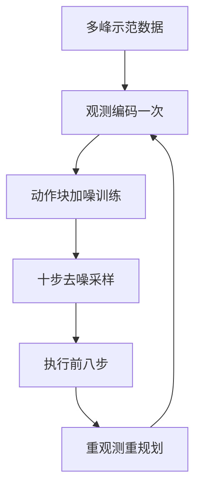

# Day 12 — Diffusion Policy：条件动作扩散与 receding-horizon 视觉控制

> 📖 阅读版：https://papa-panda.github.io/post-training/physical-ai/day-12-2023-diffusion-policy/

## 元信息
- Title: Diffusion Policy: Visuomotor Policy Learning via Action Diffusion
- Authors / Org: Cheng Chi, Siyuan Feng, Yilun Du, Zhenjia Xu, Eric Cousineau, Benjamin Burchfiel, Shuran Song / Columbia University, Toyota Research Institute, MIT（RSS 2023）
- Link / arXiv / Blog: https://arxiv.org/abs/2303.04137v5 / http://diffusion-policy.cs.columbia.edu
- Official code: https://github.com/real-stanford/diffusion_policy
- Date read: 2026-09-02
- Tags: [physical-ai, visuomotor-policy, diffusion, behavior-cloning, action-chunking, receding-horizon-control, robot-manipulation]
- Thread: physical-ai
- Folder: day-12-2023-diffusion-policy
- GitHub: https://github.com/Papa-Panda/post-training/tree/master/physical-ai/day-12-2023-diffusion-policy

## 一句话总结
Diffusion Policy 把视觉条件机器人策略写成动作序列上的 DDPM：从高斯噪声迭代去噪出一段连续控制命令，只执行前 $T_a$ 步再观察并重规划；这同时保留示范中的多峰行为、整段动作的时间一致性和闭环纠错能力，在 IJRR 扩展版覆盖的 15 个仿真与真机任务上相对既有方法平均提升 46.9%。

## 大纲
- 问题：多峰示范下单步回归会平均出不可执行动作，逐单步采样又丢掉整段轨迹的时间一致性
- 表示：只对动作块做条件扩散、观测只编码一次， $T_o$ 、 $T_p$ 、 $T_a$ 三个 horizon 分工
- 训练： $K = 100$ 步加噪学噪声预测，square cosine 日程；无 reward、无动力学模型，纯示范分布拟合
- 推理：DDIM 把 100 步压到 10 步去噪出整段轨迹，执行前 $T_a$ 步（多数任务 8 步最优）后重观测
- 证据：15 个任务平均提升 46.9%，真机 Push-T 达 95% 成功接近人类；但全是单任务、无语言、无跨 embodiment

## 流程图

## 和之前工作的关系

- **接了哪条线：** Day09 建立 VLA 总览，Day11 的 π₀ 再把 VLM 与连续 action chunk 接起来；Day12 回到更纯粹的 visuomotor behavior cloning，隔离出“条件生成式 action head + receding horizon”本身为什么有效。
- **补了哪个短板：** π₀ 的 flow matching 看起来像一个大模型部件，但 Diffusion Policy 把关键控制接口说得更清楚：observation horizon $T_o$ 、prediction horizon $T_p$ 、execution horizon $T_a$ 是三个不同时间尺度，chunk 不能等同于 open-loop 执行完整段。
- **替代 / 分叉 / 改进：** 它不学习 Day05/06 那样的环境 transition/world model，也没有语言语义或跨 embodiment backbone；它直接学习 $p(A_t\mid O_t)$ 。因此训练更像监督式行为克隆，代价是继承 demonstration coverage 与 covariate shift 的上限。
- **对之前 Day X 的直接对比：** Day11 的 π₀ 用连续时间 flow ODE 从噪声积分到动作，Diffusion Policy 用离散噪声日程和 DDPM/DDIM 反向去噪。二者都联合生成 action chunk，但 Diffusion Policy 每次只执行较短前缀并滚动重规划，闭环接口更显式；π₀ 则用 VLM、大规模跨机器人数据和 action expert 扩展语义与规模。

## 为什么今天读它

路线从 Day11–14 专题展开 VLA / 生成式 policy。Diffusion Policy 是连续动作生成的关键基线：它把“多峰示范分布”从一个统计问题，变成可部署的控制系统设计——动作序列表示、视觉条件缓存、去噪延迟、控制频率和重规划 horizon 必须联合选择。它也提供了一个很好的桥，把扩散/score matching 与 state-space control、MPC 式 receding horizon 放在同一张图里。

## 今天的 3 问
1. 为什么对多峰示范直接做单步 MSE 会输出“平均但不可执行”的动作，而对整段 $A_t$ 做 conditional diffusion 能在每次 rollout 中选定并坚持一个模式？
2. $T_p$ 预测得长有利于时间一致性， $T_a$ 执行得短有利于闭环响应；怎样把模型推理延迟、传感器频率和扰动时间尺度共同写成 horizon 选择问题？
3. 去噪 loss 只保证拟合专家动作分布，不保证动力学可行、安全或稳定；真实部署中应在哪一层加入碰撞约束、延迟补偿、uncertainty gate 与底层反馈控制？

## 问答补充（2026-09-07）

> 以下问答归档自 physical AI side chat（2026-09-05）的用户主动提问；Day N 推送卡片与提醒类消息已跳过。

### Day12（Diffusion Policy）有什么用

**问**：day12 有啥用啊？

**答**：它的用处恰恰在于"只会一招"。工厂里的机械臂不需要听懂人话，它需要把同一个零件插一百万次、成功率 99.9%——Diffusion Policy 就是为这种场景生的：小模型、百来条演示就能训、没有 VLM 的包袱，在推、翻、插这类接触丰富的单技能上精度极高。更大的用处是方法论：它发明的"动作 chunk + 生成式建模 + $T_o/T_p/T_a$ 重规划"这套东西，后来被 Octo、π₀.₅ 全盘吸收。可以说 Day12 是个"零件供应商"——自己不做整车，但发动机技术铺到了全行业。

**符号**： $T_o$ 观测历史帧数； $T_p$ 预测 horizon（动作块长度）； $T_a$ 执行 horizon（执行前 $T_a$ 步后重观测、重规划）。

**与之前工作的关系**：Day12 是"无语言→单任务"逻辑自洽的代表（对照 Day11"有语言→多任务"）；它的方法论遗产（chunk + 生成式建模 + 三 horizon 重规划）被 Day13 Octo 和 Day14 π₀.₅ 直接继承。

## 数学视角：POMDP 上的条件轨迹生成 + receding-horizon control

### 1) State / observation / action / objective

把真实机器人写成部分可观测状态空间模型：

$$x_{t+1}=f(x_t,a_t,w_t),\qquad o_t=h(x_t,v_t).$$

- $x_t\in\mathbb R^{d_x}$ ：隐藏物理状态，包括机器人位姿/速度、物体位姿、接触模式、摩擦、液体或柔性物体状态。
- $a_t\in\mathbb R^{d_a}$ ：连续控制命令；论文任务从 2-DoF 平面动作到 6/7-DoF 末端位姿或关节/夹爪命令，双臂时维度继续增加。
- $o_t$ ：可观测量，通常是多视角 RGB 加 proprioception；图像可写成 $I_t\in\mathbb R^{H\times W\times3}$ 。
- $w_t,v_t$ ：未建模动力学扰动与传感噪声；控制时间 $t$ 是真实环境步，不是 diffusion step。

在时刻 $t$ ，策略输入最近 $T_o$ 步观测

$$O_t=[o_{t-T_o+1},\ldots,o_t],$$

联合预测长度 $T_p$ 的动作块

$$A_t^0=[a_t,\ldots,a_{t+T_p-1}]\in\mathbb R^{T_p\times d_a},\qquad \pi_\theta(A_t^0\mid O_t)\approx p_{\mathcal D}(A_t^0\mid O_t).$$

训练目标不是最大化环境 reward，而是用示范数据集 $\mathcal D$ 逼近专家条件动作分布。对 Push-T 而言，同一观测下可从 T 块左侧或右侧绕行；整段分布建模允许不同轨迹模式存在，而不是把两条轨迹平均到障碍物上。

### 2) Forward diffusion 与 noise-prediction objective

令 $k\in\{1,\ldots,K\}$ 是 diffusion/noise level，注意它与真实控制时间 $t$ 不同。把干净示范动作块 $A_t^0$ 加噪：

$$A_t^k=\sqrt{\bar\alpha_k}\,A_t^0+\sqrt{1-\bar\alpha_k}\,\epsilon,\qquad \epsilon\sim\mathcal N(0,I_{T_p d_a}).$$

其中 $\alpha_k=1-\beta_k$ 、 $\bar\alpha_k=\prod_{i=1}^{k}\alpha_i$ ， $\beta_k$ 是 noise schedule。模型接收 $O_t,A_t^k,k$ ，预测噪声：

$$\mathcal L_{\mathrm{DP}}(\theta)=\mathbb E_{(O_t,A_t^0)\sim\mathcal D,\,k,\,\epsilon}\left[\left\|\epsilon-\epsilon_\theta(O_t,A_t^k,k)\right\|_2^2\right].$$

- $A_t^k,\epsilon,\epsilon_\theta\in\mathbb R^{T_p\times d_a}$ ；loss 同时覆盖全部未来步和动作维度。
- $K$ 是训练时的去噪层数。论文真机设置用 $K=100$ 训练、DDIM 10 步推理；这是生成时间尺度，不对应 100 个机器人动作。
- 论文实测 square cosine noise schedule 最好；它控制模型在不同频率/噪声尺度上学习动作信号的权重。

这也可视为条件 score matching： $-\epsilon_\theta$ 在尺度因子下近似 $\nabla_A\log p(A\mid O)$ 。推理不是一次回归均值，而是从 $A_t^K\sim\mathcal N(0,I)$ 出发，沿高概率动作流形迭代移动。

### 3) Reverse transition 与系统实现

论文把每次去噪写成 noisy gradient step：

$$A_t^{k-1}=\alpha_k\left(A_t^k-\gamma_k\epsilon_\theta(O_t,A_t^k,k)+\eta_k\right),\qquad \eta_k\sim\mathcal N(0,\sigma_k^2I).$$

- $\alpha_k,\gamma_k,\sigma_k$ 由 noise schedule 决定；直觉上 $\gamma_k$ 是沿 learned action-score field 的步长， $\eta_k$ 保留采样多样性。
- CNN 版本用 1D temporal U-Net/ConvNet 建模动作时间轴，并用 FiLM 注入 observation feature；Transformer 版本让动作 token 因果 self-attend，并对 observation embedding 做 cross-attention。
- 视觉编码器只对 $O_t$ 算一次，之后 $K$ 次去噪复用条件特征；论文的 end-to-end 版本使用修改的 ResNet-18（Spatial Softmax 保留空间位置、GroupNorm 避免 EMA 与 BatchNorm 冲突）。
- DDIM 将训练 100 步压到推理 10 步；论文报告 NVIDIA 3080 上约 0.1 s inference latency。真机 Push-T 以 10 Hz 产生 command，再线性插值到 125 Hz 执行。

### 4) Receding horizon：预测、执行、反馈三个时间尺度

生成 $A_t^0$ 后，只执行前 $T_a$ 步：

$$a_{t:t+T_a-1}\leftarrow A_t^0[0:T_a],\qquad t\leftarrow t+T_a,\qquad O_t\leftarrow\text{new observations},$$

然后再次采样。需要区分：

- $T_o$ ：看多少历史，决定部分可观测状态估计能力；
- $T_p$ ：预测多长，决定轨迹级时间一致性与隐式计划长度；
- $T_a$ ：一次真正执行多少步，决定 feedback bandwidth 与 inference amortization。

$T_a=1$ 最灵敏但每步都要完成去噪，延迟成本高； $T_a$ 太大则接近 open loop。论文消融中多数任务 $T_a=8$ 最优，并在仿真中维持到 4-step latency 的峰值表现。这与 MPC 相似：每轮优化一段未来控制，但只落地前缀；不同之处是 Diffusion Policy 的目标来自示范分布，而不是显式动力学模型和 cost function。

### 5) 假设与数学没有覆盖的真实误差

这个框架假设示范中的 action timestamp、相机帧和 proprioception 已正确同步，动作归一化和控制接口一致，且观测足以辨别任务阶段。它没有显式建模 actuator saturation、backlash、contact impulse、friction drift、camera exposure/occlusion、网络 jitter、碰撞和硬件安全约束；也不保证从训练分布外状态恢复。DDPM loss 能让动作“像数据”，却不等价于满足 $x_{t+1}=f(x_t,a_t,w_t)$ 下的可达性、稳定性或 constraint feasibility。因此真机还需要低层 position/impedance loop、限速/限力、collision checker、watchdog 与 OOD/uncertainty gate。

## 核心

1. **Motivation：显式回归和普通 implicit BC 各有硬伤**
   - 单一 Gaussian/MSE 容易在多峰动作上做均值；mixture/categorical action 随维度增加而难扩展。
   - IBC 的 energy-based policy 可表达多峰，但负样本近似 normalization constant 会带来训练不稳定。
   - Diffusion Policy 学 action distribution 的 score/noise，既不显式求 normalization constant，又能把输出扩展到高维动作序列。

2. **System / Method：conditioned action diffusion + closed-loop chunk execution**
   - 输入最近 $T_o$ 步视觉/状态，输出 $T_p$ 步连续动作；只执行 $T_a$ 步后重规划。
   - CNN 是默认稳健起点；高频变化或 velocity control 场景可用 time-series diffusion Transformer，代价是更敏感的调参。
   - position-control action 在论文中通常优于 velocity control：序列预测中的误差不会像速度积分那样持续累积，且 diffusion 更能容纳 position action 的多峰性。

3. **Training / Data Details：完全是离线示范学习，但数据与控制接口决定上限**
   - 仿真覆盖 robomimic 的 Lift/Can/Square/Transport/ToolHang、Push-T、Block Push 和 Franka Kitchen；既含 state policy 也含 visual policy、单臂/双臂、刚体/流体和短/长时程任务。
   - Robomimic 每个 proficient-human task 约 200 demonstrations，部分 mixed-human variant 约 300；Push-T 为 200，Block Push 为 1,000 scripted episodes，Kitchen 为 566 demonstrations。
   - 真机单臂包括 Push-T（136 demos）、mug flipping（250）、sauce pouring/spreading（各 90）；IJRR 扩展版还加入 egg beater、mat unrolling 和 shirt folding 双臂任务。
   - verifiable signal 仍是 task success、Push-T target area IoU、sauce coverage 等外部评测；noise-prediction validation loss 不能替代闭环 rollout。

4. **Key Tricks：最值得抄的细节**
   - **Trick 1 — 三个 horizon 分离：** $T_p$ 负责计划/平滑， $T_a$ 负责闭环带宽， $T_o$ 负责状态估计；论文多数任务的 sweet spot 是执行 8 步再重规划。
   - **Trick 2 — 条件只编码一次：** 不对 observation-action 联合轨迹做 diffusion，而只扩散 action；视觉特征可跨 10 次去噪复用，使实时控制可行。
   - **Trick 3 — position action + receding horizon：** 位置命令降低误差积分，对感知/网络延迟也更鲁棒；命令在 10 Hz 生成、底层插值到 125 Hz。
   - **Trick 4 — Spatial Softmax + GroupNorm：** 从零端到端学 visuomotor feature 时保留图像空间位置，并避开 BatchNorm 与 EMA 的不稳定组合。
   - **Trick 5 — 整段采样后“mode commitment”：** 一个 rollout 的动作序列共同落进同一轨迹 basin，避免逐步从不同模式抽样造成左右摇摆。

5. **Results：强基线来自生成表示与控制系统共同设计**
   - 当前 arXiv v5 / IJRR 扩展版覆盖 15 个仿真与真机任务，报告相对既有 SOTA 平均 success-rate 提升 46.9%；原始项目页/RSS 版本表述为 12 tasks。
   - 仿真 visual policy 在复杂的 Transport / ToolHang 上提升明显；长期多峰指标上，Block Push `p2` 提升 32%，Kitchen `p4` 提升 213%。
   - 真机 Push-T 的 end-to-end Diffusion Policy 达 95% success、0.80 IoU，接近 human 的 1.00/0.84；相同表中 best LSTM-GMM 为 20% success，IBC 为 0%。
   - Mug flipping 在 20 trials 中成功率 90%；sauce pouring/spreading 的 success 为 79%/100%，并在 coverage 上接近 human。
   - 局限也很具体：训练仍受示范覆盖限制，去噪比 LSTM-GMM 等单步 policy 计算更贵；action chunk 只能部分掩盖延迟，对真正高频 torque control 仍不够。

## 可迁移 / Transfer

- **方法在 held-out 上是否 transfer？模型 vs 框架 哪个贡献更大？** Push-T 的遮挡和物理扰动实验显示短期恢复：被挡 3 秒仍继续完成、T 块被移动后会重新规划；但这不是跨任务 foundation-model transfer。结果主要证明 policy representation、action space、视觉训练和 control loop 的系统组合，而不是互联网语义或跨 embodiment 泛化。
- **对你 Infra → Post-training → Physical AI 迁移的 1-2 个直接启发：**
  1. policy serving 的正确单位不是单次 forward latency，而是 `observe → encode → K-step sample → queue Ta commands → execute → replan` 的 deadline graph；需要同时记录 p50/p95 sampling latency、observation age、action queue depth 和 interruption rate。
  2. post-training/data flywheel 应按 failure state 采集纠错示范，而不只增加成功轨迹；多峰 coverage、idle actions、阶段切换和 OOD recovery 都要成为数据标签与分桶评测。
- **Infra 视角：可扩展性 / 成本 / 评测自动化 / 可复现性：** 官方代码把 observation/action tensor 明确成 `(B,To,Do)` 与 `(B,Ta,Da)`，适合做 shape/schema contracts。可扩展训练还应版本化 normalizer、noise schedule、camera latency、horizon 配置和 controller mode；评测必须在固定 initial-condition buckets 上跑闭环成功率，不能只看 MSE。

## 疑问 / 下一步

- **没看懂 / 想深挖：** 怎样把固定 $T_a$ 改为 event-triggered replanning？例如接触突变、视觉残差、去噪样本方差或 safety monitor 触发时提前中断 chunk，同时避免频繁重采样造成动作不连续。
- **如果要复现 / 小规模试，第一个实验做什么？** 跑官方 Push-T low-dim Colab/仓库，以相同 demonstrations 比较 `single-step MSE BC` 与 `Diffusion Policy`；做 $T_a\in\{1,4,8,16\}$ 、DDIM steps $\in\{2,5,10\}$ 的矩阵，记录 success、轨迹 jerk、p95 inference latency 与受扰后恢复时间。
- **下一步：** Day13 读 Octo，观察 diffusion action head 放入 Open X-Embodiment 数据和通用 Transformer policy 后，真正增加的是跨任务/跨机器人 transfer，还是只是模型与数据规模。

## 原文金句 (1-2句)
> “Diffusion policy refines noise into actions via a learned gradient field. This formulation provides stable training, allows the learned policy to accurately model multimodal action distributions, and accommodates high-dimensional action sequences.”

> “This design allows the policy to continuously replan its action in a closed-loop manner while maintaining temporal action consistency — achieving a balance between long-horizon planning and responsiveness.”

## 今晚产出
- [ ] 画 `To observations → visual encoder once → K denoising steps → Tp actions → execute Ta → re-observe` 时序图
- [ ] 跑官方 Push-T low-dim smoke test，记录输入 `(B,To,Do)`、输出 `(B,Ta,Da)` 与 checkpoint config
- [ ] 比较 `MSE BC / Diffusion Policy` 在双峰二维 action toy 上的 mode coverage 与均值动作失败
- [ ] 扫描 `Ta={1,4,8,16} × DDIM steps={2,5,10}`，记录 success / jerk / p95 latency
- [ ] 注入 1–4 step observation delay 与一次 block perturbation，测恢复时间并定义 deployment gate

## 连接
- 上一篇: Day11 — π₀（VLM + flow matching + high-frequency action chunks）
- 下一篇预告: Day13 — Octo（Open X-Embodiment 上的开放通用机器人策略 + diffusion readout）
- 相关: Day05 UniSim；Day06 DreamerV3；Day09 RT-2 / OpenVLA

## 参考链接
- Paper: https://arxiv.org/abs/2303.04137v5
- Project: http://diffusion-policy.cs.columbia.edu
- Official code: https://github.com/real-stanford/diffusion_policy

<!-- viz:stats: 15 任务平均提升 46.9% | DDIM 100 步压到 10 步 | 0.1s 推理延迟 -->
<!-- viz:flow: 高斯噪声 → 迭代去噪出动作序列 → 执行前 Ta 步 → 观察重规划 -->

## 第二轮复习（2026-10-15）

> 本轮补两处元信息（IJRR 正式版卷页与作者名单、RSS 原版任务口径）＋补大纲与流程图（初读缺失，本轮补齐）。核心收获：把 Day12 从「扩散版行为克隆」重读为**单技能生成层**的确立——它证明生成式动作头的价值不在扩散数学本身，而在三个 horizon 构成的控制合同；34 天后再看，它的两个先天缺口（观测表示太薄、推理步数太贵）恰好是后续工作真正赚钱的地方：DP3 从观测侧、一致性蒸馏从推理侧还账，动作生成侧反而最先稳定下来。

### 元信息修正

1. **IJRR 正式版与作者补全**：初读元信息只标 arXiv v5 与「IJRR 扩展版」，作者列了 7 人。正式期刊版为 IJRR 44(10–11):1684–1704（2025），作者共 8 人——漏列了 Russ Tedrake（IJRR 版作者序为 Chi、Xu、Feng、Cousineau、Du、Burchfiel、Tedrake、Song）。引用卷页与作者时以期刊版为准。
2. **任务口径校准**：初读正文已区分，本轮钉死——RSS 2023 原版是 12 个任务，arXiv v5 / IJRR 扩展版才扩到 15 个任务；「平均提升 46.9%」是扩展版口径，指相对各任务此前 SOTA 的平均相对提升，不是绝对成功率、也不是同一基线的统一对比。引用时必须带版本。
3. **定位校准**：初读把 Day12 记成「π₀ 的对照基线」；复习校准为**单技能生成层**——无语言、无跨任务、一个 checkpoint 只装一个技能，它在栈里的位置是 Day11/13/14 共同复用的动作生成部件，而不是与它们竞争的整机方案（初读问答补充里「零件供应商」的说法是对的，本轮把它升为正式定位）。

### 一句话总结

三十多天后回看，Day12 的耐久贡献是把策略学习拆成一个可记账的控制合同： $T_o$ 决定看得清多少状态， $T_p$ 决定一次承诺多长的未来， $T_a$ 决定多久才允许世界纠正一次；扩散只是让 $p(A_t \mid O_t)$ 这个多峰分布可采样，真正让它在真机上赢的是执行前缀加重规划的滚动结构——以及一个反直觉的消融事实：反馈不是越密越好， $T_a = 8$ 普遍胜过每步重规划。

### 和之前工作的关系

- **vs Day11 π₀（直接对比，同专题相邻篇）**：两者学同一个条件动作分布 $p(A_t \mid O_t)$ ，参数化互为镜像——Day12 用离散扩散步 $k$ 学噪声预测，Day11 用连续流时间 $\tau$ 学速度场；Day12 无语言、单任务、小模型，靠 $T_a$ 显式管理闭环，Day11 有语言、多任务、大模型，靠动作块摊销 73 ms 推理。Day12 是把 Day11 的生成头单独拆出来称重的那一篇：没有 VLM、没有 10k 小时数据，生成式 chunk 本身仍能赢既有 BC 基线一大截——这反过来说明 Day11 的总成绩里，生成头这一项的独立贡献比初读时估计的更大。
- **同专题 vs Day13 Octo 与 Day14 π₀.₅**：Day13 直接把 diffusion readout 装进多域 Transformer，等于承认 Day12 的动作头已够用、短板在数据接口；Day14 沿用 flow 版生成头，迭代轴全在数据配方。三篇连读的结论：2023 年之后这个专题的进步顺序是先动作生成（Day12）、再数据与接口（Day13）、再配方与条件（Day14）。
- **跨阶段 vs Day20 RLPD（RL / sim2real 段）**：Day12 是纯离线 BC，没有 $Q$ 函数、没有在线交互，示范分布就是天花板；Day20 RLPD 恰好补这一课——离线数据常驻 replay 加在线 $Q$ 学习，能爬出示范分布。两者拼起来才是完整图景：生成式头解决「分布怎么表示」，RLPD 解决「分布怎么改进」，Day12 的多峰覆盖恰是 RLPD 最想保留的先验。
- **跨阶段 vs Day28 评测与 Day29 安全（physical AGI / eval / safety 段）**：Day12 的评测是固定初始条件桶上的闭环成功率，这正是 Day28 评测合同的原型；而它的 loss 对碰撞、饱和、约束可行性零保证，执行前缀期间世界突变只能等下一次重规划——Day29 的逐点约束与运行时监护正是为这种「生成得流畅但无证书」的策略准备的兜底层。
- **跨阶段 vs Day31–34（最新进展）**：Day34 π0.7 的组合泛化仍建立在生成式动作块之上，变的只是条件与数据；回看链条很清楚——Day12 钉死的「整段生成 + 前缀执行」已成为默认执行格式，后续四代工作的分歧全在它之外的层。

### 核心

1. **动机重读：它解决的是分布表示，不是规划**：单步 MSE 在多峰示范上平均出不可执行动作，逐单步采样又会每一步换一个模式、轨迹左右摇摆。Diffusion Policy 的关键动作是把采样单位从单个动作换成整段轨迹：一次采样落进同一个轨迹 basin 并坚持走完前缀，时间一致性是「整段联合采样」的副产品，不需要额外的平滑项或规划器。
2. **机制深挖：去噪的粗到细就是模式选择的时间表**：高噪声阶段先定大方向（从 T 块左侧还是右侧绕），低噪声阶段才修细节轨迹；这与 Day11 flow 积分早期定模式同构。所以砍去噪步数先伤的不是轨迹平滑度，而是模式选择的分辨率——DDIM 10 步够用、再往下掉点的位置可以预判。
3. **机制深挖：三 horizon 是一份带宽合同**：有效闭环带宽由推理延迟与 $T_a$ 共同封顶——10 Hz 生成命令、底层插值到 125 Hz 执行，意味着策略层看到的世界永远滞后至少一个生成周期。 $T_a = 8$ 最优不是玄学： $T_a = 1$ 时每步重采样会反复重掷模式且延迟抖动最大， $T_a$ 太大则开环盲区吞掉纠错；最优点是「模式承诺收益」与「反馈延迟代价」的交叉点，它随扰动时间尺度移动，不是常数。
4. **机制深挖：条件只编码一次是 serving 摊销的原型**：视觉特征跨 10 次去噪复用，扩散只作用在低维动作空间而非图像空间——这是它能在 3080 上做到约 0.1 s 的原因，也是 Day11 前缀 KV cache 复用的先声。生成式策略的推理成本结构（编码一次、迭代在便宜空间）在这里就定型了。
5. **后续还账的方向校准**：DP3（RSS 2024）不动动作头、只把 2D RGB 换成稀疏 3D 点云，就在大量任务上以约 10 条示范取得更高成功率；Consistency Policy 与 OneDP 不动分布、只把多步去噪蒸馏到 1–3 步，专攻推理延迟。两条后续线的存在本身就是证据：Day12 之后，动作生成侧先饱和，增益转到观测表示与推理成本两侧——初读时把扩散数学当主角，是读偏了。

### 边界

1. **证据没有证明什么**：46.9% 是跨异质任务、各自对不同基线的相对提升均值，不能读成统一基线上的绝对增益；真机任务每项试验次数有限，95% 这类数字的置信区间很宽。它证明「生成式 chunk 表示优于既有 BC 表示」，没有证明扩散优于其它生成参数化——Day11 用 flow 取得同级效果，恰说明胜负手在 chunk 与多峰建模，不在 DDPM 本身。
2. **何时失效**：示范未覆盖的状态没有恢复行为，分布外只能采样出流畅但错误的轨迹；接触模式在执行前缀内突变（物体滑脱、被外力移动）时，剩余动作仍按旧观测执行；需要力矩级高频反馈的动态任务上，10 Hz 命令加插值的结构先天不够。
3. **系统边界**：无语言条件意味着零任务级泛化，每个技能一个 checkpoint，技能数线性放大训练与版本管理成本；把 Day12 原样搬进 Day33 式陌生家庭场景，缺的不是更多示范，而是语义条件、伙伴建模与安全层。

### 迁移到 post-training / Agentic RL Infra

可执行的同构：把 agentic RL 的 rollout 执行做成 Day12 式三 horizon 合同并逐项记账。具体落地：观测窗 $T_o$ 对应 agent 保留的最近若干步工具回执与环境状态，预测窗 $T_p$ 对应一次生成的工具调用计划长度，执行窗 $T_a$ 对应强制重观测前允许连走的步数；默认档先取「计划 8 步、执行 3 步、回执窗全量」再做二维消融。配套两条 Day12 原版没有的补丁：其一，事件触发提前重规划——工具回执与计划预期不一致、出现错误码或状态校验失败时立即截断计划，不等 $T_a$ 走完；其二，采样预算按关键性分配——分支多、不可逆的步骤多采几个候选计划并用 verifier 选一，其余步骤单采样，把去噪步数式的计算花在模式选择最难处。评测按合同记账：计划生成延迟 p50/p95、观测陈旧年龄、计划截断率、截断后恢复成功率，并按任务分桶报告，不许只报平均成功率。

### 思考题（综合 Day11 / Day12 / Day13 / Day20 / Day29）

- **(a) 执行窗的标度律**：Day12 多数任务 $T_a = 8$ 最优，Day11 预测 50 步执行 16 或 25 步。若任务的扰动时间尺度减半（接触事件来得快一倍）、同时推理延迟翻倍，你预判最优 $T_a$ 向哪边移动、移动多少？请用「模式承诺收益 vs 反馈延迟代价」的交叉点论证，并设计一个注入 1–4 步观测延迟的实验来检验你的标度猜想。
- **(b) 给生成头装上价值函数会不会破坏它**：Day20 RLPD 用 $Q$ 函数爬出示范分布，Day12 只有示范分布。若推理时一次采样 $M$ 条候选动作块、用学到的价值函数选最高分一条执行：这会放大还是破坏多峰模式承诺？请讨论被选中动作块的分布相对示范分布的偏移如何随 $M$ 增长，并结合 Day29「期望可平均、逐点不可平均」说明为什么价值挑选不能兼任安全过滤。
- **(c) 预算投到哪一侧**：Day13 换数据接口、DP3 换观测表示、一致性蒸馏换推理步数，三条后续线都不换动作生成数学。若给你一份固定预算投给一个 Day12 式单技能系统继续提分——观测表示、去噪步数、示范覆盖三选一——你选哪个？请用三篇工作的证据增量排序论证，并给出一个能证伪你排序的观测结果。

参考链接（本轮复习）：
- Diffusion Policy 论文（arXiv v5，IJRR 扩展版）：https://arxiv.org/abs/2303.04137v5
- IJRR 正式版条目（dblp，IJRR 44:1684–1704, 2025）：https://dblp.org/db/journals/ijrr/ijrr44.html
- DP3 官方代码（RSS 2024）：https://github.com/davoodsz1993/3d-diffusion-policy
- Consistency Policy（arXiv）：https://arxiv.org/html/2405.07503v1

GitHub NOTES：https://github.com/Papa-Panda/post-training/blob/master/physical-ai/day-12-2023-diffusion-policy/NOTES.md
