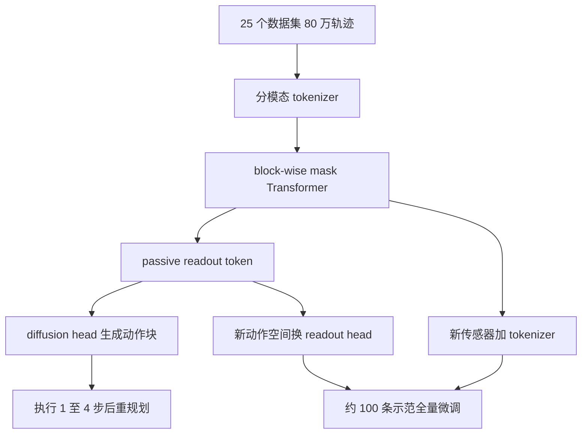

# Day 13 — Octo：开放通用机器人策略与可插拔 diffusion readout

> 📖 阅读版：https://papa-panda.github.io/post-training/physical-ai/day-13-2024-octo/

## 元信息
- Title: Octo: An Open-Source Generalist Robot Policy
- Authors / Org: Octo Model Team / UC Berkeley, Stanford University, Carnegie Mellon University, Google DeepMind（RSS 2024）
- Link / arXiv / Blog: https://arxiv.org/abs/2405.12213 / https://octo-models.github.io/
- Official code: https://github.com/octo-models/octo
- Date read: 2026-09-03
- Tags: [physical-ai, vla, generalist-robot-policy, open-x-embodiment, transformer, diffusion-policy, action-chunking, cross-embodiment, finetuning]
- Thread: physical-ai
- Folder: day-13-2024-octo
- GitHub: https://github.com/Papa-Panda/post-training/tree/master/physical-ai/day-13-2024-octo

## 一句话总结
Octo 把 25 个 Open X-Embodiment 数据集中的约 80 万条轨迹统一成“任务/观测 token → block-masked Transformer → diffusion action chunk”的开放通用策略；它真正有价值的不是零样本万能，而是能在约 100 条目标域示范、单张消费级 GPU 数小时内，适配新传感器、新动作空间和新机器人。

## 大纲
- 问题：25 个数据集的机器人、相机、任务条件与动作空间全不一致，固定 I/O 的策略无法共享预训练权重
- 接口：分模态 tokenizer + block-wise mask 把异构隔离在输入端，passive readout token 把异构隔离在输出端
- 训练：约 80 万条轨迹按人工权重 $q_d$ 混合，diffusion 目标拟合多域示范分布；batch 2048、300k steps
- 适配：新传感器加 tokenizer、新动作空间换 readout head，约 100 条示范 full finetuning 数小时完成
- 证据与边界：微调六设置平均 72%（scratch 20%）；零样本新物体 80%、新场景 40%、新技能仅 5%——强初始化而非技能组合器

## 流程图

## 和之前工作的关系

- **接了哪条线：** Day09 的 RT-2 / OpenVLA 建立 VLA 总览，Day11 的 π₀ 用 flow matching 生成高频 action chunk，Day12 解释了 Diffusion Policy 的条件动作扩散与 receding horizon；Day13 把 Day12 的 diffusion readout 放进跨数据集、跨 embodiment 的通用 Transformer policy。
- **补了哪个短板：** Day12 主要证明单任务/单平台 visuomotor diffusion 的控制收益；Octo 进一步解决输入模态、相机数量、任务条件和 action space 不同导致的接口碎片化，并把“可微调”本身当作架构目标。
- **替代 / 分叉 / 改进：** 相比 Day09 的 action-token VLA，Octo 不把连续动作量化成 token，而保留连续 diffusion head；相比 Day11 的 π₀，Octo 规模更小、语义推理较弱，但代码、checkpoint、数据管线完整开放，且新 observation/action adapter 的边界更清楚。
- **对之前 Day X 的直接对比：** Day12 的核心是 $p(A_t\mid O_t)$ 的多峰建模；Octo 学的是 $p(A_t\mid O_{t-H_o+1:t},c,d)$ ，其中 $c$ 是语言或目标图像， $d$ 是隐含在数据集/机器人分布中的 embodiment 与采集域。它没有显式输入完整动力学参数，所谓 cross-embodiment transfer 仍主要来自数据覆盖和 finetuning，而不是一个严格的 embodiment-invariant controller。

## 为什么今天读它

Day11–14 是 VLA 专题扩展。Octo 是把三个此前分开的部件接成可复现系统的关键节点：Open X-Embodiment 的多源数据、可扩展 Transformer 表征、Diffusion Policy 的连续多峰动作输出。它也直接暴露通用机器人策略的工程真相：输入/输出 schema、mask、数据 mixture、shuffle、action normalization、控制频率和 finetuning contract，往往比“模型更大”更决定能否迁移。

## 今天的 3 问
1. 当 25 个数据集的机器人、相机、语言标注和控制接口不一致时，Octo 如何用 token/mask/readout 结构保留共享表征，同时允许下游替换传感器或 action head？
2. 为什么 diffusion action head 在 WidowX 消融中达到 83%，显著高于 MSE 的 35% 和离散动作交叉熵的 18%；这个收益来自多峰分布、连续精度，还是 action chunk 的时间一致性？
3. 约 80 万条轨迹能带来哪些真正的 zero-shot generalization，哪些能力仍必须靠约 100 条目标域示范微调；怎样用部署 gate 区分“新物体”“新场景”“新技能”和“新 embodiment”？

## 问答补充（2026-09-07）

> 以下问答归档自 physical AI side chat（2026-09-06）的用户主动提问；Day N 推送卡片与提醒类消息已跳过。

### Day13 Octo 如何"结合"起来：三层

**问**：仔细讲一下 day 13 如何结合起来的。

**答**：Octo 的"结合"分三层：输入怎么统一、表示怎么共享、动作怎么生成。问题先摆出来：25 个数据集，机器人、相机数量、传感器、动作空间全不一样，直接拼数据会炸——维度对不上、有的缺语言、坐标系也不同。

**第一层：分模态 tokenizer + mask（输入统一）**。图像走 ViT 切 patch tokens，本体感知走 MLP 投成 tokens，语言走 text embedding，目标图像复用图像 tokenizer。某个数据集缺某个模态（比如没有语言、只有一个相机），就在 attention 里把对应位置 mask 掉。含义：不同 embodiment 只是"缺不同的块"，模型结构完全一样——异构被隔离在了输入端。

**第二层：readout token（表示解耦）**。加几个特殊的 readout token，它们的输出 embedding 喂给动作 head。Transformer 只负责"理解"，readout embedding 是 embodiment 无关的瓶颈表示，head 只认这个表示不认机器人。这就是为什么换新机器人 100 条 demo 就能微调：要调的只是"理解→动作"这个薄映射，理解部分是跨身体共享的。

**第三层：加权混合 diffusion（训练与推理）**。

$$\min_\theta\sum_{d=1}^{25}q_d\,\mathbb{E}_{\tau\sim\mathcal{D}_d}[\mathcal{L}_{\text{diffusion}}(\theta;\tau,d)].$$

$ q_d $ 是各域采样权重； $ \mathcal{L}_{\text{diffusion}} $ 和 Day12 同家族（ $ \mathbb{E}\|\epsilon-\epsilon_\theta(O,A^k,k)\|^2 $ ），一次预测 4 步动作块。推理时大 Transformer 只跑 1 次提特征，轻量 MLP head 做 20 步去噪，输出 $ A_t\in\mathbb{R}^{4\times d_a} $ ，执行 1–4 步后重规划。

**串起来**：数据侧是 Day15 OXE 提供的 80 万轨迹（Octo 是 OXE 的下游消费者），Octo 贡献的是"怎么吃进去"——输入端模块化、中间共享表示、输出端小 head。

**天花板（诚实标注）**：新物体约 80%、新场景约 40%、新技能只有约 5%。Imitation 学的是"数据里接下来怎么动"，mixture 没覆盖的技能在 support 之外，长不出来。所以它的真实定位是强初始化，不是万能策略——这点和 Day14 π₀.₅ 想突破的方向正好接上。

**符号**： $ d $ 数据域编号（共 25 个）； $ q_d $ 第 $ d $ 个域的采样权重； $ \mathcal{D}_d $ 第 $ d $ 个域的数据集； $ \tau $ 采样到的轨迹； $ A_t $ 时刻 $ t $ 的动作块， $ d_a $ 为动作维度； $ O $ 观测； $ A^k $ 第 $ k $ 步加噪后的动作轨迹； $ \epsilon_\theta $ 噪声预测网络。

**与之前工作的关系**：Day13 回答"在什么数据上训"（对照 README 问答记录的 2×2）；它的模块化 readout 接口与 Day14 π₀.₅ 的单 backbone hybrid 路线形成"接口即泛化 vs 配方即泛化"的对照（见 README 问答记录）。

### 追问：Octo 也不是固定硬件吧

**问**：octo也不是吧？（Day16 讨论中的追问：Octo 也不是固定硬件吧？）

**答**：对，Octo 也不是——它恰恰是跨 embodiment 的典型：25 个数据集、约 80 万条轨迹，训练目标里专门有一个机器人域下标 $ d \in \{1,\dots,25\} $ ：

$$\min_\theta\sum_{d=1}^{25}q_d\,\mathbb{E}_{\tau\sim\mathcal{D}_d}[\mathcal{L}_{\text{diffusion}}(\theta;\tau,d)].$$

整个 token/mask/readout 设计就是为了让一个模型吃下多种身体——各模态独立 tokenizer + 缺模态 mask（输入端隔离异构）、readout token（embodiment 无关的瓶颈表示）、加权混合 diffusion head（输出端）。详见本篇"Octo 如何'结合'起来：三层"。

**符号**： $ d $ 数据域编号（共 25 个，对应 25 种机器人身体）； $ q_d $ 第 $ d $ 个域的采样权重； $ \mathcal{D}_d $ 第 $ d $ 个域的数据集； $ \tau $ 采样到的轨迹； $ \theta $ 网络权重； $ \mathcal{L}_{\text{diffusion}} $ diffusion 训练 loss。

## 数学视角：POMDP 上的多域条件行为克隆

### 1) State / observation / action / objective

把第 $d$ 个机器人数据域写成部分可观测动力系统：

$$x_{t+1}=f_d(x_t,a_t,w_t),\qquad o_t=h_d(x_t,v_t),\qquad c\in\{\ell,g\}.$$

- $d\in\{1,\ldots,25\}$ ：预训练数据集/机器人域；不同 $d$ 对应不同动力学 $f_d$ 、相机 $h_d$ 、控制频率和动作标度。
- $x_t\in\mathbb R^{d_x(d)}$ ：真实但未完全观测的机器人、物体与接触状态；维度随 embodiment 改变。
- $o_t$ ：观测字典，通常含第三人称 RGB、可选腕部 RGB、可选 proprioception。Octo 预训练使用两帧历史 $H_o=2$ 。
- $c$ ：任务条件； $\ell$ 是语言指令， $g$ 是未来目标图像。没有语言标注的数据可用 hindsight goal relabeling 构造 $g$ 。
- $a_t\in\mathbb R^{d_a(d)}$ ：连续控制。预训练数据筛到 delta end-effector control 并对齐夹爪语义；发布配置的共享 action 维度为 7，常见解释为 3 维位置增量、3 维旋转增量和 1 维夹爪命令。下游可把 $d_a$ 换成关节位置或双臂 14 维动作。
- $w_t,v_t$ ：未建模动力学扰动与传感噪声。

策略不是学习显式 $f_d$ ，而是在示范混合分布上做条件行为克隆：

$$\pi_\theta(A_t\mid O_t,c),\qquad O_t=o_{t-H_o+1:t},\qquad A_t=[a_t,\ldots,a_{t+H_a-1}]\in\mathbb R^{H_a\times d_a}.$$

Octo checkpoint 使用 $H_a=4$ 的 action chunk。部署可执行整段，也可只执行前 $H_e\le H_a$ 步后重新观测； $H_e=1$ 就是最强反馈的 receding-horizon control。真实控制频率因平台而异：论文中的 finetuning 系统约 5–15 Hz，接触丰富任务还由 1 kHz 低层 impedance controller 跟踪高层命令。

### 2) Token interface：把异构输入变成统一序列

模态 tokenizer 将输入映射到共同 embedding 维度 $D$ ：

$$\mathcal T_\ell=E_\ell(\ell),\qquad \mathcal T_g=E_I(g),\qquad \mathcal T_{o,t}=E_O(o_t),$$

$$E=T_\theta([\mathcal T_c,\mathcal T_{o,t-H_o+1},\ldots,\mathcal T_{o,t},\mathcal T_{R,t}];M)\in\mathbb R^{B\times L\times D}.$$

- $B$ 是 batch size，预训练为 2048； $L$ 是所有 task/observation/readout token 数，随相机和 mask 改变。
- $D=384$ （Octo-Small，27M 参数）或 $768$（Octo-Base，93M 参数），两者都是 12 层 Transformer。
- 第三人称图像缩放为 $256\times256$ ，经 $16\times16$ patch 得到 256 个 image tokens；腕部图像为 $128\times128$ ，得到 64 个 tokens；T5-base 产生 16 个 language tokens。
- $M$ 是 block-wise attention mask：观测 token 只看任务条件和当前/过去时间步；缺失语言、腕部相机等模态被 mask；readout token $\mathcal T_{R,t}$ 可以读取上下文，却不反向污染输入 token。

系统含义是：新相机只需加 tokenizer/position embedding，新动作空间只需加 readout head；主体 Transformer 可继承预训练权重。这里的“通用”首先是接口组合性，不等于任意新形态都可零样本工作。

### 3) Diffusion action objective

令干净动作块为 $A_t^0\in\mathbb R^{B\times H_a\times d_a}$ ，噪声步 $k\in\{1,\ldots,K\}$ ， $K=20$ 。前向加噪：

$$A_t^k=\sqrt{\bar\alpha_k}A_t^0+\sqrt{1-\bar\alpha_k}\,\epsilon,\qquad \epsilon\sim\mathcal N(0,I).$$

Transformer 的 readout embedding $e_t\in\mathbb R^{B\times D}$ 作为条件，三层、hidden size 256 的 MLP diffusion head 预测噪声：

$$\mathcal L_{\text{Octo}}(\theta)=\mathbb E_{d\sim q,\,(O_t,c,A_t^0)\sim\mathcal D_d,\,k,\epsilon}\left[\left\|\epsilon-\epsilon_\theta(A_t^k,e_t,k)\right\|_2^2\right].$$

- $q(d)$ 是人工调过权重的 25 数据集 mixture；更丰富的数据集加权，过度重复的数据集降权。
- $\epsilon_\theta$ 的输出与 $A_t^k$ 同形状，为 $B\times H_a\times d_a$ 。
- 训练用 cosine noise schedule。微调时仍用同一 objective，并更新全模型；论文报告 full finetuning 优于只冻结/更新部分参数。

推理先对视觉/语言上下文跑一次大 Transformer，再只在小 action head 内做 20 步去噪：

$$A_t^{k-1}=\alpha_k\left(A_t^k-\gamma_k\epsilon_\theta(A_t^k,e_t,k)+\eta_k\right),\qquad \eta_k\sim\mathcal N(0,\sigma_k^2I).$$

这继承 Day12 的关键计算分解：昂贵的 context encoding 每个控制周期只做一次，多步采样留在小 head；否则 20 次完整 Transformer forward 很难满足机器人闭环时延。

### 4) 多域训练与迁移的统一视角

预训练优化的是 mixture risk：

$$\min_\theta\;\sum_{d=1}^{25}q_d\,\mathbb E_{\tau\sim\mathcal D_d}\left[\mathcal L_{\text{Octo}}(\theta;\tau,d)\right].$$

下游域 $d^\star$ 只有约 100 条示范时，从 $\theta_{\text{pre}}$ 初始化并继续优化：

$$\theta^\star=\arg\min_\theta\;\mathbb E_{\tau\sim\mathcal D_{d^\star}}[\mathcal L_{\text{Octo}}(\theta)],\qquad \theta\leftarrow\theta_{\text{pre}}.$$

迁移收益可理解为：backbone 已学到视觉-任务-动作的共享低维结构，下游只需校准新传感器、动作坐标与局部任务分布。但若 $f_{d^\star}$ 、技能支持集或 observation semantics 超出预训练覆盖，低 loss 并不保证闭环成功。

### 5) 假设与数学没有覆盖的真实误差

上面的 POMDP/BC 模型隐含假设：不同数据集的时间同步可靠，动作单位/坐标系可对齐，成功示范覆盖部署状态，语言或目标图像足以消除任务歧义。它没有显式建模 camera calibration drift、控制频率不一致、动作延迟、backlash、接触冲击、夹爪力、object mass/friction、operator style、失败恢复和安全约束。

论文的实证也暴露这些边界：只有 27% 预训练数据含 wrist camera，56% 含语言标注；新场景成功率下降，新技能更差。模型在 imitation objective 下只学“数据里接下来怎么动”，没有 reward、动力学可达性或 constraint satisfaction 保证。部署仍需要 schema validator、时间戳/坐标系检查、低层反馈控制、限位/限力、collision shield、OOD gate 和分桶闭环评测。

## 核心

1. **Motivation：通用策略的瓶颈不只是规模，而是 I/O contract**
   - 机器人数据横跨相机布局、任务定义、action space 和 embodiment；固定输入顺序或固定输出头会让预训练权重难以复用。
   - Octo 用 modality tokenizer + block-wise mask + readout token 解耦输入、backbone 与输出，使下游新增传感器或动作头时不必重置大部分模型。
   - 目标是“可适配的开放初始化”，而不是声称一个模型零样本解决所有机器人任务。

2. **System / Method：Transformer-first backbone + modular diffusion head**
   - 语言用 frozen T5-base，图像用浅层卷积 stem + patch tokens；绝大多数参数/FLOPs 放进 Transformer，而不是大 ResNet encoder。
   - readout token 汇总任务和历史观测，再由小 diffusion MLP 联合生成连续 action chunk；缺失模态通过 mask/zero padding 处理。
   - Transformer 每次动作预测只 forward 一次，20 步去噪都在轻量 head 内完成；这是把生成模型塞进控制 loop 的关键系统设计。

3. **Training / Data Details：80 万轨迹的 mixture 工程决定可迁移性**
   - 从 Open X-Embodiment 约 150 万 episodes 中筛出 25 个含图像、delta end-effector action 且行为多样的数据集，共约 80 万轨迹；RT-X 对照使用约 35 万。
   - 更丰富的数据集加倍权重，重复性高的数据集降权；统一夹爪语义（+1 open，0 closed），缺失相机通道 zero-pad。
   - 随机丢弃 language 或 goal-image 条件，使同一模型支持两种 task specification；无语言数据用 future-state goal image。
   - Octo-Base 以 batch 2048、TPUv4-128、300k steps 训练约 14 小时；目标域微调约 100 条轨迹、50k steps，单张 24GB A5000 约 5 小时。

4. **Key Tricks：最值得抄的细节**
   - **Trick 1 — passive readout token：** 输出 token 读取上下文但不被输入 token 反向注意，新增 action head 时可保持 pretrained representation 的结构稳定。
   - **Trick 2 — 先打通 schema，再谈 scale：** camera mask、gripper convention、delta action、goal relabeling 和 dataset mixture 都是模型 contract；任何一项漂移都可能让“跨 embodiment”退化成数据混乱。
   - **Trick 3 — 4-step chunk + receding horizon：** 联合预测多步提高动作连贯性，部署端可选择执行 1–4 步来交换反馈带宽与推理成本；论文未发现 temporal ensembling 比 receding horizon 更有额外收益。
   - **Trick 4 — 大 shuffle buffer：** 将不同轨迹的 frame 在解码前交错，shuffle buffer 从 20k 扩到 500k，并限制每条长轨迹最多抽 100 steps，避免 batch 被少数 trajectory 挤占。
   - **Trick 5 — full finetuning：** 新 observation/action space 下，全模型继续训练优于只调 head；模块化接口降低改造成本，但 representation 仍需随目标域校准。

5. **Results：强迁移，但不是无限泛化**
   - 9 个机器人平台、4 家机构；in-distribution zero-shot 中，Octo 平均成功率比开放的 RT-1-X 高 29%，在部分 WidowX/RT-1 robot 任务上与 55B RT-2-X 相近。
   - 六个约 100-demo 的目标域微调设置平均成功率 72%，显著高于 scratch 20% 和 VC-1 15%；论文表述为比次优 baseline 平均高 52 个百分点。
   - WidowX 消融：完整 Octo-Small 83%，缩窄 RT-X mixture 60%，只用单机器人 Bridge Data 43%；diffusion head 83%，MSE 35%，离散动作 18%。
   - 真正的零样本边界清楚：in-distribution 85%，novel objects 80%，novel environment 40%，novel skill 5%。它更像强 initialization，而不是已有新技能组合器。
   - 数据缺口直接映射成模型缺口：wrist camera 只占 27%、language annotation 只占 56%，相应模态表现也不稳定。

## 可迁移 / Transfer

- **方法在 held-out 上是否 transfer？模型 vs 框架哪个贡献更大？** 新物体 transfer 较强，新场景下降，新技能几乎失败；约 100 条目标域示范后的迁移则很强。消融显示数据 breadth、diffusion objective 和 Transformer-first 架构都贡献明显，不能把收益只归因于参数量。
- **对你 Infra → Post-training → Physical AI 迁移的直接启发：**
  1. 通用机器人 post-training 的核心对象应是带 schema 的 trajectory mixture，不只是 token 数：每条数据要携带 embodiment、camera set、action frame/unit、control rate、success/failure 和 mask。
  2. rollout/eval infra 要把 adapter correctness 与 policy quality 分开诊断；先验证 shape、timestamp、坐标系和 action saturation，再看 task success，否则模型问题和接口问题会混在一起。
- **Infra 视角：可扩展性 / 成本 / 评测自动化 / 可复现性：** 训练需要多数据集并行读取、解码前 shuffle、每域采样权重和缺失模态 mask；部署要记录 `observation age → transformer latency → 20-step head latency → action queue → controller tracking error`。建议评测矩阵按新物体/新场景/新技能/新 embodiment 分桶，并把 p50/p95 latency、schema validation failure 和 safety intervention 与成功率并列。

## 疑问 / 下一步

- **没看懂 / 想深挖：** 如果把数据 mixture 权重 $q_d$ 从手调变成基于 gradient conflict、coverage 或 downstream validation 的自适应优化，能否在不增加总轨迹数的情况下改善 novel-scene / novel-skill transfer？这与 model-aware data curation 的 gradient-space 视角可以直接连接。
- **如果要复现 / 小规模试，第一个实验做什么？** 不直接复现 1.2TB 预训练；先用官方 checkpoint 跑 inference shape smoke test，打印 `observation/task/action` spec，再用一个小 RLDS 数据集做 full 与 head-only finetuning，对比 validation diffusion loss、闭环 success、动作 jerk 和 p95 inference latency。
- **下一步：** Day14 读 $\pi_{0.5}$ ，重点看 open-world generalization、co-training 与 knowledge insulation 如何处理 Octo 暴露的新场景/新技能短板。

## 原文金句 (1-2句)
> “Our evaluation highlights the utility of scale and flexibility: our best models are those trained on the widest data mixtures, with the least restrictive inductive biases, and with policy objectives that can fit the diversity of behaviors in the pretraining data.”

> “This flexibility is crucial to make Octo a truly ‘generalist’ model: since we cannot cover all possible robot sensor and action configurations during pretraining, being able to adapt Octo’s inputs and outputs during finetuning makes it a versatile tool for the robotics community.”

## 今晚产出
- [ ] 跑 `OctoModel.load_pretrained` + `get_pretty_spec()`，确认两帧 observation、task mask 与 `(4, d_a)` action chunk
- [ ] 画 `task/image tokenizers → block-wise Transformer → passive readout → 20-step diffusion head → execute H_e` 数据流图
- [ ] 用一个小 RLDS 数据集跑 debug finetuning，比较 `full` 与 `head_only` 的 loss、显存和训练时间
- [ ] 写 schema validator：检查相机键、timestamp、action shape/unit/frame、gripper convention 和 pad masks
- [ ] 设计四桶闭环评测：novel object / scene / skill / embodiment，并同时记录 success、jerk、p95 latency、safety intervention

## 连接
- 上一篇: Day12 — Diffusion Policy（条件动作扩散 + receding-horizon control）
- 下一篇预告: Day14 — $\pi_{0.5}$ （open-world VLA + co-training / knowledge insulation）
- 相关: Day09 RT-2 / OpenVLA；Day11 $\pi_0$ ；Day15 Open X-Embodiment / RT-X

## 参考链接
- Paper: https://arxiv.org/abs/2405.12213
- Project: https://octo-models.github.io/
- Official code: https://github.com/octo-models/octo

<!-- viz:stats: 27M Octo-Small | 93M Octo-Base | 2048 batch TPUv4-128 300k steps 约 14 小时 -->
<!-- viz:bars: diffusion head 83% | MSE 35% | 离散 CE 18% -->

<!-- viz:bars: 分布内 85% | 新物体 80% | 新场景 40% | 新技能 5% -->

## 第二轮复习（2026-10-16）

> 本轮补两处口径（零样本四桶数字的出处与样本量、v1.5 checkpoint 的后续发布）＋补大纲与流程图（初读缺失，本轮补齐）。核心收获：把 Day13 从「开源版通用策略」重读为**接口层**的确立——Octo 的「通用」首先是一个 schema 与 adapter 合同，其次才是能力；它证明了异构可以被隔离在输入端与输出端，但也用 full finetuning 优于 head-only 这个自家消融承认：表示本身并不冻结，接口模块化买到的是改造便宜，不是零成本迁移。

### 元信息修正

1. **零样本四桶数字的口径钉死**：初读正文写的「in-distribution 85%、新物体 80%、新场景 40%、新技能 5%」出自论文 Table VII，对象是 **Octo-Small 在 WidowX 单平台**上的测试，每桶只有 2 个任务、每任务 20 次试验（每桶共 40 次）。这是方向性证据，不是大样本统计结论；引用时必须带「Small / WidowX / 每桶 40 trials」，不能当作 Octo-Base 的跨平台泛化率。
2. **版本与后续发布**：arXiv 现行版为 v2（2024-05-26 修订），论文正式发表于 RSS 2024（Delft）；初读元信息无误但未注版本。另补一条初读时不存在的事实：官方仓库后续发布了 v1.5 checkpoint（ `octo-small-1.5` / `octo-base-1.5` ，托管于 HuggingFace `rail-berkeley` ），现行 `load_pretrained` 示例默认指向 1.5 版——复现实验时要先确认用的是哪一代权重，两代不可混引。
3. **定位校准**：初读把 Octo 记成「π₀ 的开源小号对照」；复习校准为**接口层**——Day09 是语义层（动作 token 化），Day11/12 是生成层（连续动作块怎么采样），Day13 回答的是生成层之外的另一半问题：异构数据与异构身体如何插进同一个 backbone。它与 Day14 的分工是「接口即泛化 vs 配方即泛化」，不是同层竞争。

### 一句话总结

三十多天后回看，Day13 的耐久贡献是把「通用机器人策略」从一句口号拆成三件可记账的工程：输入端用 tokenizer + mask 吸收异构、中间用 readout token 划出表示与动作的接缝、训练侧用手调 mixture 权重 $q_d$ 决定模型到底在拟合哪个分布；它交付的不是零样本万能，而是一个能在约 100 条示范内完成再校准的强初始化——泛化的上限由 mixture 的支持集决定，不由架构决定。

### 和之前工作的关系

- **vs Day12 Diffusion Policy（直接对比，同专题相邻篇）**：Day13 的 diffusion head 与 Day12 同家族、同目标函数，唯一实质变化是条件从单机观测 $O_t$ 换成多域混合下的 readout 表示 $e_t$ 。连读两篇的结论很硬：动作生成数学在 Day12 就已定型，Day13 的全部增量都在它之外——数据接口、mask 语义、mixture 权重、微调合同。这再次印证 Day12 复习的判断：2023 年后这个专题的进步顺序是先生成、再接口、再配方。
- **vs Day15 Open X-Embodiment / RT-X（跨阶段，数据段）**：Octo 是 OXE 的下游消费者，Day15 是它的数据来源本身。Day13 的 mixture 权重 $q_d$ 是手调的（丰富者加权、重复者降权），Day15 的 RT-X 则证明同一批数据换一种训练配方就能得到不同的跨 embodiment 行为——两篇拼起来说明：OXE 的价值不在「数据量」而在「带 embodiment 与采集域标注的混合分布」，而 $q_d$ 至今没有原理化的设定方法，是数据 curation 的开放债。
- **vs Day24 系统辨识（跨阶段，sim2real 段）**：Day24 一系把动力学参数显式化（辨识出摩擦、质量再喂给策略），Octo 则把 embodiment 差异全部隐式压进权重与 $d$ 的分布身份里，没有任何显式动力学参数。代价在边界一节会看到：新身体超出预训练覆盖时，隐式路线没有任何可单独校准的旋钮，只能靠 100 条示范整体再拟合；显式路线慢但可诊断，隐式路线快但不可归因。
- **vs Day30 数据飞轮（跨阶段，eval / safety 段）**：Octo 的「预训练 → 约 100 条示范微调 → 分桶评测」其实就是 Day30 飞轮里 retrain 一环的手工原型：差别是 Day30 要求失败先 triage 再决定 recollect / resimulate，而 Octo 的微调合同默认「新域一律全量微调」，没有失败归因环节。把 Day30 的 gate 套回 Day13，正好补上它缺的那一课：先分清是 schema 错位、覆盖不足还是技能缺失，再决定微调、补数据还是拒部署。
- **跨阶段 vs Day34 π0.7（最新进展段）**：Day13 零样本新技能只有 5%，是整条路线最刺眼的一个数字；Day34 的组合泛化（做没教过但可由已学技能组合出的任务）正是冲着这 5% 来的。两篇相隔 21 天读，问题意识完全连续：BC 混合分布的支持集是并集不是组合闭包，要突破就必须在条件结构或数据构造上做组合，而不能指望 scale 自己长出来。

### 核心

1. **动机重读：通用性的第一瓶颈是 I/O contract，不是参数量**：25 个数据集之间对不齐的是相机数、坐标系、夹爪语义、控制频率与动作标度——这些是 schema 问题，模型再大也绕不过。Octo 的解法是把异构推到两端：输入端每模态独立 tokenizer + 缺模态 mask，输出端 readout token 之后才接 embodiment 相关的 head，中间 backbone 只处理统一 token 序列。这是整篇最可迁移的设计：先让接口可组合，再谈表示是否共享。
2. **机制深挖：readout token 是一道「接缝」，不是免费的解耦**：readout 只读上下文、不被输入 token 反向注意，于是换 head 时 backbone 的输入侧结构不动。但论文自己的消融说 full finetuning 优于只调 head——这意味着接缝两侧的表示仍是共同适应的，readout  embedding 并不是 embodiment 无关的语义瓶颈（初读问答里「薄映射」的说法要打折）。准确的说法是：模块化降低的是改造成本与回归风险，不是把迁移变成零梯度适配；把它读成「冻结 backbone + 换头即用」是过度推销。
3. **机制深挖： $q_d$ 才是这个系统真正的「架构」**：混合目标 $\sum_d q_d \, \mathbb{E}_{\mathcal{D}_d}[\mathcal{L}]$ 里，架构决定可表示的函数类， $q_d$ 决定实际被拟合的分布。WidowX 消融里 mixture 从全量缩到 RT-X 子集掉 23 个点（83% → 60%）、再缩到单机器人 Bridge 掉到 43%，跌幅大于任何架构消融——数据混合比就是这个系统里最贵的超参数，而它至今靠手调。谁掌握 $q_d$ 的设定方法，谁就掌握了通用策略的实际行为。
4. **机制深挖：支持集论证解释 85 / 80 / 40 / 5 的全部形状**：BC 拟合的是混合分布下「数据里接下来怎么动」，新物体落在已有技能的视觉邻域内（插值），新场景要求对背景与布局外推（弱外推），新技能要求轨迹模式的组合（支持集之外）。四个数字的落差不是四个独立现象，而是同一条「离支持集越远、掉得越狠」的曲线。这也预言了它的修复路径只有两条：扩支持集（采更多组合数据）或改条件结构让组合可表达（Day14 的高层子任务条件、Day34 的组合泛化都在这条路上）。

### 边界

1. **证据没有证明什么**：零样本四桶出自 Octo-Small、WidowX 单平台、每桶 40 次试验，置信区间很宽，不能外推为「Octo 的新技能泛化率是 5%」这种全称结论；微调平均 72% 是六个约 100-demo 设置的均值，各设置的任务难度与基线不可比。它证明的是「同一初始化在多类新域上可被便宜地再校准」，没有证明 zero-shot 通用，也没有证明 readout 表示 embodiment 无关（full FT 消融恰恰是反证方向）。
2. **何时失效**：目标域的动力学、观测语义或技能支持超出预训练 mixture 覆盖时，低 diffusion loss 与闭环成功脱钩——loss 只度量「像不像示范」，不度量可达性与约束；语言标注只覆盖 56% 数据、腕部相机只占 27%，依赖这些模态的下游任务会继承数据缺口而非模型能力。
3. **系统边界**：没有 reward、没有安全约束、没有失败恢复；「消费级 GPU 数小时」的前提是目标域示范已按 Octo 的 schema（delta 末端控制、夹爪语义对齐）采集完毕，真实部署里 schema 对齐与数据清洗往往比微调本身更耗时——接口层的成本没有消失，只是从训练前移到了数据接入环节。

### 迁移到 post-training / Agentic RL Infra

可执行的同构：把 agentic post-training 的多源轨迹管线按 Octo 的三件套重构，并逐项记账。其一，**每条轨迹自带 schema 描述符**：来源域、工具集版本、动作（工具调用）空间、观测模态与缺失 mask、成功/失败标签，缺字段的数据在接入层就被拒，不许进 mixture——对应 Octo 的 tokenizer + mask 合同。其二，**mixture 权重 $q_d$ 从手调改为受控实验对象**：每个数据源设权重版本，按下游分桶验证集（新实体 / 新上下文 / 新任务型 / 新工具 API 四桶，正是 Octo 四桶的 agent 版）做权重消融并记录，而不是凭数据量默认配比。其三，**适配新域走 Octo 式两段合同**：先只训「薄适配层」（新工具的调用格式映射 + 系统提示侧适配）测一遍，若分桶评测显示表示层也不匹配，再升级为全量继续训练，并用 full-vs-thin 的差值决定以后同类新域的默认档位——把 Day13 「full 优于 head-only」的教训变成一条可复用的决策规则，而不是每次重新争论。

### 思考题（综合 Day12 / Day13 / Day15 / Day30 / Day34）

- **(a) $q_d$ 的原理化设定**：Day13 的 mixture 权重靠手调，Day15 说明同一批 OXE 数据换配方行为就变。若把 $q_d$ 改为按「各域对下游四桶验证集的边际贡献」在线调整，怎样避免权重塌缩到最易拟合的大域、把稀有 embodiment 饿死？请给出一个带下限约束或覆盖正则的更新规则，并说明你用什么观测量判断它优于手调权重。
- **(b) 给 Octo 接上 RL 会先修好哪一桶**：Day13 四桶是 85 / 80 / 40 / 5。若在 Octo 初始化上按 Day20 的思路加在线 RL（示范常驻 replay + $Q$ 学习），你预判哪一桶涨幅最大、哪一桶几乎不动？请用支持集论证回答：RL 能爬出示范分布的机理对「新场景」与「新技能」为何不对称，并指出这个预判被什么实验结果证伪。
- **(c) 微调前的 triage 门**：Day30 要求失败先归因再行动。给一个 Octo 式系统设计部署前 gate：目标域闭环失败时，如何用只读诊断（schema 校验、观测分布距离、readout 表示邻域密度、试探性 thin-adapt 前后差值）区分「接口错位」「覆盖不足」「技能缺失」三类病因，并分别映射到换 adapter、补采数据、拒绝部署三种处置？请说明每一类病因至少一个不可互相冒充的判别信号。

参考链接（本轮复习）：
- Octo 论文（arXiv v2，RSS 2024）：https://arxiv.org/abs/2405.12213
- Octo 官方代码与 v1.5 checkpoint 说明：https://github.com/octo-models/octo
- RSS 2024 论文集条目（Octo）：https://enriquecoronadozu.github.io/rssproceedings2024/rss20/p090.pdf

GitHub NOTES：https://github.com/Papa-Panda/post-training/blob/master/physical-ai/day-13-2024-octo/NOTES.md
