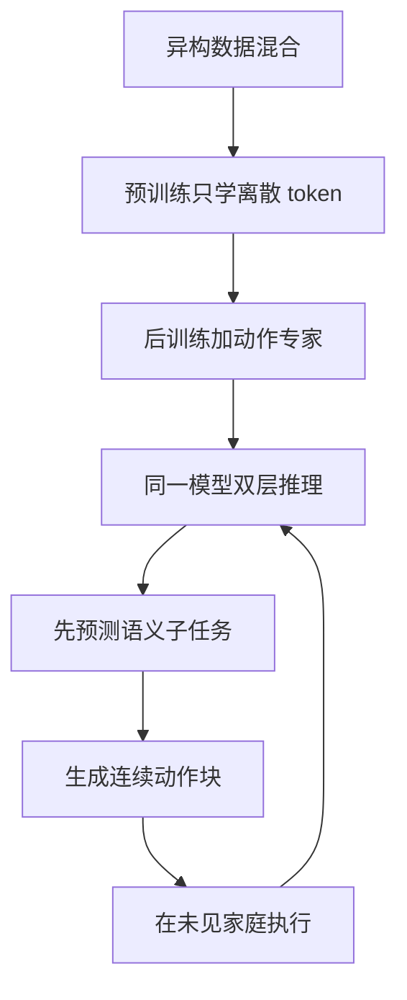

# Day14 — π₀.₅: a Vision-Language-Action Model with Open-World Generalization

> 📖 阅读版：https://papa-panda.github.io/post-training/physical-ai/day-14-2025-pi05-open-world/

> Physical Intelligence, arXiv 2504.16054 (2025-04-22). π₀的开放世界续作：异构 co-training + 高层语义子任务预测 + knowledge insulation，在未见过的真实家庭做长程灵巧操作。

## 元信息
- Title: π₀.₅: a Vision-Language-Action Model with Open-World Generalization
- Authors / Org: Physical Intelligence (Kevin Black, Noah Brown, Danny Driess, Chelsea Finn, Karol Hausman, Brian Ichter, Sergey Levine, Karl Pertsch 等 35 人)
- Link / arXiv / Blog: https://arxiv.org/abs/2504.16054 （2025-04-22）；项目页 https://www.pi.website/blog/pi05；代码 https://github.com/Physical-Intelligence/openpi
- Date read: 2026-09-05
- Tags: [physical-ai, vla, open-world-generalization, pi05, co-training, flow-matching, fast-tokenization, subtask-prediction, mobile-manipulation, knowledge-insulation]
- Thread: physical-ai
- Folder: day-14-2025-pi05-open-world
- GitHub: https://github.com/Papa-Panda/post-training/tree/master/physical-ai/day-14-2025-pi05-open-world

## 一句话总结
π₀.₅ 在 π₀ 的 VLM + flow-matching action expert 基础上，用**异构 co-training**（多机器人数据 + web/VLM 数据 + 高层语义子任务预测 + 目标检测 + hybrid 多模态样本）加**两阶段 knowledge insulation** 训练 recipe，首次让端到端 VLA 在**完全没见过的真实家庭**里完成长时程灵巧任务（clean kitchen / bedroom），并在测试时显式做高层子任务推理。

## 大纲
- 问题： π₀ 的泛化止步于已见环境；真实家庭要求物理、视觉、语义三个层级同时泛化，靠堆目标域机器人数据不可行
- 配方：约 400 小时移动操作数据（MM）+ 多环境静态数据（ME）+ 跨 embodiment 实验室数据（CE）+ 高层子任务标注（HL）+ web 多模态数据（WD），第一阶段 97.6% 的样本不来自目标移动平台
- 两阶段：预训练 280k 步只用 FAST 离散动作 token；后训练 80k 步才加入随机初始化的 flow matching 动作专家，并保留 web 数据与文本预测防遗忘
- 推理：同一模型先自回归预测语义子任务，再以子任务为条件生成 50 步（1 秒）连续动作块，形成慢语义环 + 快控制环
- 证据与边界：训练地点从 3 增至 104 时未见家庭表现逼近「直接在测试家庭训练」的基线；定量主战场是 mock 家庭，真实家庭只有 3 个；显式高层推理的收益小于训练期混入 HL 数据的收益

## 流程图

## 和之前工作的关系

- 接了哪条线：Day09 VLA 总览 → Day11 π₀（flow-matching 连续动作专家）→ Day14 开放世界泛化，是 π₀路线的直接续作。
- 补了哪个短板：Day11 的 π₀ 强在 in-lab / 已见场景的高频精细操作，但泛化止步于"新物体、已知环境"；π₀.₅ 把泛化边界推到"**新环境、新家庭**"和**长时程（多分钟）任务**。
- 替代 / 分叉 / 改进：
  - 相对 Day09 RT-2/OpenVLA 的**离散 action token 路线**：π₀.₅ 没有放弃 token，而是把 FAST 离散 tokenization（IV-B combining discrete & continuous）和 flow matching 连续动作专家**同时保留**——离散 token 服务预训练效率与 VLM 兼容，连续 flow 服务控制精度。两条路线合流而不是二选一。
  - 相对 Day12 Diffusion Policy 的 receding-horizon：π₀.₅ 的重规划之上又加了一层**高层语义子任务重规划**（slow outer loop），形成"子任务 → action chunk → 执行短前缀"双层闭环。
  - 相对 Day13 Octo 的模块化 readout：π₀.₅ 反其道而行——用**同一个 backbone 同时**做语义预测和动作生成（hybrid examples），把泛化归因于训练配方而不是接口插拔。
- 对之前 Day X 的直接对比：Day09-13 的泛化论证都停留在"训练分布内/邻域的桌案任务"，π₀.₅ 的论文标题就是 open-world generalization，评估直接搬到 4 个未见过的真实家庭；它的核心变量是**训练混合配方的成分设计**，不是更大的模型。

## 为什么今天读它
路线图中 Day11–14 是 VLA 专题扩展的闭环收尾（Day09/10 总览 → Day11-14 专题）。Day11 学了流匹配动作专家、Day12 学了扩散动作、Day13 学了模块化泛化策略，π₀.₅ 把"**如何让 VLA 离开实验室**"这一真实产品问题的训练 recipe 补齐，是 VLA → 真实部署的关键一站。它的 co-training 配方思想（异构数据源混合）也是后天 Day15–18（Open X-Embodiment / DROID / BridgeData）机器人数据规模化的直接前置。

## 今天的 3 问
1. π₀.₅ 的异构 co-training 配方里，**每个成分（多机器人数据、web 数据、高层子任务预测、目标检测）分别补了哪一类泛化**？ablation 显示缺了哪个最致命？
2. "Knowledge insulation" 到底在绝缘什么？预训练混合与 post-training 的分工如何防止机器人数据把 web 语义"洗掉"？
3. 高层语义子任务预测为什么要在**测试时**也显式做（high-level inference）？它相对直接输出动作的增益来自哪里，代价是什么？

## 问答补充（2026-09-07）

> 以下问答归档自 physical AI side chat（2026-09-06）的用户主动提问；Day N 推送卡片与提醒类消息已跳过。每个条目保留问题原文（精简）、核心答案与符号定义。

### Day14 π₀.₅：把"想"和"做"分开

**问**：day 14（接着 Day13 的短板往下走）。

**答**：思路是**把"想"和"做"分开**。问题先摆出来：π₀ 能做好"拿起杯子"这种短任务，但"收拾整个桌子"这种长程任务会漂——语言指令太粗（之前聊过的"语言太模糊"），一个指令对应几十步动作，中间任何一步理解偏了就全塌。

**π₀.₅ 的答案：分层策略**。

$$\pi_\theta(s_t,A_t\mid o_t,\ell)=\pi_\theta^H(s_t\mid o_t,\ell)\,\pi_\theta^L(A_t\mid o_t,\ell,s_t).$$

高层 $ \pi^H $ 慢，输出是**语言**：输入观测和长指令 $ \ell $ （如"收拾桌子"），输出语义子任务 $ s_t $ （如"先拿起杯子"）；因为输出是语言，它可以靠 web/VLM 数据训，不需要机器人演示。低层 $ \pi^L $ 快，用 flow matching 生成连续动作块 $ A_t $ ，条件是 $ (o_t,\ell,s_t) $ ——在"拿起杯子"这个明确子目标下学生成动作。

**为什么分层有效（方差分解）**：

$$\mathrm{Var}(A\mid o,\ell)=\mathbb{E}_s[\mathrm{Var}(A\mid o,\ell,s)]+\mathrm{Var}_s(\mathbb{E}[A\mid o,\ell,s]).$$

左边是直接从"收拾桌子"预测动作——方差巨大（先拿杯子还是先拿盘子？）。拆开后：第一项，给定子任务"拿起杯子"，动作分布变窄了，低层只学"怎么拿"；第二项，"先干哪件"的不确定性被搬到离散的语言空间，正好是 VLM 的强项。直觉：**把高层多模态塞进语义变量，低层只剩窄的连续分布**。

**数据配方（异构 co-training）**：

$$\mathcal{L}(\theta)=\sum_{k\in\{\mathrm{robot,subtask,web,det}\}}w_k\mathcal{L}_k(\theta).$$

robot 训低层动作头，subtask 训高层"怎么拆任务"，web 保住 VLM 语义不被洗掉，det（目标检测）补空间定位；外加 FAST 离散动作 token 和连续 flow expert 并存——离散管语义对齐，连续管精度。

**与 Day13 的关系**：Octo 解决"多种身体吃一种数据接口"（管宽度/身体），π₀.₅ 解决"长任务怎么拆"（管长度/时间）——高层靠 VLM 的组合泛化，把没见过的长流程拆成见过的短原子，低层只管执行。

**诚实标注**：论文说的"knowledge insulation"两阶段训练，到底是只有数据混合+两阶段配方，还是有显式的参数隔离/冻结/adapter——仍是 open question（待精读 IV-C/IV-D），先不把它说死。

### 修正/澄清：三个核心公式的符号全定义

**问**：你给数学很好，但你要说清楚每个字母的含义是啥啊。

**答**（逐字母重推导；此前公式只给数学不给符号定义是硬伤）：

**公式一：分层策略**

$$\pi_\theta(s_t,A_t\mid o_t,\ell)=\pi_\theta^H(s_t\mid o_t,\ell)\,\pi_\theta^L(A_t\mid o_t,\ell,s_t).$$

- $ \pi $ ：策略，就是一个条件概率分布，"看到什么→以多大概率做什么"；
- $ \theta $ ：神经网络的全部权重参数， $ \pi_\theta $ 读作"由 $ \theta $ 参数化的策略"；
- $ s_t $ ： $ t $ 时刻的高层子任务，一句自然语言，如"先拿起杯子"；离散的，慢时间尺度（几秒一切换）；
- $ A_t $ ： $ t $ 时刻开始的动作块，一个连续矩阵 $ A_t\in\mathbb{R}^{H\times d_a} $ ； $ H $ 是 chunk 长度（π₀ 里取 50）， $ d_a $ 是动作维度（如 7 维关节/末端）；快时间尺度（50Hz 控制）；
- $ o_t $ ： $ t $ 时刻的观测（多视角图像 + 本体感知关节状态）；
- $ \ell $ ：长程语言指令（如"收拾桌子"），整个任务期间不变，是 episode 级别（几分钟）；
- 上标 $ H $ / $ L $ ：High 高层 / Low 低层； $ \mid $ 读作"在…条件下"；中间的乘号是链式法则：联合分布 = 高层分布 × 低层分布。

**公式二：方差分解**

$$\mathrm{Var}(A\mid o,\ell)=\mathbb{E}_s[\mathrm{Var}(A\mid o,\ell,s)]+\mathrm{Var}_s(\mathbb{E}[A\mid o,\ell,s]).$$

- $ \mathrm{Var} $ ：方差，衡量一个分布有多"散"——可能的动作越多，方差越大；
- $ \mathbb{E}_s $ ：对子任务 $ s $ 取平均；
- 第一项：**给定**子任务之后还剩多少动作不确定性（"怎么拿"的方差）；
- 第二项：子任务**本身**带来的不确定性（"先拿哪个"的方差）；
- 这里 $ A,o,\ell $ 含义同公式一，只是省略了 $ t $ 下标，泛指一般时刻。

**公式三：混合训练目标**

$$\mathcal{L}(\theta)=\sum_{k\in\{\mathrm{robot,subtask,web,det}\}}w_k\mathcal{L}_k(\theta).$$

- $ \mathcal{L} $ ：训练 loss，一个标量，越小越好；
- $ k $ ：数据成分的编号；花括号里是四种数据源：robot（机器人演示）、subtask（子任务标注）、web（互联网图文）、det（目标检测数据）；
- $ w_k $ ：第 $ k $ 种数据的混合权重，超参数（论文没公开具体值，这是它的短板）；
- $ \mathcal{L}_k $ ：第 $ k $ 种数据上的 loss，比如 robot 上是 flow matching 的速度场 loss，web 上是语言模型的交叉熵。

三个时间尺度串起来： $ \ell $ （分钟级，一句话）→ $ s_t $ （秒级，一句子任务）→ $ A_t $ （毫秒级，50 步连续动作）。

### 追问：π₀.₅ 也是固定硬件吗

**问**：pi 0.5是吗（Day16 讨论中的追问：π₀.₅ 也是固定硬件吗？）

**答**：不是。π₀.₅ 恰恰是跨 embodiment 那一路：它的训练数据是 π₀ 的 10k+ 小时多机器人数据，加上新增的移动操作平台家庭采集，再混 web 和检测数据。它的"泛化"赌的是**数据配方**（异构 co-training），不是固定硬件：

$$\mathcal{L}(\theta)=\sum_{k\in\{\mathrm{robot,subtask,web,det}\}}w_k\mathcal{L}_k(\theta).$$

$ k $ 数据源编号（robot / subtask / web / det 四类）； $ w_k $ 第 $ k $ 类数据的混合权重； $ \mathcal{L}_k $ 第 $ k $ 类数据上的 loss； $ \theta $ 网络权重。

和 Day16 DROID 正好是两个方向：DROID 固定身体、扩张场景多样性；π₀.₅ 拥抱身体异构，靠配方让共享表示自己长出"语义"和"控制"的分工——这正是 README 问答记录里"接口即泛化（Octo）vs 配方即泛化（π₀.₅）"对照的另一面。

## 数学视角：统一成一个双层时间尺度的条件生成控制问题

把 Day11 的 POMDP 扩展成**分层（options/层次化）POMDP**：观测 $o_t=[I_t,\ell_t,q_t]$ 不变，语言指令 $\ell$ 变成长程任务（如"打扫厨房"），模型内部生成一个慢变量——语义子任务 $s_t$ （如"拿起海绵"、"擦桌子"），再由快变量动作块 $A_t$ 落实到关节。

### 1) State / observation / action / objective

- 慢层 policy： $\pi^H(s_t\mid o_t,\ell)$ ，输出为**自然语言子任务 token 序列** $s_t=(w_1,\ldots,w_M)$ ，时间尺度秒级（每个子任务持续数秒到数十秒）。
- 快层 policy： $\pi^L(A_t\mid o_t,\ell,s_t)$ ，输出动作块 $A_t\in\mathbb R^{H\times d_a}$ （沿用 Day11 的 $H=50$ 块），时间尺度毫秒级，移动操作平台在 20–50 Hz 执行。
- 联合行为克隆目标同时匹配两个条件分布：

$$\pi_\theta(s_t,A_t\mid o_t,\ell)\approx p_{\mathcal D}(s_t,A_t\mid o_t,\ell)=p(s_t\mid o_t,\ell)\,p(A_t\mid o_t,\ell,s_t).$$

这个分解是 π₀.₅ 相对 π₀ 的关键加法：示范数据中多了高层 annotation（mobile manipulation 采集时标注的 segment 级语义子任务，约 2 秒粒度——Day11 π₀ 里已有 segment annotation 的影子，这里被正式做成训练信号和推理输入）。

### 2) Co-training 混合目标：一个 loss，多路知识

论文的训练混合包含四类样本，每类对应一个 loss 项，混合权重 $w_k$ 就是 recipe 的核心超参：

$$\mathcal L(\theta)=\sum_{k\in\{robot,subtask,web,det\}} w_k\,\mathcal L_k(\theta).$$

- $\mathcal L_{robot}$ ：低层动作行为克隆，Day11 的 flow matching loss $\mathcal L_{FM}$ （连续动作专家）与 FAST 离散 token 的交叉熵 loss 并存，对应 IV-B 的 discrete & continuous 结合：同一个动作块既被 tokenize 进语言词表参与 VLM 训练，又被 flow expert 拟合为连续分布。
- $\mathcal L_{subtask}$ ：给定观测和总任务指令，预测语义子任务的语言建模 loss—— $\mathrm{CE}(s_t\mid o_t,\ell)$ ，标准的 next-token loss。它把"任务分解"变成可学习的显式中间表示。
- $\mathcal L_{web}$ ：常规 VLM 任务（caption / VQA）的 LM loss，**绝缘子**的作用：防止大量机器人动作数据把 PaliGemma 的 Internet-scale 语义"灾难性遗忘"掉。这是 knowledge insulation 的第一层含义——配方层面的绝缘，用混合比例而不是冻结参数来保留知识。
- $\mathcal L_{det}$ ：目标检测类监督，提供显式的空间 grounding 信号，连接视觉语义和可执行区域。

**Hybrid multi-modal examples**：一个训练样本可以同时包含图像观测、语言命令、目标检测框、语义子任务、低层动作——即同一个序列里混排 $\mathcal L_{subtask}$ 和 $\mathcal L_{robot}$ 的监督。这就是为什么一个 backbone 能同时干规划和执行：它不是两个模型，而是一个序列模型在不同 token 位置承担不同角色。

### 3) Knowledge insulation 的第二层：两阶段 recipe

- **Pre-training**：宽混合（上述四类）上训练出通用底座，目标是同时拥有 web 语义、跨 embodiment 运动先验和子任务分解能力。
- **Post-training**：只在少量高质量 in-domain 数据（目标平台的高质量示范）上微调，沿用 Day11 π₀的思路；post-training 混合刻意**变窄**，只做适配不做重写——这就是阶段层面的绝缘：用数据范围而非参数冻结来隔离"学新本领"和"忘旧知识"。
- 符号直觉：设预训练后参数为 $\theta_0$ ，post-training 目标是找 $\Delta\theta$ 使 in-domain 风险最小而 out-of-domain 风险不增；窄混合 + 短训练 + 小学习率就是把 $\|\Delta\theta\|$ 限制在"适配"量级的工程近似。

### 4) 测试时高层推理（high-level inference）

部署时模型先自回归生成子任务 $s_t\sim\pi^H(\cdot\mid o_t,\ell)$ ，再把 $s_t$ 作为额外条件生成动作块。这带来两个数学效应：

1. **方差分解**： $\mathrm{Var}(A_t\mid o_t,\ell)=\mathbb E_{s_t}[\mathrm{Var}(A_t\mid o_t,\ell,s_t)]+\mathrm{Var}_{s_t}(\mathbb E[A_t\mid o_t,\ell,s_t])$ 。显式子任务把长程任务的多峰性（先擦桌子还是先收盘子）搬到离散语义空间处理，低层只需拟合"给定子任务"的更单峰的动作分布，flow matching 更容易学准。
2. **可干预性**： $s_t$ 是人类可读、可检查、可改写的中间变量，长程任务失败时可以定位是"子任务分解错了"还是"执行错了"——这是从黑盒端到端向可调试系统迈的一步。

代价：慢层推理增加延迟，且子任务预测错误会级联到执行（error compounding），论文 V-E 用消融说明净收益为正。

### 5) 和系统实现的对应

- **模型**：沿用 π₀的 PaliGemma VLM + 300M 级 action expert 双路；新增的是 FAST tokenization 把动作块压缩成离散 token 参与 VLM 预训练（预训练效率的关键，否则纯 flow 在大规模混合上算力吃不消）。
- **数据**：π₀的 10k+ 小时跨 embodiment 预训练数据 + 新增的移动操作平台家庭采集数据（含高层子任务标注）+ web 数据；评估在 4 个**从未进过**的真实家庭（厨房/卧室清洁类长程任务）。
- **评估**：对比 π₀基线、去掉各混合成分的 ablation、以及其他 VLA；核心结论是每个配方成分都对开放世界泛化有可测贡献，高层推理在测试时不可省略。详细 per-task 分解在论文 Appendix A-D。

### 6) 假设与数学没有覆盖的真实误差

- 公式假设示范数据里的子任务标注 $s_t$ 是"正确分解"，但人类标注的分解方式本身有偏（不同人分解粒度不同），模型学的是标注者的分解习惯而非最优分解。
- 混合权重 $w_k$ 是经验调参，没有理论保证最优；web 数据占比过高会稀释动作精度，过低则语义遗忘——这是个没有闭式解的 trade-off。
- 数学框架不覆盖真实家庭的**长尾物理**：湿滑台面、异形餐具、光照剧变下的感知失效；也不覆盖移动底盘的定位漂移（AMCL 级误差）如何污染 $q_t$ 。
- "未见过的家"仍是发达国家中产家庭的分布；对极端杂乱、非标准家具的泛化未被评估。

## 核心
1. **Motivation**: VLA 在实验室桌案上很强，但"离开实验室去真实家庭做长程任务"仍是开放问题。Baseline（纯 π₀式训练）的问题：训练分布=实验室，泛化只到"新物体、旧环境"；长程任务需要任务分解能力，而纯动作克隆没有显式的分解表示。和 Physical AGI 的关系：这是 foundation model for robots 从"demo"走向"product"的第一块拼图。
2. **System / Method**: 架构沿用 π₀（VLM + flow matching action expert）+ FAST 离散动作 tokenization；方法核心是训练配方——异构 co-training 混合 + hybrid 多模态样本 + 两阶段 knowledge insulation；推理时显式高层子任务预测再生成动作块（双层闭环）。
3. **Training / Data Details**: Sim 数据：本文基本不用仿真（real-home eval）；Real 数据：π₀的 10k+ 小时多机器人数据 + 新增移动操作平台家庭采集（含语义子任务标注）+ web/VLM 数据 + 目标检测数据；Reward / verifiable signal：纯行为克隆，无显式 reward，成功判据是任务完成 rubric（Appendix A-B）。
4. **Key Tricks**（3个最值得抄的）:
   - **配方即模型**：把泛化能力归因于 $w_k$ 混合权重的设计而不是更大的 backbone；做 robot foundation model 先设计数据混合，再谈 scaling。
   - **Hybrid 样本**：一个序列里同时监督"说什么（子任务）"和"做什么（动作）"，让单个 backbone 兼任 planner 和 executor，避免两模型级联的接口对齐成本。
   - **测试时高层推理**：把长程多峰性推到离散语义空间，用语言模型的组合泛化能力换低层动作分布的单峰化；同时得到可读的调试中间变量。
5. **Results**: 在 4 个完全未见的真实家庭中完成长程灵巧操作（厨房/卧室清洁类任务）；相对 π₀基线和其他 VLA 有显著的成功率提升；ablation 证实每个混合成分（多机器人数据、web 数据、高层子任务预测、高层推理）都不可或缺。论文自称首次（"for the first time"）让端到端学习系统在全新家庭做长程灵巧操作。

## 可迁移 / Transfer

- 方法在 held-out 上是否 transfer？是——评估本身就是 held-out homes，泛化结论直接来自测试集。模型贡献 vs 框架贡献：框架（配方+双层推理）贡献更大，backbone 沿用 π₀量级。
- 对你 Infra → Post-training → Physical AI 迁移的 1-2 个直接启发：
  1. Post-training 的"配方思维"可直接迁移：做 agent/RL infra 时，SFT/RL 数据的混合比例（web 知识 vs 任务数据 vs 推理链标注）是比模型尺寸更早要锁定的设计变量；π₀.₅的 ablation 方法论（逐个去掉成分看 held-out 泛化）是评估配方价值的标准动作。
  2. 显式中间表示（子任务 token）= 可观测性：agent harness 里让模型输出可读的 plan/子任务再执行，不仅是 prompt 技巧，更是把多峰决策搬到可验证空间的数学选择，且失败可归因。
- Infra 视角：FAST tokenization 解决的是大规模 co-training 的算力效率问题——离散 token 让动作数据能进 VLM 的高效训练管线；评测上"未见过的真实家庭"是最贵的评测（人力+场地），论文用 4 个家庭做 gate，这对 Physical AI 的 eval infra 设计是直接参考：仿真评测再多，最终 gate 必须是真实分布。

## 疑问 / 下一步

- 没看懂的 / 想深挖的 1 个问题：knowledge insulation 在论文里到底是"混合比例设计"还是有显式的参数隔离机制（如冻结 VLM backbone、adapter、梯度mask）？今天的理解偏向前者，需要精读 IV-C/IV-D 确认——这决定了抄作业时是调 $w_k$ 还是改架构。
- 如果要复现 / 小规模试，第一个实验做什么？在 openpi 的 π₀.₅ checkpoint 上做最小消融：关掉测试时高层推理（直接用总指令生成动作），在同一个未见场景里对比长程任务成功率，验证"方差分解"增益是否在小规模下依然成立。

## 原文金句 (1-2句)
> "We describe π₀.₅, a new model based on π₀ that uses co-training on heterogeneous tasks to enable broad generalization."
> "we demonstrate for the first time that an end-to-end learning-enabled robotic system can perform long-horizon and dexterous manipulation skills, such as cleaning a kitchen or bedroom, in entirely new homes."（摘要原文）

## 今晚产出
- [x] 按模板补齐 System / Training / Key Tricks / Results / 可迁移
- [x] 保留并完善「和之前工作的关系」小节（含 Day09/11/12/13 对比）
- [x] 数学视角：双层时间尺度分层 POMDP + co-training 混合 loss + 方差分解 + knowledge insulation 两层含义
- [ ] 精读 IV-C/IV-D 确认 knowledge insulation 的确切机制（疑问/下一步）

## 连接
- 上一篇: day-13-2024-octo — Octo 的模块化 readout vs π₀.₅的单 backbone hybrid 样本：两条泛化路线
- 下一篇预告: day-15-2023-open-x-embodiment-rtx — 回到数据源头：Open X-Embodiment 的 22 种机器人统一 schema 与跨 embodiment scaling

<!-- viz:flow: 高层语义子任务重规划 → action chunk → 执行短前缀 → 双层闭环 -->
<!-- viz:vs: Day09-13 | 训练分布内桌案任务泛化 || π₀.₅ | 3 个未见真实家庭 + mock 家庭; 核心变量是训练混合配方 -->
<!-- viz:stats: 约 400 小时 MM 数据 | 第一阶段 97.6% 样本非目标平台 | 预训练 280k 步 | 后训练 80k 步 -->

## 第二轮复习（2026-10-25）

> 本轮答上初读留下的 open question（knowledge insulation 到底是什么机制），并修正三处口径（真实家庭数量、venue、「每个成分不可或缺」的过强表述）＋补大纲与流程图（初读缺失，本轮补齐）。核心收获：把 Day14 从「配方即泛化」重读为**时间层**的确立—— π₀.₅ 的真正发明不是某个新模块，而是把泛化拆成三个可分别记账的轴：数据成分（补哪一层抽象）、训练阶段（什么时候允许哪种梯度进来）、推理层级（先想再做）；而它自家消融给出的最反直觉结论是，这三轴里训练期的 HL 数据混入比测试期的显式子任务推理更值钱。

### 元信息修正

1. **「knowledge insulation」的出处与机制钉死（初读悬案结案）**：初读把 knowledge insulation 记成 π₀.₅ 自带的两阶段机制并标注待精读——精读原文（arXiv:2504.16054 全文）后确认：**该词在 π₀.₅ 论文中一次都没有出现**。原论文里的真实机制是两阶段课程：预训练 280k 步只用 FAST 离散 token 训练（根本没有 flow 动作专家），后训练 80k 步才随机初始化动作专家、以联合目标（式 1， $\alpha = 10.0$ ）同时练 next-token 与 flow matching，且后训练混合里刻意保留 web 数据（WD）以保住语义与视觉能力、动作数据只取成功且长度受限的 episode（MM + ME 子集 + HL 切片 + VI）。「Knowledge Insulation」是**后续单独一篇论文**（Driess et al.，《Knowledge Insulating Vision-Language-Action Models》，2025-05-29，arXiv:2505.23705，NeurIPS 2025）的标题概念，产物称 π₀.₅-KI：它才提出显式的梯度隔离——动作专家的 flow 梯度 stop-gradient 不回传 VLM backbone，backbone 改由离散 FAST 动作 token 的交叉熵学习动作信息。初读问答里「Day11 共享 attention 的半隔离由 Day14 还账」的说法据此修正：还账的是 π₀.₅-KI 这篇续作，不是 Day14 原文；抄作业时两者要分开——原版调的是阶段与混合，KI 版改的是梯度通路。
2. **真实家庭数量：4 → 3**：初读正文与 viz 多处写「4 个完全未见的真实家庭」。论文 §V-A 与 Fig. 7 的口径是 **3 个真实家庭**（三厨房、三卧室的清洁任务，每任务 10 trials 量级、按 rubric 进度打分），定量对比的主战场另有可复现的 **mock 家庭**。博客与论文一致说「entirely new homes」，但数字是 3，不是 4；本轮已同步修正文末 viz。
3. **Venue 补录**：π₀.₅ 为 **CoRL 2025 Oral**（初读元信息只记 arXiv 与日期，未记会议）。
4. **「每个成分不可或缺」过强，改为分工口径**：初读 Results 写「ablation 证实每个混合成分都不可或缺」。论文 Fig. 10 的 mock 整任务上，no WD（去掉 web 数据）的差异**不显著**；WD 的大作用出现在另外两处——OOD 物体类别的语言跟随（Fig. 11）与高层子任务推理（Fig. 13）。ME / CE 两路机器人数据在所有评测上都大掉点。准确表述是：成分不是个个全域不可或缺，而是各补一层——ME/CE 补环境与身体覆盖，WD 补语义层（新物体类别 + 高层推理），VI（仅占 HL 移动操作样本约 11% ）补高层策略的对齐。另补一个初读漏掉的关键量：第一阶段训练样本的 **97.6% 不来自目标移动平台**——目标域数据是配方里的少数派，这是整篇最值得记住的比例。

### 一句话总结

三十多天后回看，Day14 的耐久贡献是给出了一张「泛化资产负债表」：约 400 小时的目标平台数据只占第一阶段样本的 2.4% ，其余全部是借来的知识——别家的机器人、别的环境、web 语义、人类口头指令——而借来的知识要真正变成自家能力，靠的是三件记账工具：成分消融（每类数据补哪一层）、阶段隔离（离散 token 先行、连续专家后入）、地点数 scaling（3 → 104 个地点、等样本量对照）。它交付的不是「更大的 VLA」，而是一个可审计的配方：任何一类泛化主张，都能指回配方里的某一行。

### 和之前工作的关系

- **vs Day11 π₀（直接对比，同专题相邻源头）**：架构几乎未动（PaliGemma + 动作专家 + $H = 50$ 动作块），π₀.₅ 的全部增量都在架构之外：数据混合、两阶段课程、测试时高层推理。连读两篇得到的硬结论是：Day11 解决「连续动作怎么生成」，Day14 解决「生成器吃什么、什么时候吃、吃之前先想什么」——2025 年这条线的进步已经从生成数学转移到训练课程设计。这也解释了 Day11 复习里留下的悬念（共享 attention 会不会互相污染）：原版 π₀.₅ 用「专家晚入场 + 后训练保留文本目标」绕开它，π₀.₅-KI 才正面用 stop-gradient 回答。
- **vs Day13 Octo（直接对比，同专题相邻篇）**：Day13 是接口即泛化（tokenizer / mask / readout 把异构隔离在两端， $q_d$ 手调），Day14 是配方即泛化（同一 backbone 吃 hybrid 样本，异构不隔离、靠混合与阶段消化）。复习后看，两者其实在回答同一个问题——异构数据的梯度该如何共存——只是答案相反：Octo 靠结构隔离，π₀.₅ 靠课程隔离。哪条对，取决于污染发生在哪：输入 schema 对不齐时 Octo 对，表示会被动作梯度冲坏时 π₀.₅-KI 对；真实系统大概率两层都要。
- **vs Day09 RT-2 / OpenVLA（跨阶段，总览脚手架段）**：Day09 的离散动作 token 路线在 Day11 被 flow matching「赎回」后并没有死——在 Day14 它以 FAST token 的身份回到预训练主位，理由从「表达动作」变成了「保护 backbone 并让动作数据进 VLM 的高效训练管线」。三篇连起来是一条完整的表示辩证法：token 化（Day09）→ 连续生成（Day11/12）→ 离散管训练、连续管推理的分工（Day14）。
- **vs Day30 评测与数据飞轮（跨阶段，eval / safety 段）**：π₀.₅ 的评测设计是 Day30 四轴里最超前的一篇：它不用单一成功率，而用 rubric 进度分 + 语言跟随率双指标，且把最终 gate 放在 3 个真实家庭、把可复现的定量对比放在 mock 家庭——这正是 Day30 说的「仿真/mock 做回归、真实分布做 gate」的两层评测。但它缺 Day30 飞轮的后半圈：失败只被统计，没有 triage → 定向补采 → 再训的闭环记录；论文局限一节列出的三类失败（异形抽屉把手、遮挡导致的 partial observability、高层推理被干扰反复开关抽屉）如果按 Day30 的流程走，本应分别映射到 CE 补采、记忆/上下文增强、HL 数据纠偏——这张映射表就是把 Day14 升级成飞轮的第一步。
- **跨阶段 vs Day34 π0.7（最新进展段）**：Day14 泛化的是**地点**（新家庭里做学过的清洁技能），Day34 泛化的是**技能组合**（做没教过、但可由已学技能重组出的任务）。两者之间隔着 Day13 那条 5% 的新技能曲线：π₀.₅ 的高层子任务机制其实已经站在组合的门口——它能把长任务拆成见过的原子子任务——但它的评测从未要求它处理「原子本身没教过的新组合目标」，子任务词表仍来自标注分布。Day34 的组合泛化正是来收这笔账的：三篇连读，泛化轴的迁移一目了然——物体（Day13）→ 环境（Day14）→ 组合（Day34）。

### 核心

1. **动机重读：泛化是三个层级的问题，不是scale 的问题**：论文引言把未见家庭里的失败拆成物理层（没见过的勺子要捏柄、盘子要捏边）、视觉层（杂乱布局里找到目标）、语义层（衣服该进洗衣篮而不是床上）。三层的知识来源完全不同——物理靠机器人数据、语义靠 web 与语言——所以「多采目标机器人数据」在原理上补不齐三层：400 小时 MM 之外必须借数据。这解释了 97.6% 这个比例不是凑数，而是动机本身：目标域数据在原理上就是少数派，配方设计的目标函数是「每层抽象都有对应的数据源」，不是「数据总量最大」。
2. **机制深挖一：两阶段课程才是原版的「绝缘层」，且绝缘的是梯度出生顺序**：预训练 280k 步只有离散 token 目标，backbone 在没有随机初始化动作专家干扰的环境里先把语义 + 动作 token 的联合表示长好；后训练 80k 步专家才入场，且文本预测目标全程保留、WD 继续在混合里。这是一个「先长表示、后接执行头」的顺序设计，和 LLM 圈先 SFT 表示后接 RL 头的直觉同构。把它与 π₀.₅-KI 对照读收获更大：KI 的消融表明即便专家晚入场，flow 梯度仍会伤 backbone，于是再加 stop-gradient 硬隔离——绝缘强度是沿着「混合保留 → 阶段隔离 → 梯度隔离」逐级加码的历史，不是一个静态技巧。
3. **机制深挖二：分层收益的大头在训练期，不在推理期（本轮最反直觉）**：初读用方差分解解释高层推理，默认收益来自测试时先想再做。论文 §V-E 的消融把这笔账拆开了：完整模型（训练混 HL + 推理用 HL）最好，甚至**超过人类 oracle 高层**；但第二名是 implicit HL——训练混了 HL 数据、推理时**不做**显式子任务预测——它甩开 no HL（训练也不混）一大截。也就是说，子任务标注作为训练信号的收益 > 子任务作为推理中间变量的收益：HL 数据先把「任务结构」写进了表示，显式推理只是把已内化的结构再外显一遍、拿到可干预性与边际增益。方差分解没有错，但它解释的是较小的一半。推论很硬：抄 π₀.₅ 时若预算只够做一件事，先给数据加子任务标注，不要先搭双层推理管线。
4. **机制深挖三：地点数 scaling 给出了「多样性 > 总量」的受控证据**：§V-B 在等样本量（post-training 固定 40k 步、同等 unique samples）下只变地点数 3 / 12 / 22 / 53 / 82 / 104 ，未见家庭表现单调上升，104 地点时逼近「直接在测试家庭采数据训练」的对照。这条曲线是整篇方法论上最干净的一块：它把 Day13 只能定性说的「覆盖决定上限」变成了可复现的剂量-反应关系，也给数据采集预算提供了边际定价——下一个地点的价值可以对着这条曲线估，而不是拍脑袋。

### 边界

1. **证据没有证明什么**：真实家庭只有 3 个、定量结论主要来自 mock 家庭与每任务 10 trials 量级，rubric 口径是「任务进度百分比」而非二值成功率，与 Day11/Day13 的成功率数字不可直接横比；「for the first time」是作者自述，无第三方在同口径下复现。环境 scaling 的「逼近在测试家庭训练的基线」同样出自 mock 评测。它证明的是「配方能让未见环境的差距收敛到可接受范围」，没有证明任意新家庭、任意长程任务的可靠部署。
2. **何时失效（论文自列，§VI）**：不熟悉的抽屉把手、物理上难开的柜门（物理层长尾）；手臂遮挡待擦污渍这类 partial observability（模型上下文短、无记忆，跨房间与「记得东西放哪」明确不在能力内）；高层推理被干扰——放东西时反复开关同一抽屉（语义环没有进度状态机，子任务预测错了会级联且不自知）。三类失效恰好对应三层泛化各漏一层，是很好的失败分类学，但论文只列举未量化各类占比。
3. **系统与复现边界**：平台是 18–19 DoF 双臂移动操作机器人、4 相机、50 Hz 直接下发位姿目标 + 简单 PD，无轨迹规划与碰撞检测——安全完全寄托于策略本身，按 Day25–30 的 safety 口径这在真实家庭里是不设防的。复现侧：混合权重 $w_k$ 未公开、训练数据不开放（openpi 后续放出的 π₀.₅ checkpoint 不等于配方可复现）；提示复杂度被论文自承「relatively simple」，带偏好与约束的复杂指令不在评测内。

### 迁移到 post-training / Agentic RL Infra

可执行的一条主映射：**把 agent post-training 做成 π₀.₅ 式的两阶段 + 三记账**。其一，**阶段隔离**：第一阶段只用离散监督（工具调用 token、子任务/计划标注、文档与 web 语义数据）做广混合 SFT，目标任务轨迹占比刻意压到少数（参照 2.4% 的量级感，先以 10% 为上限做消融），这一阶段不接任何连续优化头（RL / 价值头）；第二阶段才引入 RL 或 verifier 驱动的继续训练，且混合里强制保留固定比例的通用语义回放数据（WD 的 agent 版），用通用能力验证集做遗忘 gate，回放比例与 π₀.₅-KI 的 stop-gradient 一样被当作「绝缘强度」的旋钮记账。其二，**先标注、后推理**：按 implicit HL 的教训，预算优先给轨迹加子任务/计划标注并混入训练，而不是先搭 planner-executor 双模型推理管线；双层推理只在标注版基线立住后作为增量上线，并用「训练混标注 × 推理用标注」的 2×2 消融决定去留。其三，**环境多样性定价**：把「不同工具版本 / 不同站点 / 不同任务环境数」当作独立 scaling 轴，按 §V-B 的等样本量对照法测剂量-反应曲线，给数据采集排优先级——而不是默认堆同一环境的轨迹总量。三件事都落到 harness 的实验配置与评测分桶里，每项有明确的对照与判读标准，不是口号。

### 思考题（综合 Day11 / Day13 / Day14 / Day30 / Day34）

- **(a) 绝缘强度怎么选**：Day14 原版用阶段隔离、π₀.₅-KI 再加梯度隔离、Day13 的 Octo 用结构隔离（readout 接缝）。给一个 VLA（或 agent）系统设计实验：在同一数据混合下比较「无隔离 / 阶段隔离 / 阶段 + stop-gradient」三档，用哪两个观测量（一个测目标域执行、一个测语义保持）画出绝缘强度的收益-代价曲线？并预判：为什么绝缘过强（backbone 完全收不到动作梯度）反而可能伤低层表现，证据会长什么样？
- **(b) 训练期结构 vs 推理期结构**：Day14 的 implicit HL 消融显示「训练混子任务标注」的收益大于「推理时显式预测子任务」。把这个结论搬到 Day34 π0.7 的组合泛化：若一个任务的原子子任务都在训练分布内、但组合没见过，你预判瓶颈在训练期（表示没把组合结构写进去）还是推理期（有结构但不会现场重组）？请设计一个能区分这两种病因的消融（提示：对照 implicit HL 与 oracle HL 两种设定在组合任务上的差距），并说明每种结果分别指向改数据还是改推理管线。
- **(c) 给 π₀.₅ 接上 Day30 飞轮**：论文 §VI 三类失效（异形把手、遮挡、子任务打转）目前只被列举。若按 Day30 的 triage → recollect / resimulate → retrain → gated deploy 闭环运行一轮：每一类失效应映射到哪种补采（CE 式跨平台数据、带遮挡标注的 ME 数据、还是 VI 式口头纠偏），再训时动配方的哪一行（成分、阶段、还是绝缘强度），上线 gate 用 mock 回归 + 真实家庭抽检如何分工？请给出一张三行映射表，并指出哪一类失效是飞轮转多少圈都修不好的、必须改架构（记忆 / 状态估计）的，为什么。

参考链接（本轮复习）：
- π₀.₅ 论文（arXiv:2504.16054，CoRL 2025 Oral）：https://arxiv.org/abs/2504.16054
- Physical Intelligence 官方博客（π0.5）：https://www.pi.website/blog/pi05
- Knowledge Insulation 后续论文（arXiv:2505.23705，NeurIPS 2025）：https://arxiv.org/abs/2505.23705

GitHub NOTES：https://github.com/Papa-Panda/post-training/blob/master/physical-ai/day-14-2025-pi05-open-world/NOTES.md
