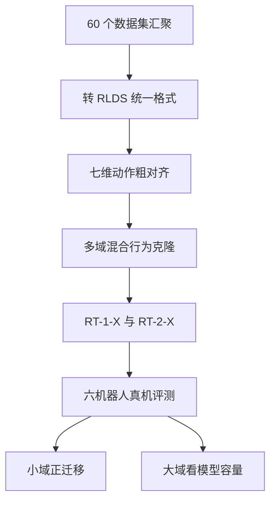

# Day15 — Open X-Embodiment / RT-X: 跨机器人数据规模化

> 📖 阅读版：https://papa-panda.github.io/post-training/physical-ai/day-15-2023-open-x-embodiment-rtx/

> Open X-Embodiment Collaboration（Google DeepMind 牵头，21 institutions），arXiv 2310.08864（2023-10-13，ICRA 2024）。机器人学的"ImageNet 时刻"宣言：把 34 个实验室的 60 个数据集、22 种机器人、100 万+ 轨迹统一成 RLDS schema，用一个 7 维末端执行器动作接口做粗对齐，训练跨机器人通用策略 RT-X。

## 元信息
- Title: Open X-Embodiment: Robotic Learning Datasets and RT-X Models
- Authors / Org: Open X-Embodiment Collaboration（Quan Vuong, Brian Ichter, Chelsea Finn, Sergey Levine 等 290+ 作者）/ Google DeepMind 牵头 + 21 institutions（Stanford、UC Berkeley、CMU、Meta AI、TRI、NVIDIA、KAIST、东京大学、清华、上海交大等）
- Link / arXiv / Blog: https://arxiv.org/abs/2310.08864 ；项目页 https://robotics-transformer-x.github.io/ ；代码/数据 https://github.com/google-deepmind/open_x_embodiment
- Date read: 2026-09-06
- Tags: [physical-ai, open-x-embodiment, rtx, cross-embodiment, robot-data, data-mixture, behavior-cloning, emergent-skills, rlds]
- Thread: physical-ai
- Folder: day-15-2023-open-x-embodiment-rtx
- GitHub: https://github.com/Papa-Panda/post-training/tree/master/physical-ai/day-15-2023-open-x-embodiment-rtx

## 一句话总结
OXE 把机器人学的"数据孤岛"问题变成"格式统一"问题：60 个数据集、22 种 embodiment、100 万+ 轨迹、527 个技能（160,266 个任务）全部转成 RLDS 格式，动作统一到 7 维末端执行器接口（x, y, z, roll, pitch, yaw, gripper），然后**不做任何显式的 embodiment-gap 对齐机制**，直接在混合数据上训练 RT-1-X（35M）与 RT-2-X（55B PaLI-X）；3600 次真实机器人评测证明跨机器人**正向迁移真实存在**：小数据域平均 +50%，RT-2-X 在别的机器人数据里的技能上相对 RT-2 提升约 3 倍（emergent skills 27.3% → 75.8%）。

## 大纲
- 问题：每个实验室各自采集、各自训一个机器人，数据孤岛使机器人学没有 NLP / CV 式的预训练底座可言
- 聚合：60 个数据集、34 个实验室、22 种 embodiment、100 万+ 轨迹统一转成 RLDS，动作粗对齐到 7 维末端接口
- 训练：实际训练混合只用 9 种机械臂的数据，RT-1-X（35M）与 RT-2-X（55B）是同一个混合的两个容量档
- 证据：小数据域平均 +50% ，大域小模型欠拟合、大模型才追回；emergent skills 27.3% → 75.8%
- 边界：评测的 6 种机器人都在训练混合内，未测新机器人；未见物体 / 背景 / 环境泛化与 RT-2 持平（61% vs 62%）

## 流程图

## 和之前工作的关系

- 接了哪条线：Day15–18 "机器人数据规模化"专题的**源头**。Day11–14（π₀ / Diffusion Policy / Octo / π₀.₅）讨论的都是"给定数据怎么训出好策略"，OXE 回答的是更底层的问题："数据从哪来、怎么拼成预训练底座"。
- 补了哪个短板：Day09–14 的训练数据都隐含"某一个实验室的几台机器人"；OXE 把规模化从单机房扩展到全社区，是 Day14 π₀.₅"异构 co-training 配方"的历史前传——π₀.₅的配方思想第一次被系统验证的地方就是这里。
- 替代 / 分叉 / 改进：
  - 替代了 per-robot / per-task / per-lab 各自训各自的范式：统一 schema（RLDS + 7 维动作接口）替代各自为政的数据格式。
  - 相对 Day13 Octo：Octo 用的正是 OXE 的 25 个数据集（约 80 万轨迹）——Octo 回答"怎么用混合数据"（block-masked Transformer + diffusion readout + 可插拔接口），OXE 回答"为什么值得聚合"（正向迁移的实验论证）。Octo 是 OXE 的下游消费者。
  - 相对 Day09 RT-2：RT-2 训在 Google Robot 自己的数据上；RT-2-X 把同样的"动作即文本 token"机制扩展到 9 种机械臂的混合数据——路线相同，数据混合是唯一变量。
- 对之前 Day X 的直接对比：Day14 π₀.₅的 ablation 证明"去掉某个数据成分泛化就掉"；OXE 的"去掉 Bridge 数据集"消融（emergent skills 75.8% → 42.8%）是同一个思想的更早、更干净的版本：把跨机器人迁移做成了**可归因的因果实验**。

## 为什么今天读它
路线图 Day15–18 是"Robot Data / Benchmark 扩展"阶段，OXE 是这一切的起点：BridgeData V2（Day17）、DROID（Day16）、RoboCasa（Day18）都是沿着"聚合→统一→规模化"这条路往下走的数据工作。不读 OXE，后面三天的数据论文就只剩"又一个数据集"的表面印象。同时它也是理解 π₀（Day11）"10k+ 小时跨 embodiment 预训练"为什么有效的理论地基。

## 今天的 3 问
1. 动作空间的对齐到底对齐了什么？论文只做了 7 维末端 delta + per-dataset 归一化 + 256-bin 离散化，**刻意没有**统一坐标系、没有区分绝对/相对/速度控制——为什么这么粗的对齐还能产生正向迁移？迁移到底发生在哪个表示层？
2. RT-1-X 在小数据域平均 +50%，但在大域（Bridge、Google Robot）反而不如单机房训的 RT-1（underfit：Bridge 上 27% vs 40%，RT-1 6 技能上 73% vs 92%）——容量 $C$ 与混合数据熵 $H(\mathcal D_{mix})$ 之间的 scaling 关系是什么？这对"先堆数据还是先堆模型"有什么启示？
3. Emergent skills 实验里，去掉 Bridge 数据后 RT-2-X 从 75.8% 跌到 42.8%——这个"移除式消融"如何把"跨机器人迁移"从相关性变成因果证据？它和 Day14 π₀.₅的成分消融在方法论上是什么关系？

## 数学视角：多源混合行为克隆 + 共享动作接口的迁移

把 OXE 理解成一个**跨分布的行为克隆混合问题**： $K$ 个数据源（数据集/机器人），每个有自己的观测分布、动作标定和任务集，但共享一个粗粒度的动作接口。统一的数学框架是——

### 1) State / observation / action / objective

- **Observation**： $o=(I,\ell)$ ， $I$ 是每个数据集选定的**规范视角**单张 RGB（统一缩放到公共分辨率）+ 语言指令 $\ell$ ；RT-1 架构用 15 帧历史 $I_{t-14:t}$ ，RT-2-X 用短历史（2 帧）或单帧。
- **Action**：规范化的 7 维向量 $a=(dx,dy,dz,droll,dpitch,dyaw,g)\in\mathbb R^7$ ——末端执行器位姿增量或速率 + 夹爪开合。关键：论文**没有**跨数据集统一坐标系，也**没有**统一"绝对位置 vs 相对增量 vs 速度"的控制语义，每个数据集按自己原来的控制方式解释同一个向量。
- **对齐算子**（per-dataset $k$ ）：先归一化 $a^{(k)}_{norm}=(a-\mu_k)/\sigma_k$ ，再均匀离散化到 256 档：

$$b_j = \Big\lfloor 255\cdot \mathrm{clip}\!\left(\frac{a^{(k)}_{norm,j}-lo}{hi-lo},\,0,\,1\right)\Big\rfloor\in\{0,\dots,255\},\quad j=1..7,$$

外加第 8 维 episode-termination token。模型在 $8\times 256$ 的离散空间上做分类（RT-1 是 256-way softmax，RT-2 是把 "1 128 91 241 5 101 127" 当文本 token 做 LM loss）。
- **混合目标**：

$$\mathcal L(\theta)=\sum_{k=1}^{K} w_k\;\mathbb E_{(o,\ell,b)\sim\mathcal D_k}\big[\mathrm{CE}(\pi_\theta(b\mid o,\ell))\big],$$

RT-2-X 再加一层 co-fine-tuning： $\mathcal L=\mathcal L_{VLM}(\text{web})+\mathcal L_{robot}$ ，web 数据与机器人数据比例约 1:1（沿用 RT-2 配方）。

### 2) 为什么粗对齐还能迁移：task-space 共享结构

直觉：不同机器人的逆运动学 $f_i^{-1}:\text{task-space}\to\text{joint-space}$ 各不相同，但"看到香蕉在碗左边 → 末端向左上方移动"这个**任务空间**的映射 $p^*(b\mid o,\ell)$ 在各 embodiment 间有重叠支撑。粗对齐的有效性说明迁移发生在**语义-任务空间层**，而不是关节动力学层——模型学的是"图像+语言 → 末端运动意图"，各数据集自己的 de-normalize 再把意图翻译成具体关节命令。

符号化一点：设真实条件分布可分解为 $p_k(b\mid o,\ell)=p_{shared}(b\mid o,\ell)\cdot p_{k,calib}(b\mid o,\ell)$ ，其中共享部分是任务语义、calibration 部分是各机器人的标定/坐标系差异。混合训练让大容量模型先拟合 $p_{shared}$ （数据量大、跨域一致），小容量或单域模型则被 $p_{k,calib}$ 的噪声淹没。这就解释了 Q2：

### 3) 容量 vs 混合熵：RT-1-X 的 underfit

小数据域 $k$ （如 NYU Door Opening、Kitchen Manipulation）：单域样本 $n_k$ 小，估计方差 $\propto 1/n_k$ ；混合训练用共享表示做正则，等效样本量放大 → 平均 +50%（5 个小域中 4 个打败原作者的专用方法）。

大域（Bridge、Google Robot 数据）：混合分布的熵 $H(\mathcal D_{mix})\gg H(\mathcal D_k)$ ，35M 的 RT-1 容量 $C$ 成为瓶颈——bias-variance 分解里 bias 项下不去，表现为 underfit（Bridge：RT-1-X 27% < 单域 RT-1 40%；RT-1 6 技能：73% < 92%）。换 55B 的 RT-2-X 后容量够了，Bridge 上 50% 反超单域 RT-1 的 40%。

**Scaling 启示**：数据混合的收益是**容量条件**的——先有足够的 $C$ 吸收 $H(\mathcal D_{mix})$ ，混合才从"噪声"变成"正则"。这也是为什么 RT-X 论文的标题把 Datasets 放在 Models 前面： infra（数据统一）先行，但模型容量必须跟上。

### 4) Emergent skills：联合分布外推 + 移除式因果归因

定义迁移量 $\Delta = \mathrm{succ}(\text{RT-2-X}) - \mathrm{succ}(\text{RT-2})$ ，在 Google Robot 上评估、但任务来自 Bridge/WidowX 数据集（RT-2 自己的训练数据里没有这些技能/物体）。这是**联合分布外推**：测试点 $(o,\ell)_{test}$ 在机器人 $i$ 的数据支撑之外、在机器人 $j$ 的数据支撑之内。

- $\Delta$ ：27.3% → 75.8%，约 **3×**。
- 反事实消融：训练混合去掉 Bridge 后 $\Delta$ 坍缩到 42.8%——直接把"WidowX 数据 → Google Robot 技能"这条因果链钉死。这是 Q3 的答案：移除式消融 = do-calculus 的工程近似， $P(\text{skill}\mid do(\text{remove Bridge}))$ 显著下降 ⇒ Bridge 数据是涌现技能的因。
- 配套消融（Table II）：55B vs 5B（75.8% vs 44.4%）说明迁移量随容量单调增；有/无图像历史（44.4% vs 14.5%）说明时序上下文是迁移的载体之一；无 web 预训练从零训（0%）说明 VLM 语义底座不可或缺——和 Day09 RT-2 的结论一致。

### 5) 和系统实现的对应

- **数据 infra**：RLDS 格式（tfrecord 序列化），容纳不同相机数、深度/点云；TFDS 加载；每个数据集选一个规范视角 + 统一分辨率。60 个数据集的元数据和 citation 维护在一个公开 spreadsheet——社区级数据 infra。
- **模型**：RT-1-X = RT-1 架构原样（35M，EfficientNet + USE + FiLM + decoder-only Transformer），唯一变量是数据；RT-2-X = PaLI-X 55B，动作 token 当文本训。
- **部署**：推理 3–10 Hz（按机器人要求），RT-1 本地跑，RT-2 云端服务网络查询——和 Day09 的部署形态一致。
- **评测**：3600 次真实机器人试验、6 种机器人；分"小域"（5 个）和"大域"（Bridge + RT-1）两套口径。

### 6) 假设与数学没有覆盖的真实误差

- 混合权重 $w_k$ 的设计是经验性的（论文只说"robotics data mixture"，未公开逐数据集权重）——配方不可复现，这是 OXE 作为 infra 最大的短板。
- 相机位姿差异没有对齐：模型可能学到"看相机视角 = 认出机器人"的捷径，用 embodiment 指纹代替真正的跨域泛化；论文承认观测差异大（Fig.1）但没有量化这个 confounder。
- RLDS 统一了**格式**，没有统一**质量**：demo 质量、标注噪声、任务难度在 60 个数据集间异构，混合目标把它们当同等可信。
- 量级诚实性：100 万轨迹 vs NLP 的 15–45 亿 token、CV 的 5–18M 图像——论文自己承认机器人数据仍小 2–3 个数量级，"ImageNet 时刻"是方向宣言不是已达状态。
- 评测全是短时程桌面操作（short-horizon manipulation），长程/移动操作/全身控制不在 OXE 的验证范围内——Day14 π₀.₅的"未见家庭长程任务"正是 OXE 没覆盖的下一棒。

## 核心
1. **Motivation**: 每个实验室各自为政训 per-robot 策略，数据孤岛；NLP/CV 靠 web-scale 数据 consolidation 出通用底座，机器人没有 web 可爬。问题：22 种机器人、60 个数据集能不能拼成一个可用的跨机器人预训练底座？和 Physical AGI 的关系：这是"foundation model for robots"的数据地基宣言。
2. **System / Method**: RLDS schema 统一 60 数据集（tfrecord + 规范视角 + 统一分辨率 + 7 维末端动作 + per-dataset 归一化 + 256-bin 离散化）；RT-1-X（35M，15 帧历史，纯机器人数据混合）与 RT-2-X（55B PaLI-X，web:robot ≈ 1:1 co-fine-tuning）；推理 3–10 Hz，RT-1 本地 / RT-2 云端。
3. **Training / Data Details**: 训练混合 = 9 种机械臂数据（RT-1、QT-Opt、Bridge、Task Agnostic Robot Play、Jaco Play、Cable Routing、RoboTurk、NYU VINN、Austin VIOLA、Berkeley Autolab UR5、TOTO、Language Table）；全量 22 embodiment 数据集已公开发布（实验时只有 9 种可用）；Sim 数据：无；Reward：纯行为克隆，无显式 reward。
4. **Key Tricks**（3个最值得抄的）:
   - **粗对齐就够用**：7 维末端动作 + per-dataset 归一化，不统一坐标系、不区分绝对/相对/速度——把 embodiment 差异留给模型吸收，证明迁移的载体是 task-space 共享结构。做多源数据聚合时，先定义统一的 action/observation contract，再谈精细对齐。
   - **小域放大器**：RT-1-X 在 5 个小数据域中的 4 个上打败原作者的专用方法（平均 +50%）——数据混合是数据穷人的免费午餐，单域训不动时先想混合。
   - **Emergent skills + 移除式消融的评估设计**：测"别的机器人数据里的技能"在本机器人上的表现，再做一次去掉该数据源的反事实——把"泛化"从形容词变成可归因的实验。这个方法论 Day14 π₀.₅又用了一次。
5. **Results**: 3600 次真机试验、6 种机器人；小域 RT-1-X 平均 +50%（4/5 域胜过 original method）；大域 RT-1-X 欠拟合（Bridge 27% vs 单域 RT-1 40%），55B RT-2-X 在 Bridge 上 50% 反超；emergent skills：RT-2 27.3% → RT-2-X 75.8%（~3×），去 Bridge 掉到 42.8%，55B vs 5B 为 75.8% vs 44.4%，无历史帧掉到 14.5%，无 web 预训练从零训 0%。

## 可迁移 / Transfer

- 方法在 held-out 上是否 transfer？是——emergent skills 本来就是 held-out 技能/物体的跨机器人评测。模型 vs 框架贡献：**框架贡献占绝对主导**（RT-1-X 架构与 RT-1 完全相同，增益全来自数据混合）。
- 对你 Infra → Post-training → Physical AI 迁移的 1-2 个直接启发：
  1. Post-training 数据配方的"混合权重设计"优先于模型改动：OXE 证明同样架构换混合就能 +50% / 3×；做 agent/RL infra 时，SFT/RL 数据的来源混合比例是比改 loss 更早锁定的变量。但注意 OXE 没公开 $w_k$ ——抄作业时要自己设计权重搜索/消融流程，不能抄数字。
  2. "接口统一先于细节对齐"：7 维动作 contract 让 22 种机器人进同一条训练管线；做 agent harness 时，先定义统一的 action/observation schema（tool call 格式、观测序列化），再谈各环境的精细适配——schema 是规模化的前提。
- Infra 视角：RLDS/tfrecord + TFDS 加载 + 数据集 spreadsheet（citation/元数据）是社区级数据 infra 的范本；3600 次真机评测是 eval infra 的成本标杆（仿真评测再多，真机 gate 省不掉）；"数据集先行、模型跟进"的节奏值得学——OXE 发布时实验只用了 9/22 种 embodiment，但 infra 一次到位，后续 Octo、π₀、DROID 全是它的下游。

## 疑问 / 下一步

- 没看懂的 / 想深挖的 1 个问题：训练混合中各数据集的采样权重 $w_k$ 到底怎么定的（按轨迹数？按技能多样性？手动调？）？论文 IV-C 只给了成分列表没给权重——这决定了混合配方的可复现性，想挖的话要去翻 open_x_embodiment 仓库的训练脚本或 RT-1-X colab。
- 如果要复现 / 小规模试，第一个实验做什么？用 Day13 Octo 的开源代码，在 OXE 的 2–3 个小数据集（如 NYU Door Opening + Cable Routing + 一个 Franka 数据集）上做最小混合：单数据集训 vs 混合训对比小域成功率，验证"+50% 小域放大器"在小规模下是否成立；再做一次"去掉某数据集"的移除消融，复现因果归因的方法论。

## 原文金句 (1-2句)
> "We assemble a dataset from 22 different robots collected through a collaboration between 21 institutions, demonstrating 527 skills (160266 tasks)."（摘要原文）
> "RT-2-X outperforms RT-2 by ~3×, suggesting that incorporating data from other robots into the training improves the range of tasks that can be performed even by a robot that already has large amounts of data available."（V-B 原文）

## 今晚产出
- [x] 按模板补齐 System / Training / Key Tricks / Results / 可迁移
- [x] 保留并完善「和之前工作的关系」小节（含 Day09/11/13/14 对比：RT-2→RT-2-X、Octo 作为下游、π₀.₅配方的历史前传）
- [x] 数学视角：多源混合 BC 目标 + per-dataset 归一化/离散化对齐算子 + task-space 共享结构 + 容量-混合熵 underfit + emergent skills 联合分布外推与移除式因果归因
- [ ] 深挖训练混合权重 $w_k$ 的具体设计（疑问/下一步：翻仓库训练脚本）

## 连接
- 上一篇: day-14-2025-pi05-open-world — π₀.₅的异构 co-training 配方，其"移除式成分消融"的方法论源头正是 OXE 的去 Bridge 实验
- 下一篇预告: day-16-2024-droid — DROID：多机构真实家庭/办公场景的 Franka 数据采集体系，看 OXE 之后社区如何继续补"数据多样性"这块短板

<!-- viz:stats: 75.8%→42.8% 去掉 Bridge 数据 emergent skills | 27.3%→75.8% Δ 约 3× | 50% 小域平均提升 -->
<!-- viz:bars: RT-2-X 未见物体背景环境 61% | RT-2 62% -->
<!-- viz:bars: RT-2-X Bridge IRIS 50% | RT-2-X Bridge RAIL 30% -->

## 第二轮复习（2026-10-26）

> 本轮做四处口径修正（三层规模不可混读、大域「反超」改为分站恢复、去 Bridge「钉死因果」降格、补上初读漏掉的阴性结果）＋补大纲与流程图（初读缺失，本轮补齐）。核心收获：把 Day15 从「机器人学的 ImageNet 时刻」重读为**聚合层**的确立——OXE 真正证明的不是「数据 pooled 起来就会迁移」，而是正迁移是一个**有条件**的现象：它按目标域大小换符号、被模型容量把门、只扩张技能库而不扩张视觉语义泛化。聚合的价值不在总量，在于第一次让这三个条件都能被分桶测量。

### 元信息修正

1. **Venue 与版本补全**：初读只记「arXiv 2310.08864（2023-10-13，ICRA 2024）」。正式版为 ICRA 2024，pp. 6892–6903（DOI 10.1109/ICRA57147.2024.10611477）；arXiv 从 v1（2023-10-13）一路修订到 v9（2025-05-14），引用数字应以晚版全文为准。作者口径收紧：arXiv 现版列为 Open X-Embodiment Collaboration 加 293 位其他作者，初读的「290+ 作者」大体成立，但不应再写成以 Quan Vuong 等少数人领衔——这是一篇以协作体为作者的论文。
2. **三层规模不可混读（本轮最重要的口径修正）**：初读标题与一句话总结容易让人以为 RT-X 是在 22 种 embodiment 的全部数据上训出来的。原文分三层：**仓库层**是 60 个数据集、34 个实验室、22 种 embodiment、100 万+ 轨迹；**训练层**的 robotics data mixture 只用了 9 种机械臂的数据（§IV-C 的成分列表）；**评测层**是 3600 次试验、6 种机器人。后续 Day13 Octo 的 25 个数据集约 80 万轨迹、Day09 OpenVLA 的 970k 条演示，各自又是不同的筛选与重加权，都不是「OXE 全量」的同义词。以后引用 OXE 必须指明说的是哪一层。
3. **大域「反超」改为分站恢复**：初读 Results 写 RT-2-X「在 Bridge 上 50% 反超单域 RT-1 的 40%」。Table I 里 Bridge 有两个评测站：IRIS（Stanford）是 50% vs 40% ，RAIL（UC Berkeley）是 30% vs 30% ，只是打平；RT-1 的 6 技能一项是 91% vs 92% ，实质也是打平（低 1 个百分点）。准确表述是：55B 把小模型在大域的欠拟合**追回到打平、并在一站反超**，不是全面反超。同一个 Bridge、同一机器人、两个实验室差 20 个百分点，这本身也是一个被初读漏掉的信号——评测站是隐藏变量。
4. **去 Bridge「钉死因果」降格**：初读把 75.8% → 42.8% 写成把因果链「钉死」。去掉 Bridge 之后 emergent skills 仍有 42.8% ，明显高于 RT-2 的 27.3% ，说明 Bridge 是这项测试里最大的单一贡献源，但不是唯一来源；而且移除同时削减了总量与多样性，论文没有做等量替换对照，所以它不是干净的 do 干预。方法论地位应降为：与因果解释一致的强证据，不是因果证明。这一降格同样适用于 Day14 复习里对成分消融的读法。另外 Table II 内部也有混杂：55B vs 5B 的两行（75.8% vs 44.4%）同时差了图像历史设置，容量结论是提示性的，不是干净的 scaling 曲线。
5. **补上初读漏掉的阴性结果**：Table II 最后一列，RT-2-X 在未见物体、背景与环境上的泛化是 61% ，RT-2 是 62% ，实质持平。初读只讲了 emergent skills 的 3 倍增益，漏了这一列——它恰恰划出了跨 embodiment 训练的作用边界（见核心第 4 点）。

### 一句话总结

三十多天后回看，Day15 的耐久贡献不是那个 100 万+ 的标题数字，而是一张**迁移的条件表**：把多家数据 pooled 到一个粗对齐接口下，小数据域平均涨 50% 、大数据域先被小模型拖累、容量够大才追平，而技能库能跨身体借来、视觉语义泛化借不来。OXE 是整条路线里第一个把「数据聚合」从口号变成可分桶、可消融、可证伪的实验对象的工作——它是聚合层，后面所有数据论文都是在它的条件表上改某一行。

### 和之前工作的关系

- **vs Day13 Octo（直接对比，同专题上游）**：Day13 是接口层，Day15 是聚合层，两篇是一枚硬币的两面。Octo 回答「混合数据怎么吃」——tokenizer 与 mask 在输入端隔离异构、readout 在输出端划接缝、权重 $q_d$ 手调；OXE 回答「为什么值得聚合」——正迁移的实验论证。但本轮重读后要补一句：Octo 从约 150 万 episodes 里筛出 25 个数据集约 80 万轨迹这个动作本身，就是对 OXE 的一次再策展；下游的筛选与重加权和上游的聚合一样决定结果，不能把增益全记在聚合头上。
- **vs Day09 RT-2 / OpenVLA（跨阶段，总览脚手架段）**：这是本轮最有力的外部校验。OpenVLA 只用 7B、在 OXE 的 970k 条演示上训练，却在 29 个任务上比 55B 的 RT-2-X 高 16.5 个百分点（Day09 复习已钉死此数）。若 Day15 初读的「容量吸收混合熵」是唯一解释，这个结果不该发生。它说明容量是门，不是全部：数据筛选（OpenVLA 对 DROID 低权重并在末段移除）、视觉编码与训练配方同样能改变混合的收益。Day15 的容量故事要降为多因子之一。
- **vs Day14 π₀.₅（直接对比，分专题相邻篇）**：两篇都是配方论文，但记账方式相反。π₀.₅ 的成分是按抽象层分工的（机器人数据补物理、web 数据补语义），且第一阶段 97.6% 的样本非目标平台；OXE 的成分是按来源机构分的，混合权重 $w_k$ 干脆没有公开。前者是「设计好的配方」，后者是「先 pooled 再测条件」——Day14 的可审计性正是站在 Day15 的肩膀上补的课。而两篇的消融读法也要一起降格：移除式消融给的是贡献排序，不是因果证明（见元信息修正第 4 条）。
- **vs Day16 DROID / Day17 BridgeData V2（同专题下游）**：OXE 一次扩张的是 embodiment 轴，DROID 固定 Franka 只扩场景轴，Bridge 扩技能轴——这个「覆盖三轴」的框架初读已有，本轮补它的方法论短板：Bridge 的等量对照（轨迹数相当时 13 技能 vs 3 技能，未见 pick-and-place 0.30 → 0.65）恰好是 OXE 去 Bridge 实验缺的那个对照形态。数据专题读到 Day17 才算把「多样性 ≠ 总量」的对照做干净，Day15 是提出问题的人，不是做干净的人。
- **跨阶段 vs Day20 RLPD / Day30 数据飞轮（RL 与评测段）**：OXE 交付的是一个静态的离线混合，它的下游出口在 Day20 才出现——RLPD 的 50/50 对称采样本质上就是把「离线混合 + 在线数据」做成一个持续更新的 $w_k$ 问题，OXE 没公开权重这个债，在 RLPD 里变成了必须在线维护的采样比。到 Day30，OXE 的 3600 次真机评测与分站差异（IRIS 50% vs RAIL 30%）正是飞轮 gate 设计的原始教材：同一策略在不同站点的读数差 20 个百分点时，gate 的阈值必须按站点标定，不能用全仓平均数放行。

### 核心

1. **动机重读：问题不是「数据不够」，是「能不能 consolidation」**：论文引言问的是 NLP / CV 式的整合能否在机器人学重演——一个预训练底座服务所有下游，而不是每机器人、每任务、每环境各训一个。它先交付仓库与格式，再用 RT-X 做存在性证明。这个顺序决定了它的证据形态：RT-X 不是要刷榜的模型，是用来证明 pooled 数据有正迁移的探针。所以评判 Day15 要看条件表是否可信，不要看 RT-2-X 是不是最强 VLA——它很快就被 Day09 的 OpenVLA 超过，这不伤 Day15 的地位。
2. **机制深挖一：正迁移按目标域大小换符号**：把每个目标域的迁移增益写成混合训练相对单域训练的差 ， $\Delta_k$ ，OXE 的数据呈现出一个一致的符号结构：小域 $\Delta_k > 0$ 且大（平均 +50% ，5 个小域 4 个胜过原作者方法），大域在 35M 容量下 $\Delta_k < 0$ （Bridge 27% vs 40% ，RT-1 技能 73% vs 92%），换到 55B 后 $\Delta_k$ 回到 0 附近或转正。机制上这正是初读写的方差—偏差分解：小域缺的是样本，共享表示是免费的方差削减；大域不缺样本，混合带来的是分布熵与标定噪声，容量不足时先付偏差的账。推论是可操作的：**任何「加数据源涨点」的宣称都必须按目标域大小分桶**，聚合平均数会把换符号的效应洗成一个好看的总平均。
3. **机制深挖二：粗对齐的真正含义是「让模型自己认身体」**：7 维接口只统一了形状，没有统一坐标系，也没有统一绝对 / 相对 / 速度的控制语义（初读已指出）。本轮把这点的后果说透：同一串 token 在不同数据集里语义不同，模型要正确解码，必须先从图像与上下文里推断「我现在是哪台机器人」——embodiment 指纹不是纯粹的捷径 confounder，它同时是这套粗对齐方案赖以成立的隐式条件变量。这解释了为什么迁移发生在任务空间层：共享的是「末端该往哪动」的意图，标定差异被指纹条件化吸收。代价也随之而来：指纹学得越好，对没见过的身体就越没有抓手——这与论文自承「未研究对新机器人的泛化」是同一件事的两面。
4. **机制深挖三：跨 embodiment 扩的是技能库，不是语义泛化（本轮最反直觉）**：emergent skills 涨约 3 倍而未见物体 / 背景 / 环境泛化持平（61% vs 62%），说明 pooled 数据扩张的是**技能 × 身体的联合支撑**——Google Robot 学会了它自己数据里没有、WidowX 数据里有的技能；而「认出没见过的物体」这类能力在 RT-2 里已经由 VLM 预训练给足，机器人混合数据在这一轴上没有边际信息。两类「泛化」在初读里被混为一谈，本轮拆开：以后看到 VLA 的泛化宣称，先问它涨的是哪一轴——技能库、场景、还是语义——三轴的数据处方完全不同（分别对应 Day17 的技能覆盖、Day16 的场景覆盖、Day14 的 web 数据成分）。

### 边界

1. **论文自承的三条（§VI）**：不考虑感知与 actuation 模态非常不同的机器人；不研究对**新机器人**的泛化；不给出正迁移何时发生的判据。本轮强调第二条的分量：评测的 6 种机器人都在训练混合内，所以 OXE 证明的是「混合内的跨身体借技能」，不是「零样本上新身体」——标题里的 X-embodiment 不能按后者读。
2. **证据没有证明什么**：3600 次试验摊到 6 种机器人、多个任务与两个 Bridge 站点后，单格样本量并不大，且成功率口径与各原论文不完全一致；大域结论只有 Bridge 与 RT-1 两个域，小域只有 5 个——条件表的每一格都是小样本。RT-2-X 的云端 55B 与 RT-1-X 的本地 35M 也不只是容量差，还有 VLM 预训练与 co-fine-tuning 的差别，Table I 不能读成纯参数 scaling。
3. **何时失效**：目标域本身数据充足且任务窄时， pooled 训练对小模型是净负担（大域欠拟合就是实例）；新身体的相机位姿与动作语义同时落在混合支撑之外时，粗对齐没有锚点；混合里混入低质量或标定错误的数据集时，没有公开的 $w_k$ 与质量门控意味着坏成分只能靠事后消融发现。下游 OpenVLA 要给 DROID 降权并在末段移除，正是这类失效在真实训练中的显形。

### 迁移到 post-training / Agentic RL Infra

可执行的一条主映射：**把 agent 轨迹池做成 OXE 式的三层记账 + 分桶迁移表，而不是一个越滚越大的数据湖**。具体落到 harness 的数据层：一，**三层数字分开报**——仓库层（共 pooled 多少条轨迹、覆盖多少环境 / 工具版本）、训练层（本次 mixture 实际用了哪些来源、各来源权重 $w_k$ 必须写进实验配置并随结果一起发布，补上 OXE 没公开权重这个债）、评测层（多少次真实评测、按站点 / 环境分开）；二，**迁移按目标域大小与泛化轴分桶**——目标任务按自有数据量分小域 / 大域，按与混合支撑的距离分「混合内技能、跨来源技能、未见对象 / 场景」三桶，每次改 mixture 只看分桶表做决定，聚合平均数只作参考；三，**消融要做等量替换版**——移除某个数据源时用其余来源等量重采样补足总量，把「该来源的因果贡献」与「总量效应」拆开（Day17 的等量对照形态），达不到这个对照的消融结论在评审里只能写「贡献排序」不能写「因果」。判读规则也钉死一条：若小域涨、大域跌，先查容量与训练量（Day15 的容量门），不要先砍数据源；若技能桶涨而语义桶平，下一笔预算投向 web / 语义成分而不是继续 pooled 同类轨迹（核心第 4 点的处方）。

### 思考题（综合 Day09 / Day13 / Day14 / Day15 / Day17 / Day30）

- **(a) 给去 Bridge 实验补上它缺的对照**：Day15 的移除式消融分不清「Bridge 的内容」与「总量减少」，Day17 却用等量对照把多样性与总量拆开了。请为 RT-2-X 设计一个等量替换版实验：去掉 Bridge 后，分别用「其余来源等量重采样」与「等量的单一大数据集」两种方式补足，预判 emergent skills 会落在 75.8% 与 42.8% 之间的什么位置，并说明每种结果分别支持哪种解释；同时写清你会用哪个观测量监控 Day13 那个 $q_d$ 式的权重塌缩——即补足的数据把稀有 embodiment 饿死。
- **(b) 三轴泛化该投哪一轴**：Day15 显示 pooled 机器人数据涨技能库、不涨语义泛化（61% vs 62%）；Day14 显示 web 数据成分补的正是语义层；Day16 显示场景覆盖是独立的一轴。假设一个 agent 系统现在的失败分桶是「新工具组合不会用 40% 、没见过的页面布局认错 35% 、长尾场景没覆盖 25%」，请把三类失败逐一对到技能 / 语义 / 场景三轴，给出三笔数据预算的分配顺序与各自的验证桶，并说明为什么「继续 pooled 更多同类轨迹」只能修其中一类。
- **(c) 新身体的最小适配曲线**：Day15 没有测过训练混合之外的机器人，Day13 的 Octo 给了「约 100 条示范微调」的适配点，Day30 要求上线有 gate。请设计一条「新 embodiment 适配预算曲线」实验：横轴是目标机器人示范条数（0 / 10 / 100 / 1000），纵轴是成功率，对照「OXE 式 pooled 预训练 + 微调」与「单域从零训」两条线，预判两条线交叉点的位置与形状；再说明在曲线上哪一段的读数可以作 Day30 式的放行 gate、哪一段不行，为什么零样本那一点即使读数不低也不能放行。

参考链接（本轮复习）：
- Open X-Embodiment 论文（arXiv:2310.08864，ICRA 2024，pp. 6892–6903）：https://arxiv.org/abs/2310.08864
- Open X-Embodiment 项目页：https://robotics-transformer-x.github.io/
- Open X-Embodiment 代码与数据：https://github.com/google-deepmind/open_x_embodiment

GitHub NOTES：https://github.com/Papa-Panda/post-training/blob/master/physical-ai/day-15-2023-open-x-embodiment-rtx/NOTES.md
