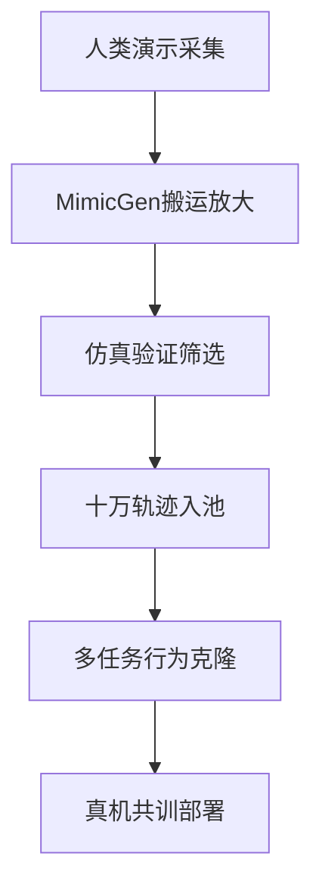

# Day18 — RoboCasa：仿真合成的 manipulation 数据规模化

> 📖 阅读版：https://papa-panda.github.io/post-training/physical-ai/day-18-2024-robocasa/

> Soroush Nasiriany、Abhiram Maddukuri（共同一作）、Lance Zhang（共同一作）、Adeet Parikh、Aaron Lo、Abhishek Joshi、Ajay Mandlekar、Yuke Zhu / UT Austin + NVIDIA Research，arXiv 2406.02523（RSS 2024）。数据三角的"合成边"：120 个程序化厨房场景、2,500+ 物体（153 类别）、25 原子任务 + 75 个 LLM 建议的复合任务；4 个操作员用 SpaceMouse 采 1,250 条人类演示，经 MimicGen 放大到 100K+ 轨迹；BC-Transformer 多任务从 28.8%（Human-50）涨到 47.6%（Generated 全集）；真机上小数据 + 仿真 co-train 把 seen 物体成功率从 13.6% 拉到 24.4%。

## 元信息
- Title: RoboCasa: Large-Scale Simulation of Everyday Tasks for Generalist Robots
- Authors / Org: Soroush Nasiriany、Abhiram Maddukuri（equal）、Lance Zhang（equal）、Adeet Parikh、Aaron Lo、Abhishek Joshi、Ajay Mandlekar、Yuke Zhu / The University of Texas at Austin、NVIDIA Research
- Link / arXiv / Blog: https://arxiv.org/abs/2406.02523 ；项目页 https://robocasa.ai （视频、文档、数据集）；官方代码 https://github.com/robocasa/robocasa （MIT，基于 robosuite/MuJoCo；资产约 5GB，需 `download_kitchen_assets.py`）
- Date read: 2026-09-09
- Tags: [physical-ai, robocasa, robot-data, simulation, sim2real, mimicgen, behavior-cloning, generative-ai, kitchen-manipulation, cross-embodiment, mobile-manipulation]
- Thread: physical-ai
- Folder: day-18-2024-robocasa
- GitHub: https://github.com/Papa-Panda/post-training/tree/master/physical-ai/day-18-2024-robocasa

## 一句话总结
RoboCasa 把"机器人数据规模化"的第四条路做成了可复现的配方：仿真不是拿来做 RL 训练的，而是拿来做**数据工厂**的——用程序化厨房（layout × style 组合出 120 场景）、生成式 AI 三件套（text-to-3D 物体、text-to-image 纹理、LLM 建议任务）和 MimicGen 的 object-centric 轨迹搬运，把 4 个人采的 1,250 条演示放大 80 倍成 100K+ 轨迹；证明三件事：合成数据在原子任务上打出清晰的 scaling 曲线（28.8% → 47.6%）、原子技能预训练能撬动复合任务的微调（5 个任务里 4 个从零到非零）、仿真数据 co-train 能实质提升真机部署（seen +79% 相对增益）——sim2real 在这里不是 zero-shot 的信仰，而是 co-training 的工程。

## 大纲
- 问题：真实机器人数据采集贵到不现实，泛化要的规模拿不到
- 配方：120 程序化厨房乘生成纹理，LLM 建议 75 个复合任务
- 放大：4 人采 1,250 条演示，MimicGen 搬运放大到 100K+ 轨迹
- 证据：合成 scaling 28.8% 到 47.6%，原子预训练撬动复合任务，真机共训 seen 13.6% 到 24.4%
- 边界：纯仿真零样本数字没给，复合任务最高仅 12.0%，厨房域内天花板

## 流程图

## 和之前工作的关系

- 接了哪条线：Day15–18 "Robot Data / Benchmark 扩展"专题的收官棒。Day15 OXE 回答"怎么聚合跨身体数据"，Day16 DROID 回答"真实场景覆盖怎么带来增益"，Day17 Bridge 回答"低成本多技能覆盖怎么做"，Day18 回答"**采集不起就合成**"——数据三角（embodiment × scene × skill）之外，补上了第四条边：**reality 轴的仿真端**。
- 补了哪个短板：Day15/16/17 全是真实数据路线，隐含假设是"数据必须人采"；RoboCasa 把"程序化多样性"变成和真实采集对等的覆盖手段——Day16 DROID 的 564 真实场景 vs RoboCasa 的 120 程序化厨房 × 生成纹理，正好是"场景覆盖"这条轴的两种解法。
- 替代 / 分叉 / 改进：
  - 相对 Day17 Bridge：**正交取舍**——Bridge 用真实廉价臂扩张 skill 轴，RoboCasa 用仿真扩张 scene × object 轴；两者都是"平民化规模化"，一个靠 \$4,000 硬件，一个靠生成式 AI + MimicGen。
  - 相对 Day16 DROID：真机评测直接跑在 **DROID 硬件 infra** 上（Franka Panda + 轮式移动平台）——DROID 是这篇的"真机试验台"；co-train 增益（seen 13.6% → 24.4%）是 DROID "+20%" 的仿真对应版，配方都是"本域小数据 + 外部大规模数据 co-train"。
  - 相对 Day10 Habitat 3：room-scale 仿真的双代表——Habitat 管导航/社交，RoboCasa 管厨房操作；都强调"仿真先把多样性做足"。
  - 相对 Day02 MuJoCo：RoboCasa 建在 **robosuite（MuJoCo）** 上——Day02 的接触模型在这里是整个数据工厂的物理地基；仿真数据的可信度上限就是物理引擎的可信度。
  - 相对 Day12 Diffusion Policy：论文明确也考虑了 diffusion policy 架构（主力是 BC-Transformer）——Day12 的数学在这里是"备选方法"之一；MimicGen 生成的 jerky 轨迹正好说明 Day12 的 $T_o$ / $T_p$ / $T_a$ 三 horizon 为什么重要（低质量动作序列需要闭环重规划兜底）。
- 对之前 Day X 的直接对比：
  - Day15 OXE 的"混合权重没公开"疑问：在 RoboCasa 这里有干净对照——Human-50 vs Generated-100/300/3000 的 scaling 曲线就是"合成 vs 真实"的混合实验，只是轴换成了数据量。
  - 2026-09-07 问答"固定硬件路线"：RoboCasa 是第五个固定硬件代表，但它是**仿真里的**固定硬件（Omni-Frankie：Franka Panda + Omron 移动基座）——固定身体、扩张场景/物体，与 Day16 DROID 的"固定 Franka、扩张真实场景"形成镜像。

## 为什么今天读它
路线图明确要求 Day18 是"用程序化家庭场景和大规模仿真轨迹扩充 manipulation 数据，连接 Habitat 总览与 sim2real"——它是数据专题的合成收官，也是 Day21（domain randomization）/ Day24（sim2real system identification）的前置：AI 纹理是生成式 domain randomization，sim→real co-train 是 sim2real 的工程形态。读完这篇，"真实采集 vs 程序化合成"这对取舍就有了数字。

## 今天的 3 问
1. MimicGen 把人类演示分解成 object-centric 段，用 $\Delta T = T_{\text{new}} \cdot T_{\text{old}}^{-1}$ 把轨迹搬到新场景——这个 SE(3) 等变假设在什么情况下失效？铰链物体、接触丰富的插入任务、遮挡变化的场景里，哪一步数学假设先破？（见数学视角 §2）
2. 生成的 72K 轨迹是 1,250 条人类演示的确定性变换，按信息论"没有引入新的人类行为信息"——那 Human-50 28.8% → Generated-3000 47.6% 的增益到底从哪来？（见数学视角 §3：支撑扩张，不是信息增量；呼应 Day17 的 13 vs 3 skills 消融——多样性的轴换成了"场景/纹理/物体初位姿"）
3. 仿真 72K vs 真机 150 条演示（3 任务 × 50 条），co-train 时真机信号不会被淹没吗？混合权重 $\alpha$ 该怎么理解，$\alpha$ 太大/太小各发生什么？（见数学视角 §4；和 Day16 DROID co-train、Day14 π₀.₅ knowledge insulation 的两阶段配方对照）

## 问答补充（2026-09-09）

> 以下 2 组问答来自 2026-09-09 当晚用户对 Day18 RoboCasa 卡片（MimicGen 搬运公式）的追问，原样归档。

### Q1：RoboCasa 是数学论文吗？

**问题原文**："这是个数学论文？"

**核心答案**：不是。RoboCasa 是**数据集/仿真系统论文**，不是数学论文——它的贡献是"数据工厂"本身：120 个程序化厨房、MimicGen 轨迹搬运管线、100K+ 轨迹、BC-Transformer 的评测结果。

NOTES 里的 $SE(3)$ 、pushforward、支撑扩张这些数学，是按学习模板加的"数学视角"——用统一框架把"为什么生成数据有用"讲清楚。论文原文里没有这些推导，它讲的是工程：怎么搭仿真、怎么搬运轨迹、怎么评测。

**结论**：区分"论文的创新"（系统和数据）与"我们的理解工具"（数学视角）。归档和复述时把两者分开写，避免把解读误记成论文主张。

### Q2：MimicGen 的 $\Delta T$ 搬运是啥意思？ $SE(3)$ 等变假设三处哪一步先破？

**问题原文**："1/ 啥意思？我都看不懂 MimicGen 用 $\Delta T=T_{\text{new}}\cdot T_{\text{old}}^{-1}$ 搬运轨迹，这个 $SE(3)$ 等变假设在铰链物体、插入任务、遮挡变化时哪一步先破？"

**核心答案**：

**MimicGen 在干什么**：人用 SpaceMouse 遥操作采了一条演示（"从桌上拿起杯子"），MimicGen 想把这条演示**搬**到 100 个新厨房里（杯子位置变了、桌子换了），自动变出 100 条新演示，不用人再采。

**三步**：
1. **分解**：把演示切成"以物体为中心"的段——"靠近杯子"段锚定杯子，"抓起"段锚定杯子；每段轨迹都表示成**相对于杯子**的运动。
2. **搬运**：新场景里杯子挪了位置，把整段轨迹做一次刚体变换跟过去。
3. **验证**：在仿真里重播一遍，成功的留下，失败的扔掉。

**字母表**：
- $SE(3)$ ：三维空间所有刚体运动的集合 = 旋转 + 平移；一个位姿 $T \in SE(3)$ 即 4×4 矩阵（ $R$ 为旋转、 $t$ 为平移）：

$$\begin{bmatrix} R & t \\ 0 & 1 \end{bmatrix}$$

- $T_{\text{old}}$ ：采演示时杯子的位姿（如在 (1,0,0) 处）。
- $T_{\text{new}}$ ：新场景里杯子的位姿（如挪到了 (2,1,0) 处）。
- $\Delta T = T_{\text{new}} \cdot T_{\text{old}}^{-1}$ ：杯子这一次"动了多少"——先乘 $T_{\text{old}}^{-1}$ 把轨迹换算到"杯子自己"的坐标系（跟杯子绑定），再乘 $T_{\text{new}}$ 把绑定好的轨迹放到新位置；例子里 $\Delta T$ 就是"往 $x$ 平移 1、往 $y$ 平移 1"。

**" $SE(3)$ 等变假设"**：**把物体和轨迹一起刚体搬运，任务照样成功**——成功只取决于"手和物体的相对位姿"，跟它们在世界里的绝对位置无关。

**三处哪一步先破**：
1. **铰链物体（门/抽屉）——第一步"分解"先破**。铰链物体的位姿不是单个刚体 $T$ ，而是"底座位姿 + 关节角 $\phi$ "；开门轨迹是**绕铰链轴画圆弧**， $\Delta T$ 只能做刚体平移旋转，搬过去的圆弧不再绕新场景的铰链轴——拉的方向一开始就错了。
2. **插入任务（peg-in-hole）——"运动学等变 ⇒ 成功等变"这一步先破**。插入的成功不只看几何相对位姿，还看接触动力学：摩擦、几毫米的对准；刚体搬运只保证了几何对应，毫米级误差在变换和重播中被放大，直接卡住。这也是论文评测里 insertion 最难的原因（见本 NOTES §核心第 5 点）。
3. **遮挡/新障碍物——第二步"搬运"的隐含假设先破**。 $\Delta T$ 里只有杯子的位姿、**没有障碍物**；新场景多了个挡路的东西，搬过去的轨迹直接穿模——这就是论文承认的"残留碰撞"的来源。

**顺带**：移动底盘的导航任务 MimicGen 直接**不支持**——基座轨迹没法锚定到某个物体上，"object-centric"这个前提就不成立。

**和之前工作的关系**：三处失效正是本 NOTES §6"假设与数学没有覆盖的真实误差"第一条（ $\Delta T$ 是纯几何操作）的具体展开；铰链/插入的边界也反衬 Day12 Diffusion Policy 的路线——接触丰富的任务不靠刚体搬运，而靠扩散模型直接拟合多模态接触行为分布。

## 数学视角：MimicGen 的 SE(3) 搬运 × 合成数据的支撑扩张 × sim2real 的 gap 分解

RoboCasa 是数据论文，数学就是三块：**MimicGen 的轨迹变换**、**合成数据为什么带来增益**（覆盖论）、**sim2real co-training 的分布视角**。统一框架接 Day15/16/17 的覆盖三轴：泛化误差 $\lesssim d(P_{\text{test}}, \mathrm{supp}(P_{\text{train}}))$ ， $P_{\text{test}}$ 是部署分布， $\mathrm{supp}(P_{\text{train}})$ 是训练混合的支撑——RoboCasa 的全部设计都是在**用程序化手段把支撑撑大**。

### 1) State / observation / action / objective

- **State** $s$ ：机器人关节角 $q \in \mathbb{R}^7$（Franka Panda 7 自由度臂）+ Omron 移动基座位姿 $b \in SE(2)$ + 厨房里每个物体 $i$ 的位姿 $T_i \in SE(3)$ + 铰链物体（门/抽屉/微波炉）的关节角 $\phi_j$ 。注意 $s$ 在仿真里是**特权信息**（MimicGen 和自动成功检测都用它），策略看不到。
- **Observation** $o$ ：第三视角 RGB + 腕部 RGB（论文主力评测配置）+ 本体感知 $(q, \dot{q})$ ；训练图像用 AI 生成纹理渲染，评测用人工精选纹理——这是**纹理轴上的 train/test 分布偏移**，故意设计的泛化测试。
- **Action** $a$ ：workspace end effector 控制， $a = (\Delta x, \Delta y, \Delta z, \Delta r_x, \Delta r_y, \Delta r_z, g)$ ，前 6 维末端笛卡尔相对位姿， $g$ 夹爪；仿真用 Operational Space Control @20Hz，真机 DROID @15Hz 非 OSC 控制器——**控制频率和控制器的 mismatch 是 sim2real gap 的第一项**。
- **Objective**：多任务行为克隆， $\mathcal{L}_{\text{BC}}(\theta) = -\mathbb{E}_{(o,a) \sim \mathcal{D}_{\text{multi}}}[\log \pi_\theta(a \mid o)]$ ，其中 $\mathcal{D}_{\text{multi}} = \bigcup_{t=1}^{24} \mathcal{D}_t$ 是 24 个原子任务（导航任务被 MimicGen 排除，见 §2）的混合；策略是 robomimic 的 BC-Transformer（视觉编码 + transformer 序列建模）。
- 对应到实现：`robocasa/robocasa` 仓库提供 100 个任务的 gym 接口（`gym.make("robocasa/PickPlaceCounterToCabinet")`）、MimicGen 数据生成管线、与 robomimic / Diffusion Policy / π₀ / GR00T 的对接示例。

### 2) MimicGen：object-centric 分解 + SE(3) 搬运

MimicGen（Mandlekar 等，arXiv 2310.17596；RoboCasa 的 Ajay Mandlekar 也是该论文作者——方法与数据是同一拨人）是这篇的数据放大器，数学分三步：

- **分解**：把一条人类演示 $\tau = (s_0, a_0, \dots, s_H)$ 切成 $K$ 个 object-centric 段 $\tau = [\tau_1, \dots, \tau_K]$ ，每段 $\tau_k$ 锚定到一个相关物体 $o_k$（比如"抓杯子"段锚定杯子、"开微波炉"段锚定微波炉门）。切分用启发式（夹爪开合、接触事件）+ 人类演示的子任务标注。
- **搬运**：记演示采集时物体位姿 $T_{\text{old}} \in SE(3)$ ，新场景里该物体位姿 $T_{\text{new}} \in SE(3)$ ，定义 $\Delta T = T_{\text{new}} \cdot T_{\text{old}}^{-1}$ 。新轨迹段 $\tau_k' = \Delta T \circ \tau_k$ ：段内每个末端位姿左乘 $\Delta T$ （位置旋转平移、姿态相应旋转）。这是**刚体运动的群作用**——假设"好的抓取/操作轨迹在物体位姿的刚体变换下保持有效"。
- **拼接与验证**：把 $\tau_k'$ 按顺序拼起来，让机器人在新场景跟随执行，用仿真的特权 $s$ 检查任务是否成功；失败的丢弃（论文 limitation 承认仍有 jerky motions 和碰撞残留——变换保持的是几何关系，不保持动力学可行性）。

**符号与假设**： $T \in SE(3)$ 是 4×4 齐次变换矩阵； $\circ$ 表示对轨迹中每个位姿的作用。核心假设是**接触动力学的 SE(3) 等变性**：把物体和轨迹一起刚体搬运，接触力/抓取几何近似不变。**失效清单**（Q1 的答案）：① 铰链物体——门的转轴变了， $\Delta T$ 搬运的圆弧轨迹不再绕新轴；② 插入类高接触任务——几毫米的几何误差在变换后被放大，论文评测里 insertion 正是最难的技能之一；③ 遮挡/碰撞环境变化——新场景的障碍物不在 $\Delta T$ 里，搬运后的轨迹可能穿模（这就是残留碰撞的来源）；④ 移动操作（navigation）——基座轨迹不是 object-centric 的，MimicGen 直接**不支持**，所以 25 个原子任务里导航任务被排除在 72K 之外。这解释了为什么论文说"生成轨迹技术上成功但有 undesirable effects，可用仿真状态自动检测剔除"——检测剔除是在用特权 $s$ 做**数据质量的 sim2sim 门控**，呼应 Day08 的 sim2sim gate 思想。

### 3) 合成数据的"信息增益"：支撑扩张，不是信息增量

Q2 的答案。72K 生成轨迹是 1,250 条人类演示经确定性 $\Delta T$ 映射的像——**行为模式（behavioral modes）没有增加**，增加的是这些模式在"场景 × 纹理 × 物体初位姿"乘积空间里的**支撑**。形式化：设人类演示的经验分布为 $\hat{P}_{\text{human}}$ ，MimicGen 定义了一个变换族 $\mathcal{G} = \{\Delta T\}$ ，生成数据的分布是 $\hat{P}_{\text{gen}} = \mathbb{E}_{g \sim \mathcal{G}}[g_\# \hat{P}_{\text{human}}]$ （pushforward）。BC 学的是 $p(a \mid o)$ 在支撑上的条件分布——支撑越大，未见测试 $(o', a')$ 落进支撑的概率越高，泛化误差上界 $d(P_{\text{test}}, \mathrm{supp}(P_{\text{train}}))$ 越小。

数字钉死这个解释：
- Human-50（1,250 条）：28.8%；Generated-100（2,400 条）：~35%；Generated-300（7,200 条）：~42%；Generated-3000（72,000 条）：**47.6%**——单调 scaling 曲线，且评测本身就是支撑测试：50 trials/任务、5 个固定场景、**只用未见物体实例**、其中 2 个场景是训练没见过的风格。
- 技能难度排序呼应"多样性 vs 可学性"：开/关门和抽屉（每类只有 6 个实例）好学；pick-and-place（几十个物体类别、affordance 差异大）难学——**类内多样性越大，同样数据量下越难**，这是 Day17"多样性带来增益"的另一面：多样性是双刃剑，RoboCasa 靠 80 倍数据量把它压了下去。
- 和 Day17 的对照：Bridge 用 13 vs 3 skills 的等量消融证明"多样性 > 数据量"；RoboCasa 用 Generated-100 → 3000 的曲线证明"给定行为模式，程序化支撑扩张带来单调增益"——两篇合起来：**多样性的轴可以是 skill（真实采集），也可以是 scene/texture/pose（程序化合成）**。

成本视角（Infra 视角的前置）：4 个操作员采 1,250 条演示 vs 生成 100K——人类边际成本趋零后，数据 scaling 的瓶颈从"人力"变成"仿真资产质量 + 生成管线的保真度"。这是"数据工厂"和"数据采集"的根本区别。

### 4) Sim2real 的 gap 分解与 co-training 的分布视角

Q3 的答案。设仿真分布 $P_{\text{sim}}$ 、真机分布 $P_{\text{real}}$ ，gap 可分解为四项（论文 V-C 逐项列出）：

1. **控制器**：仿真 OSC @20Hz vs 真机非 OSC @15Hz——同样是"workspace end effector 控制"，底层的跟踪动力学不同；
2. **感知**：相机标定、光照、基座相对场景的位姿差异；
3. **物理**：MuJoCo 接触模型 vs 真实摩擦/柔顺（Day02 的地基问题在这里变现）；
4. **任务**：3 个 pick-place 任务 × 50 条真机演示 × 5 类物体。

Co-training 的 loss： $\mathcal{L}(\theta) = \alpha \, \mathcal{L}_{\text{sim}}(\theta) + (1-\alpha) \, \mathcal{L}_{\text{real}}(\theta)$ ， $\alpha$ 由 batch 混合比隐式决定。72K 仿真 vs 150 条真机——真机信号会不会被淹没？**不会，原因有二**：① 真机数据是 $P_{\text{test}} = P_{\text{real}}$ 的无偏样本，它的梯度指向目标分布，仿真数据再多也只是"支撑提供者"；② 共享视觉编码器 $\varphi$ 在仿真的大支撑上被撑开（见 Day17 §3 同样的机制），真机数据只负责把最后的 readout 对齐到真实 gap 上。这正是 Day14 π₀.₅ "knowledge insulation"两阶段配方的单阶段版本，也是 Day16 DROID co-train（+20%）的数学同构。

结果：seen 物体 13.6% → **24.4%**（相对 +79%），unseen 物体 2.6% → **9.3%**（仍低，但 3.5 倍）。注意论文诚实的一点：这是 co-training，不是 zero-shot sim2real——**纯仿真策略直接部署的数字没有给**，gap 的真实大小被 co-train 掩盖了一部分。这是读 sim2real 论文时要盯的数字：凡是只报 co-train 不报 zero-shot 的，gap 都还在。

$\alpha$ 的两端： $\alpha \to 1$ 退化成纯仿真策略，真机 gap 无人纠正； $\alpha \to 0$ 退化成 150 条演示的小数据 BC（13.6% 的 Real only 基线）。最优 $\alpha$ 本质是在"支撑宽度"和"分布对齐"之间做偏差-方差权衡——论文没扫这个超参，留白。

### 5) 和系统实现的对应

- **物理地基**：robosuite（MuJoCo）——Day02 的接触求解器在这里决定了"合成数据可信度"的上限；论文 Related Work 的 Table I 里 RoboCasa 是唯一同时满足 mobile manipulation + room-scale + realistic physics + AI-generated tasks/assets + cross-embodiment + 100K 轨迹的。
- **GenAI 三件套的工程对应**：text-to-3D 物体（仓库里 2,500+ 物体多数来自 text-to-3D，153 类别）→ 几何多样性；text-to-image 纹理（训练用 AI 纹理、评测用人工纹理）→ **生成式 domain randomization**，Day21 的前置；LLM 建议活动（洗碗、煎炒、补货柜……基于"LLM 训练在人类中心互联网内容上，捕捉行为的生态统计"这一假设）→ 任务多样性，但论文自认"仍需人工写任务实现"，LLM 只负责出点子。
- **120 厨房 = layouts × styles**：参考建筑/家装杂志整理常见平面（一字型到 U 型带岛台），按标准尺寸建模；程序化组合出 120 场景——"场景多样性"从此变成可枚举、可复现的 infra，而不是 DROID 式的物流。
- **跨 embodiment**：单臂移动平台（主力 Omni-Frankie）、humanoid、带臂四足——和 Day15 OXE 的 22 种真实身体对照：RoboCasa 的跨身体是"仿真里先验证接口统一"，OXE 是"真实数据里做聚合"。
- **复合任务**：5 个代表任务（ArrangeVegetables、MicrowaveThawing、RestockPantry、PreSoakPan、PrepareCoffee），每任务 50 条人类演示；scratch 在 4/5 上挂零，atomic 预训练微调后 4/5 非零（最好 12.0%）——**原子技能预训练是复合任务的必要非充分条件**，长程组合仍是开放问题。
- **发布**：代码 MIT、资产 CC BY 4.0；v0.2（2024-10）切到 robosuite v1.5；社区已有 Diffusion Policy / π₀ / GR00T 的对接和 RoboCasa365（365 任务）扩展。

### 6) 假设与数学没有覆盖的真实误差

- **变换不保持动力学可行性**：MimicGen 的 $\Delta T$ 是纯几何操作，生成的轨迹可能 jerky、有碰撞——论文靠"仿真状态自动检测剔除"兜底，但检测器本身的阈值是启发式的；低质量动作序列对 BC 是标签噪声（呼应 Day17 §4：BC 要分布匹配）。
- **复合任务仍低**（0–12%）：MimicGen 的 object-centric 假设在长程任务的**段间过渡**处最弱——"放下杯子"和"拿起海绵"之间的 free-space 运动不是 object-centric 的，拼接缝是误差集中地。
- **没有高灵巧/可变形/双臂任务**（论文自认）——泛化结论的外推边界是"厨房粗操作"。
- **厨房语义域单一**：120 个场景全是厨房， $P_{\text{test}}$ 的支撑再大也出不了厨房；和 DROID 的 52 栋建筑比，这是"程序化多样性"的域内天花板。
- **纯 zero-shot sim2real 数字缺失**：只报了 co-train，gap 的真实大小未知——读的时候要把 24.4% 理解成"仿真数据的迁移价值"，不是"仿真策略的部署能力"。
- **LLM 任务设计的生态统计假设没被验证**："LLM 捕捉人类行为的生态统计"是个漂亮的直觉，但 75 个复合任务里"偶尔有不合直觉的任务逻辑"（论文自认）——任务质量的上界还是人工。

## 核心
1. **Motivation**: CV/NLP 靠大数据 + 大模型拿到泛化，机器人学想抄但真实数据采集贵到不现实（Day16 DROID：52 栋建筑、50 个采集员）。问题：能不能用**仿真当数据工厂**，把"场景 × 任务 × 数据"三件事一起规模化？和 Physical AGI 的关系：这是数据飞轮里"合成数据"那一环的奠基配方——如果仿真数据能用，机器人学的 scaling 定律就有了燃料。
2. **System / Method**: robosuite（MuJoCo）后端 + 120 程序化厨房（layout × style）+ 2,500+ 物体（text-to-3D 为主）+ text-to-image 纹理 + LLM 建议的 75 复合任务；100 任务 = 25 原子（8 大 sensorimotor 技能）+ 75 复合；跨 embodiment（移动单臂、humanoid、带臂四足）；Omni-Frankie（Franka Panda + Omron 基座）为主力评测身体。
3. **Training / Data Details**: 4 个操作员 SpaceMouse 采 1,250 条人类演示（原子任务每任务 50 条）→ MimicGen 生成 72K（24 任务 × 3,000，导航任务除外）+ 28K AI 物体版 = **100K+**；训练用 AI 纹理、评测用人工纹理；BC-Transformer（robomimic）多任务训练，每任务 50 trials × 5 固定场景评测，只用未见物体；复合任务每任务 50 条人类演示做 scratch vs 微调对照；真机 3 任务 × 50 演示在 DROID 硬件上做 Real only vs Real+Sim 对照。
4. **Key Tricks**（3个最值得抄的）:
   - **MimicGen 的 object-centric SE(3) 搬运**： $\Delta T = T_{\text{new}} \cdot T_{\text{old}}^{-1}$ 把人类演示按物体位姿刚体搬运到新场景——"一次人类演示，N 个场景复用"，数据放大的数学本质是**变换群作用下的支撑扩张**；失效清单（铰链、插入、遮挡、导航）就是这个假设的边界，抄之前先对着清单检查自己的任务。
   - **训练/评测纹理分离**：训练用 AI 生成纹理、评测用人工精选纹理——把 domain randomization 做进数据管线而不是训练 trick；这是 Day21 的生成式版本，抄作业时记住"随机化的轴要和评测的泛化轴对齐"。
   - **原子预训练 → 复合微调的两段式**：scratch 在 4/5 复合任务上挂零，atomic 预训练微调后 4/5 非零——长程任务不要从零训，先拿原子技能把表征的支撑铺好；和 Day14 π₀.₅ 的子任务分层、Day06 Dreamer 的分层思想同构。
5. **Results**: 原子任务 Human-50 28.8% → Generated-3000 **47.6%**，Generated-100/300 的中间点形成单调 scaling 曲线；复合任务微调后最好 12.0%（ArrangeVegetables），4/5 非零 vs scratch 4/5 挂零；真机 seen 物体 13.6% → **24.4%**（相对 +79%），unseen 2.6% → 9.3%；技能难度：开关门/抽屉好学，pick-place（几十类物体）和 insertion 难学。

## 可迁移 / Transfer

- 方法在 held-out 上是否 transfer？是——评测设计本身就是 held-out（未见物体实例、2 个未见风格场景、真机未见物体）；模型 vs 框架贡献：**框架（数据工厂）贡献主导**——同一套 BC-Transformer，数据从 1,250 换到 72K，28.8% → 47.6%，增益几乎全由数据解释；MimicGen 的变换质量是框架内的关键变量（jerky/collision 是它的税）。
- 对你 Infra → Post-training → Physical AI 迁移的 1-2 个直接启发：
  1. Post-training 数据配方的"第四轴"：embodiment（OXE）× scene（DROID）× skill（Bridge）× **reality（RoboCasa：仿真合成）**——做 agent RL 数据时先问"我的四轴分别覆盖到哪"；当真实采集的边际成本太高时，程序化合成不是"次选"，而是和真实采集对等的覆盖手段，关键是**合成变换的假设边界要写清楚**（MimicGen 的失效清单就是范本）。
  2. "支撑扩张 > 点加密"的合成版：RoboCasa 证明即使行为模式零新增（确定性变换），把支撑在场景/纹理/位姿轴上撑大 80 倍也能带来近 20 个点的增益——做 SFT/RL 数据增强时，优先扩张输入分布的支撑（paraphrase、多场景、多初态），而不是在同一分布上堆更多同分布样本。
- Infra 视角：仿真数据工厂的 infra 三件套——**资产管线**（text-to-3D/text-to-image 的生成 + 5GB 资产分发）、**生成管线**（MimicGen 分解-搬运-拼接-验证，失败自动丢弃）、**质量门控**（用特权仿真状态做 sim2sim 数据筛选，呼应 Day08）；发布标准：代码 MIT + 资产 CC BY 4.0 + gym 接口 + 主流策略库对接示例——数据集发布的黄金标准又多了一块砖；评测成本锚点：50 trials/任务 × 5 场景是"仿真数据论文"的 eval 预算参考线。

## 疑问 / 下一步

- 没看懂的 / 想深挖的 1 个问题：MimicGen 的段间拼接缝（free-space 过渡段不是 object-centric 的）到底贡献了多少失败？论文把 jerky/collision 归为"可自动检测剔除"，但没有量化**剔除率**和**剔除后 vs 剔除前的性能差**——如果拼接缝是主要误差源，那么"原子技能预训练 → 复合任务微调"的低成功率（最高 12%）可能主要不是策略容量问题，而是数据质量问题。值得翻 MimicGen 原论文（arXiv 2310.17596）的附录找消融。
- 如果要复现 / 小规模试，第一个实验做什么？用官方 `robocasa/robocasa` 仓库跑通 1 个原子任务（如 `PnPCounterToCab`）的 MimicGen 生成管线：拿 5 条人类演示生成 500 条，对比"生成数据训练"vs"5 条直接训练"的成功率——验证支撑扩张在最小规模下是否成立，顺手统计生成失败/被剔除的比例，摸清 MimicGen 在你关心的任务上的"税"是多少。

## 原文金句 (1-2句)
> "We advocate using realistic physical simulation as a means to scale environments, tasks, and datasets for robot learning methods."（abstract 原文——整篇论文一句话的 thesis）

## 今晚产出
- 按模板补齐 System / Training / Key Tricks / Results / 可迁移 ✅
- 保留并完善「和之前工作的关系」小节 ✅（接 Day15/16/17 数据三角 + Day02/10/12 的横向对照）
- 数学视角：MimicGen SE(3) 搬运三步 + 支撑扩张的 pushforward 解释 + sim2real 四项 gap 分解 + co-training 的 α 权衡 ✅

## 连接
- 上一篇: Day17 BridgeData V2（真实廉价数据的 skill 轴）— Day18 是同一"平民化规模化"问题的合成解
- 下一篇预告: Day19 PPO for Robotics——从数据回到算法：clipped surrogate + GAE + 并行 rollout 的 robot policy optimization 基线

<!-- viz:stats: co-train 增益 seen 13.6%→24.4% | 120 程序化厨房 × 生成纹理 -->
<!-- viz:vs: Bridge | 真实廉价臂扩张 skill 轴 || RoboCasa | 仿真扩张 scene × object 轴; MimicGen 程序化放大 -->
<!-- viz:flow: 人类演示采集 → MimicGen搬运放大 → 仿真验证筛选 → 多任务行为克隆 → 真机共训部署 -->

## 第二轮复习（2026-10-29）

> 本轮做六处口径修正（scaling 曲线中间点与单调性、复合任务从零到非零的计数、120 厨房与 2,509 物体的精确构成、真机评测的噪声量级、共训仿真侧的数据池范围、arXiv 版本）＋补大纲与流程图（初读缺失，本轮补齐）。核心收获：把 Day18 从「仿真数据规模化」重读为**合成层**的确立——RoboCasa 最耐久的不是 100K 这个数字，而是两条可复制的记账规则：合成数据的 scaling 曲线必须带中间点（低量会先跌），以及 co-train 数字不能冒充 zero-shot 部署能力。

### 元信息修正

1. **scaling 曲线中间点错了，且第一步不是单调上升**：初读 §数学视角§3 写 Generated-100 约 35%、Generated-300 约 42%。论文 §V-A 图 12 的实际值：Human-50 28.8%，Generated-100 26.3%，Generated-300 35.0%，Generated-3000 47.6%。初读把 Generated-300 的 35.0% 错安到 Generated-100 头上，42% 在论文里没有对应值。更重要的是定性修正：曲线先跌后升——100 条/任务的生成数据还不如 1,250 条人类演示本身，合成支撑扩张在低量时先交税（变换引入的 jerky 轨迹与残留碰撞噪声），过了 300 条/任务才净赢。初读「单调 scaling 曲线」的说法只对 300→3000 段成立。
2. **复合任务「4 个从零到非零」数错了**：论文 §V-B 图 7：scratch 五任务为 ArrangeVegetables 2.0%、其余 4 个 0%；微调后 ArrangeVegetables 12.0%、MicrowaveThawing 2.0%、RestockPantry 6.0%、PreSoakPan 4.0%、PrepareCoffee 0%。所以从零到非零的是 3 个（微波解冻、补货柜、预浸泡），ArrangeVegetables 是从非零到更高，PrepareCoffee 微调后仍挂零。初读「5 个任务里 4 个从零到非零」把「微调后非零 4/5」误读成「从零变非零 4 个」。PrepareCoffee 的 0% 是本篇最诚实的数字：原子预训练连一个长程组合任务都救不起来。
3. **120 厨房与 2,509 物体的精确构成**：120 = 10 个平面布局 × 12 种风格（论文 §III-B），不是任意 120 个；物体是 2,509 个（1,592 个来自 Luma.ai，其余来自 Objaverse），横跨 153 类。初读「2,500+ 物体」量级对，但来源构成值得钉死：几何多样性主要来自现成资产库的聚合，text-to-3D 是增量来源而非全部——「生成式 AI 三件套」里物体一环的生成占比没有初读暗示的那么纯。
4. **真机评测的噪声量级必须带上**：论文 §V-C 图 9 是 3 个种子平均后的均值 ± 标准差，未见物体单任务标准差最大到 ±11.0（如 counter→cabinet 未见 11.1±11.0）。seen 13.6→24.4 与 unseen 2.6→9.3 是 3 任务平均，单任务未见增益有的格子在噪声带内。引用 9.3% 时必须带「3 种子平均、单格噪声大」的限定，不能当成点估计。
5. **共训仿真侧是全部单阶段仿真数据，不只是目标任务的仿真数据**：论文 §V-C 的 Real+Sim 是目标任务的 50 条真机演示 + 全部单阶段任务的 MimicGen 仿真演示。初读 §数学视角§4 的 α 讨论把仿真侧写得像目标任务的仿真对应集，实际仿真侧是全池——这让「支撑提供者」的解释更强（全池撑开视觉编码器），但也意味着真机任务的仿真对应数据占比被进一步稀释，α 的实际有效值比名义混合比更难算。论文没有扫 α，留白依旧。
6. **版本与导航排除口径**：arXiv 2406.02523 只有 v1（2024-06-04 提交），没有 v2；初读写的编号与 RSS 2024 无误，补版本信息以便后人复核。导航任务排除的原因钉死为论文原话方向：MimicGen 目前不能生成移动操作轨迹（任务名 NavigateKitchen），留待未来工作——不是「导航不需要数据」，而是方法够不着。

### 一句话总结

三十多天后回看，Day18 的耐久贡献不是 100K 这个数字，而是**合成层**的两条记账规则：第一，合成数据的 scaling 曲线要带中间点报——低量先跌（26.3% 低于 28.8%）说明变换税真实存在，过了阈值才净赢；第二，仿真数据的部署价值必须分两本账——co-train 的 24.4% 是迁移价值，zero-shot 部署能力论文根本没给，两个数字不许互相冒充。

### 和之前工作的关系

- **vs Day17 Bridge（直接对比，同专题相邻篇）**：同一「平民化规模化」问题的两条正交轴。Bridge 扩张的是行为模式（13 技能），RoboCasa 扩张的是模式的支撑（场景 × 纹理 × 初位姿），72K 生成轨迹没有引入新的人类行为信息。本轮的新对比点是稀释的方向相反：Bridge 等量对照里目标技能被稀释仍赢（0.30→0.65），RoboCasa 低量生成先输（26.3% 低于 28.8%）——差别在于 Bridge 的多样性自带新模式，RoboCasa 的多样性只是旧模式的刚体搬运；搬运税在低量时大于支撑收益，过了 300 条/任务才翻过来。两篇合起来才是完整的合成/采集取舍表。
- **vs Day16 DROID（直接对比，同专题上游）**：同一 co-train 配方，两个版本。DROID 是「本域小数据 + 外部真实大规模数据」，RoboCasa 是「本域小数据 + 外部仿真大规模数据」；DROID 的 +20% 与 RoboCasa 的 seen +10.8 点（13.6→24.4）量级可比，但 RoboCasa 的真机评测只有 3 任务 × 3 种子，噪声比 DROID 更大。DROID 是这篇的真机试验台（Franka + 轮式平台），这一点初读已写，本轮补上：试验台相同，数据来源不同，增益才可比。
- **跨阶段 vs Day21 域随机化与 Day24 系统辨识（RL/sim2real 段）**：AI 纹理训练、人工纹理评测就是 Day21 的生成式版本——随机化轴（纹理）与评测泛化轴（未见风格）对齐，这正是 Day21 要求的那种对齐记账。而 §数学视角§4 的四项 gap 分解（控制器 20Hz 对 15Hz、感知、物理、任务）是 Day24 的前置清单：RoboCasa 把 gap 拆出来却没有逐项闭合（控制器 mismatch 直接留着），co-train 是绕过 gap 不是消除 gap。
- **跨阶段 vs Day09/10 总览脚手架**：Day10 Habitat 3 是 room-scale 导航/社交仿真，RoboCasa 是厨房操作仿真——同一「仿真先把多样性做足」的思路落在不同子栈；Day09 的 RT-2/OpenVLA 走语义 token 化，RoboCasa 的 BC-Transformer 走连续动作克隆，两者在「数据规模化」这一层汇合：VLA 的语义泛化仍要靠 Day15–18 这类数据层供血。
- **跨阶段 vs Day30 数据飞轮与 Day33/34 最新进展**：Day30 飞轮的「合成数据」一环，RoboCasa 是奠基配方，但飞轮要吃它必须先过两道门：合成 scaling 曲线的阈值门（低量先跌），与 zero-shot 数字缺失的披露门。Day33 Figure Helix 进 30 个陌生家庭 56% 成功率，正好是 RoboCasa 厨房天花板的现实对照：120 个程序化厨房撑大的支撑，出不了厨房语义域，进真实家庭的 gap 仍在执行层与接触层。Day34 π0.7 的组合泛化则是 RoboCasa 复合任务 12% 天花板的问题升级版——原子技能预训练能撬动组合，但 PrepareCoffee 的 0% 说明「撬动」不等于「解决」，组合泛化的瓶颈从数据量转到了长程组合机制。

### 核心

1. **动机重读：合成不是廉价替代品，是第四条轴**：初读已写数据三角之外补 reality 轴的仿真端，本轮加一句：这条轴的成本结构变了——瓶颈从人力变成资产质量 + 生成管线保真度。2,509 个物体的来源构成（Luma.ai 聚合为主）说明，所谓「生成式 AI 三件套」里最重的其实是资产库的聚合与清洗，不是现场生成。
2. **机制深挖一：先跌后升的阈值是合成数据的第一性征**：Generated-100 26.3% 低于 Human-50 28.8% 不是噪声可以打发的小数点——它说明 MimicGen 变换在低量时引入的标签噪声（jerky、残留碰撞）大于支撑收益。阈值在 100→300 条/任务之间。任何「合成数据有用」的宣称，不带中间点、不报阈值位置，都是不完整的 scaling 证据。这是本轮对初读最大的修正。
3. **机制深挖二：复合任务天花板是段间拼接缝，不是策略容量**：初读疑问里留的「剔除率与剔除前后性能差没量化」依旧无解，但 PrepareCoffee 微调后仍 0% 加了一条新证据：五个复合任务里四个被原子预训练撬动，恰恰最长程、最依赖段间过渡的那个纹丝不动。结合 §数学视角§2 的失效清单（free-space 过渡段不是 object-centric 的），拼接缝是比策略容量更可能的瓶颈——数据质量问题伪装成了长程能力问题。
4. **机制深挖三：co-train 的 α 账本比初读更难算**：仿真侧是全池单阶段数据，真机侧是单任务 50 条——名义混合比与有效 α 之间隔着全池稀释。论文没扫 α，本轮也不替它补数；可执行的是记账要求：以后引用 24.4% 必须同时写清仿真侧池子范围（全池）与真机侧条数（50 条/任务），否则 α 两端的思想实验（趋向 1 退化纯仿真、趋向 0 退化小数据 BC）没有锚点。

### 边界

1. **统计规模**：仿真评测每任务 50 trials × 5 场景，尚可；真机每任务格子小、3 种子、未见单格标准差可达 ±11.0——unseen 2.6→9.3 的「3.5 倍」是平均数上的倍数，单任务上有的格子在噪声带内，不宜当成部署承诺。
2. **域内天花板**：120 厨房全是厨房语义域，支撑再大也出不了厨房；与 Day16 的 52 栋真实建筑比，这是程序化多样性的域内上限。Day33 的真实家庭 56% 是这条边界的现实标尺。
3. **任务边界**：没有高灵巧/可变形/双臂任务（论文自认）；铰链、插入、遮挡、导航四处失效清单依旧是方法边界，插入类任务在评测里最难，说明接触丰富任务不靠刚体搬运解决。
4. **zero-shot 缺失**：纯仿真策略直接部署的数字论文没给，24.4% 是 co-train 的迁移价值。任何把 RoboCasa 读成「仿真策略可直接部署」的综述，都是误读。
5. **何时失效**：当新任务的运动模式与 1,250 条人类演示的行为模式不相交时，MimicGen 搬运无模式可搬，支撑扩张归零；当任务需要精确力控或长程组合时，本篇的 scaling 结论整体不适用——PrepareCoffee 的 0% 就是现成反例。

### 迁移到 post-training / Agentic RL Infra

可执行的一条主映射：**把 RoboCasa 的两道门做成 agent 合成数据的入训检查**。一，**合成 scaling 阈值门**：任何「合成数据能涨泛化」的宣称，必须先跑至少三点 scaling 曲线（低/中/高量），且低量点要与纯人类基线同表对比；低量先跌是正常现象，不报低量点、不报阈值位置的合成方案不批准扩量——判据是曲线翻过基线的那个量级，不是终点数字。二，**支撑轴记账**：每次合成扩量都要写清扩张的是哪条轴（场景/纹理/初位姿/措辞/初态）与哪条轴没动（行为模式、任务语义、接触动力学）；没动的轴就是外推边界，评测桶要按没动的轴切分，不能只报平均数。三，**co-train 与 zero-shot 分账**：合成数据进飞轮（Day30）前，zero-shot 部署数与 co-train 数分两栏报；只有 co-train 数的合成方案，进飞轮时只能走「仿真预训练 + 真实数据微调」支线，不许走「仿真直出部署」支线。四，**长程组合单列桶**：原子技能涨不等于组合任务涨，PrepareCoffee 式挂零任务要单列一个组合桶，预算与验收都与原子桶分开；组合桶挂零时，下一笔预算投给段间过渡数据与长程信用分配机制，不投给原子数据扩量。

### 思考题（综合 Day14 / Day16 / Day17 / Day21 / Day30 / Day33 / Day34）

- **(a) 稀释为什么一赢一输**：Bridge 等量对照里目标技能被稀释仍从 0.30 升到 0.65，RoboCasa 低量生成却从 28.8% 跌到 26.3%。请用「行为模式是否新增」与「变换税」两个变量解释这一对反例，并设计一个实验把两者拆开：同一批人类演示，一路只做刚体搬运扩支撑，一路只加新技能模式，总量钉死，预判两路的 scaling 曲线在低量段与高量段的形状差异，以及曲线交叉点出现时你会用哪个观测量先察觉——生成轨迹的验证通过率、策略在未见物体上的失败模式分布，还是已见任务的成功率？
- **(b) PrepareCoffee 的 0% 该怪数据还是怪策略**：原子预训练撬动了 4/5 复合任务，唯独 PrepareCoffee 微调后仍是 0%。请借 Day14 π0.5 的分层思想与 Day34 π0.7 的组合泛化问题，设计一个二选一实验区分两种解释：解释一是 MimicGen 段间拼接缝（free-space 过渡段不是 object-centric 的）导致长程演示本身带毒；解释二是策略的长程信用分配撑不住多步组合。写清对照组如何钉死数据量与预训练，只变拼接缝处理或分层结构，以及哪种结果会让你把下一笔预算从数据工厂转向分层策略。
- **(c) 飞轮敢不敢吃只有 co-train 数的合成数据**：RoboCasa 只报了 co-train 的 24.4%，没给 zero-shot 数；Day30 飞轮的 gated deploy 要求每个进轮数据都有可审计的部署价值。请借 Day21 域随机化（随机化轴与评测轴对齐）与 Day16 DROID 的试验台对照，写一条准入规则：合成数据进飞轮前必须补的三个数字是什么（zero-shot、co-train、噪声带），以及 Day33 真实家庭 56% 这类现实标尺如何用来给合成数据的部署承诺打折——打折系数该由什么观测量决定？

参考链接（本轮复习）：
- RoboCasa 论文（arXiv:2406.02523v1）：https://arxiv.org/html/2406.02523v1
- RoboCasa 项目页：https://robocasa.ai

GitHub NOTES：https://github.com/Papa-Panda/post-training/blob/master/physical-ai/day-18-2024-robocasa/NOTES.md
